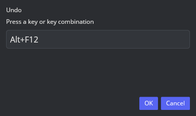
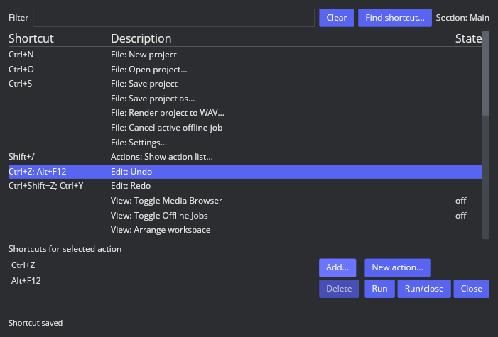

# AAADAW-INPUT-002 — 动作列表与数字键盘

2026-10-09，在唯一分支 `feat/reaper-parity` 继续实现 `UI-030` / `INPUT-BIND-001`，并推进 `SHELL-PROFILE-001`。

## 实际参照：LNX-782-ACTIONLIST-002

仍为隔离 Linux REAPER 7.82 / Default 7，X11 Xvfb 1920×1080、无窗口管理器。Action List 客户端为 701×475；绑定输入窗口为 387×229。以下为运行观察，不是完整 P0 验收：

- 顶部 Filter / Clear / Options / Find shortcut / Section，列表列为 Shortcut / Description / State。
- 底部有选中动作的快捷键列表、Add / Delete、Key map / Menu editor、自定义动作管理和 Run / Run-close / Close。选中空历史中的 Undo 时 Run 和 Run/close 仍启用。
- Add 打开 Keyboard/MIDI/OSC Input；默认录入后仍需 OK，自动关闭选项默认未选。包含特殊键入口、CC 参数及 Scope。
- 临时给 Undo 添加 Ctrl+Alt+7 后，原 Show undo history 动作和 Undo 在列表中都保留这个组合；没有出现拒绝冲突提示。关闭列表、新增一条轨道后按此组合执行 Undo，轨道消失，没有打开历史窗口。该观察证明目前的跨动作拒绝策略与参照不同；未推断所有重复绑定的优先级规则。
- 空工程默认 Mixer 可见，Arrange 在上方、Transport 位于 Arrange 和 Mixer 之间，Master strip 位于 Mixer 左端。

内部参照截图保留在采集环境的 `/tmp/aaadaw-reaper-782/`，不提交为产品资源。绑定实验只修改临时隔离会话；动作目录 `LNX-782-ACTIONS-001` 保留原始默认导出，不用实验配置重写。

## 本批实现

- 主窗口 `?`（US 布局 Shift+/）打开独立 701×475 Actions 窗口。已有动作与宏使用稳定 registry ID，列表支持多词搜索、Toggle 状态、选择、Run / Run-close、快捷键查找、追加与单独删除。绑定保存先完成原子磁盘写入，再发布运行配置，失败保留原绑定及其他 Settings 草稿。
- Filter 的 Enter 将焦点交给首个可见结果；结果列表的 ↑/↓ 移动选择、在首尾停止并在越出视口时滚动，Home/End 选择并滚动到首项/末项，Enter 执行当前选择。Linux REAPER 7.82 / Default 7 与 AAADAW 的对照截图、键盘路由回归见[输入焦点验证](input-focus.md#action-list-结果导航)。
- `ShortcutInput` 贯穿捕获与执行，保留逻辑键、物理键、位置和修饰键。新增 NumPad0–9、运算符、Decimal、Comma、Equal、Enter；NumLock 关闭时按物理身份匹配，NumPad5 的逻辑 Unidentified 也不丢弃。
- 新绑定的 `Standard7` / `NumPad7` 等可区分主键区与数字键盘；旧 `7` / `Enter` / `Home` 保留原来的任意位置逻辑匹配，冲突检查包含其实际重叠。配置仍用文本格式，无工程 schema 迁移。
- F10 菜单启动限定未修饰按键；已配置的裸 F10 优先执行绑定，捕获先于菜单处理。Ctrl/Alt+F10 可执行；各入口保留忙碌和待处理保存确认守卫。
- 桌面和触控由明确 `ShellProfile` 区分；窄 Linux 窗口不再自动进入触控工作流，Android 默认 Touch。
- Project 提供只读 `can_undo` / `can_redo`，菜单可用性反映实际历史；同一领域历史仍由 Project 管理。

## 验证证据

自动回归覆盖：主键区/数字键盘独立分发、NumLock 两种状态、NumPad5 Unidentified、Enter/数字键盘 Enter、运算符、旧配置重叠、F10 修饰组合及捕获、配置保存失败原子性、忙碌辅助窗口输入、保存确认期间不执行工程动作、Run-close 的空历史关闭行为、窄桌面/Android profile、历史可用性。

GUI 使用独立 `/tmp/aaadaw-p1-smoke/` XDG 配置：`?` 打开列表，筛选 Undo，追加 Alt+F12，Find shortcut 找到 Undo，再单独删除 Alt+F12，保留 Ctrl+Z。配置文件相应从 `Mod+Z; Alt+F12` 变为 `Mod+Z`。截图：[追加](action-list-added.png)、[查找](action-list-find.png)、[单独删除](action-list-deleted.png)。本证据不作为主题/像素验收。

## 2026-10-13 重复快捷键继续推进

根据上面的隔离 REAPER 实测，普通动作之间现在允许保存相同快捷键；Action List 与 Settings 均保留两条绑定。回归确认 Undo 显式绑定到 `Mod+S` 时仍保留 Save project 的工厂默认 `Mod+S`，运行时由显式动作映射优先处理，并确认磁盘写入失败仍不改变运行中的绑定。不同普通动作均显式绑定同一组合时，配置验证也保留两条记录。

宏仍单独校验：宏与宏、宏与显式普通动作的快捷键冲突仍拒绝，未放宽同一动作绑定自身的保留 Escape/输入合法性检查。当前 AAADAW 的重复显式动作按 registry 顺序解析；原厂探针只证明一个显式 Undo 映射优先于已有 Show undo history 映射，尚未测清各 Section、宏、用户动作与工厂默认值之间的全部优先级，因此 `INPUT-BIND-001` 继续 `in_progress`。

nightly+Cranelift Action List/Settings/映射回归 6/6 通过（496 项过滤）；随后 `aaadaw` 全部 502 项测试通过、0 跳过，Stable strict Clippy、fmt、diff 与 parity CSV/证据链接检查也通过。

## 2026-10-13 Main action 40182：Select all items

默认动作导出确认 Main Section 的 40182 名为 `Item: Select all items`，快捷键字段为空。AAADAW 将其注册为 `item.select-all`，可从 Action List 搜索并运行。REAPER 7.82 原生探针在 3 轨、13 个混合 Audio/MIDI items 上选中全部 items；工程状态计数增加 1，Undo 标签变为 `Select all items`。AAADAW 同样选中混合 item 并把选择动作放进应用级 Undo/Redo 历史，但不增加内容修订。原厂窗口和逐项结果见[REAPER Arrange 截图](fixtures/item-selection-all-native.png)及[探针记录](fixtures/item-selection-actions-native.tsv)。新的 AAADAW 实窗验证用 Action List 搜索运行 40182；1280×1024 截图可见两条轨道上的两个 MIDI items 都被选中，Ctrl+Z 状态显示 `Undid Select all items`，Ctrl+Y 显示 `Redid Select all items`。Action List、选中、撤销、重做窗口图和二进制哈希见[AAADAW 验证记录](fixtures/item-selection-aaadaw.tsv)，截图分别为[Action List](fixtures/item-selection-action-list-aaadaw.png)、[选择结果](fixtures/item-selection-all-aaadaw.png)、[撤销](fixtures/item-selection-undo-aaadaw.png)和[重做](fixtures/item-selection-redo-aaadaw.png)。原厂内容保存/脏标记、automation point 交互及零 items 的启用状态尚未探测，`ITEM-SELECT-001` 继续 `in_progress`。

回归 `select_all_items_action_selects_audio_and_midi_without_editing_the_project` 覆盖跨轨 Audio/MIDI 选择和 Action List Run；`item_selection_undo_and_redo_stay_in_order_with_project_edits` 覆盖选择与内容编辑的撤销顺序。无变化动作和新 Undo 分支另有回归。原厂选择事件会增加状态计数，AAADAW 的选择历史暂时只保存在应用层；保存/脏标记语义仍需对齐。

## 2026-10-13 Main action 40421：Select all items in track

同一原厂 Main Section 导出中还列有 40421 `Item: Select all items in track`，快捷键字段为空。隔离 REAPER 7.82 实测：只选中轨道 A 时仅选择 A 上的 items；同时选 A+B 时无论轨道选择顺序如何，都选择 A 与 B 上的 items，工程状态计数增加 1，Undo 标签为 `Select all items in selected tracks`。AAADAW 已调整为按所有选中轨道（含活动选中轨道）选择，并把动作纳入应用级撤销历史。探针记录见[TSV](fixtures/item-selection-actions-native.tsv)。Item 菜单启用边界、focus 与保存语义尚待验证，矩阵继续 `in_progress`。

回归 `select_all_items_in_track_action_selects_all_selected_tracks` 覆盖多轨选择与 Audio/MIDI 混合；撤销顺序和 redo 分支由相邻测试覆盖。

## 2026-10-13 Main actions 40717/40718：时间选区内选择 items

默认动作导出中的 Main Section 列有 40717 `Item: Select all items in current time selection` 和 40718 `Item: Select all items on selected tracks in current time selection`，均无默认快捷键。AAADAW 分别注册为 `item.select-all-in-time-selection` 与 `item.select-all-on-selected-tracks-in-time-selection`，可搜索并通过 Action List Run 执行。原厂实测在时间选区 `[1,3]` 时，40717 选中从 1 开始、区间内部及跨过 3 的 Audio/MIDI items；结束于 1 或开始于 3 的 items 被排除，符合半开区间相交。40718 在此基础上只选中多选轨道 A 与 C 的 items。两项都增加一次工程状态计数并建立 Undo 标签 `Select items in time selection`。AAADAW 当前匹配选择集合及范围，并加入应用级撤销历史；持久化和 automation point 行为仍未探测。完整记录见[原厂 TSV](fixtures/item-selection-actions-native.tsv)。

`select_all_items_in_time_selection_action_selects_overlapping_audio_and_midi` 与 `select_all_items_on_selected_tracks_in_time_selection_action_respects_multi_track_scope` 覆盖 Action List 搜索/Run、Audio/MIDI 混合、边界和轨道过滤。原厂时间选区端点、多轨范围现已有实测；运行时启用条件、保存/脏标记、automation point 与实际 AAADAW 窗口仍未验收，`ITEM-SELECT-003/004` 保持 `in_progress`。

## 2026-10-13 Main action 40289：Unselect all items

默认动作目录确认 Main Section 有 40289 `Item: Unselect (clear selection of) all items`，无默认快捷键。原厂探针确认它清空全部 item 选择，同时保留轨道 C 选择、时间选区 `[1,3]` 和编辑光标 4.0；状态计数增加 1，Undo 标签为 `Unselect all items`，撤销后恢复原来的 13 个 item 选择。再次对空选择运行时状态计数增加 0，Undo 标签保持不变。对已有 redo 分支执行一次确实改变选择的 40289 会清除 redo 分支；无变化动作不清除它。AAADAW 的 `item.unselect-all` 已加入应用级撤销历史并按快照恢复 item/活动项/锚点，且 no-op 不建历史。

`unselect_all_items_action_clears_item_selection_and_preserves_other_view_state` 覆盖 Action List Run 和时间线状态边界；`no_op_item_selection_does_not_discard_redo_history` 与 `changed_item_selection_discards_project_redo_history` 覆盖 redo 语义。原厂 automation point、命令禁用状态、内容保存/脏标记仍未探测；AAADAW 的 automation point 交互尚无实窗对比，`ITEM-SELECT-005` 保持 `in_progress`。

## 2026-10-13 Main action 40528：Select item under mouse cursor

默认目录确认 Main Section 有 40528 `Item: Select item under mouse cursor`，无默认快捷键。Arrange 当前在鼠标移动进入 item 区域时更新悬停 item，离开 item/时间线、载入不同工程或改变视图布局时清除目标；Action List Run 选择该目标并替换此前 item 选择，不修改工程修订或 Undo/Redo。视图平移/缩放后需要鼠标再次移动来重新命中；没有有效悬停 item 时动作禁用。

`arrange_cursor_motion_tracks_and_clears_the_hovered_item` 从真实 timeline shader 鼠标事件验证悬停命中/清除；`select_item_under_mouse_action_uses_current_hover_and_replaces_selection` 验证 Action List 搜索/Run 和工程历史不变。REAPER 原厂对 Action List 焦点、视图变换后悬停目标及实窗界面的行为尚无运行探针，`ITEM-SELECT-006` 保持 `in_progress`。

## 2026-10-13 Main actions 40529/40530：添加或切换鼠标下的 item 选择

默认动作目录列出 40529 `Item: Select item under mouse cursor (leaving other items selected)` 和 40530 `Item: Toggle selection of item under mouse cursor`，均无默认快捷键。AAADAW 注册稳定 ID `item.add-under-mouse-to-selection` 与 `item.toggle-under-mouse-selection`。40529 添加悬停 item 且不会因为它已选中而移除；40530 会在选择集合中增删悬停 item。两者不修改工程或 Undo/Redo；必须先命中有效 Arrangement item 才启用。

`select_item_under_mouse_leaving_other_items_selected_adds_without_toggling` 验证添加和对已选 target 的保留；`toggle_selection_of_item_under_mouse_adds_and_removes_the_hovered_item` 验证 toggle 两个方向。原厂对多选后活动 item/anchor、Action List 焦点和视图变换后 hover 的运行时行为尚未核实；这两项及 40528 一样保持 `in_progress`。

## 2026-10-13 Main action 41115：Invert selection

Main Section 动作导出确认 41115 的描述为 `Item: Invert selection`，没有默认快捷键。AAADAW 将其注册为 `item.invert-selection`，Action List Run 会在整个工程的 Audio 与 MIDI items 中选择当前未选中的项，并清除当前已选项；结果沿用工程轨道和 item 顺序，最后一项成为活动 item。它只改变时间线选择，不改变工程修订或 Undo/Redo 历史；没有媒体 items 时禁用。

`invert_item_selection_action_selects_the_complement_of_audio_and_midi_items` 覆盖 Action List 搜索/Run、混合 item 类型、多轨结果、再次执行恢复原集合，以及工程/撤销历史不变。REAPER 原厂的空选择/部分选择运行时启用边界、活动 item 规则与实际窗口焦点尚未单独探测，`ITEM-SELECT-009` 保持 `in_progress`。

## 2026-10-13 Main actions 41127/41128：相邻非重叠 item 选择

Main Section 动作导出列出 41127 `Item: Select next adjacent non-overlapping item` 和 41128 `Item: Select previous adjacent non-overlapping item`，均无默认快捷键。隔离 REAPER 7.82 的真实 item 点击探针显示，目标边界必须与源边界精确相接；存在时间空隙时不算 adjacent。多选时每个源 item 独立映射到同轨相邻 item，没有目标的源项会从结果里移除；整个集合没有目标时，原厂仍执行动作并清空 item 选择。原厂动作不移动 edit cursor。AAADAW 已按 Audio sample 到项目 tick、MIDI tick 统一比较，并保留轨道选择和项目/Undo 历史。

`adjacent_non_overlapping_item_actions_navigate_within_the_active_track` 与 `adjacent_item_actions_require_touching_boundaries_and_map_each_selection` 覆盖边界相接、跨类型、重叠/空隙过滤、多选逐项映射、无目标清空及工程/Undo 历史不变。原厂运行记录见 [item navigation TSV](fixtures/item-navigation-native.tsv)；空选择时动作可用性、完整 Mouse/Action List 焦点及 7.82 实窗视觉验收仍未关闭，`ITEM-SELECT-010/011` 保持 `in_progress`。

## 2026-10-13 Main actions 41167/41168：移动光标到最近 item 边缘

Main Section 动作导出列出 41167 `Item navigation: Move cursor left to nearest item edge` 与 41168 `Item navigation: Move cursor right to nearest item edge`，均无默认快捷键。原厂 7.82 探针确认两项搜索整个工程的 Audio 与 MIDI item 起止边缘，不依赖 item 选择；边缘必须严格位于当前 edit cursor 的左侧或右侧。光标正好位于一个边缘时会跳过该点，继续寻找下一个边缘。AAADAW 逻辑和无方向目标时的禁用条件与这些观察一致；执行只移动光标，保留 item 选择和项目/Undo 历史。

`item_edge_navigation_actions_move_to_nearest_audio_or_midi_boundary` 覆盖混合类型、Action List Run、双向无目标、item 选择保留和工程历史不变；原厂音频边缘、MIDI 边缘、无选择及相等端点输出见 [item navigation TSV](fixtures/item-navigation-native.tsv)。Action List 焦点和整套 Arrange 实窗对照仍待完成，`ITEM-SELECT-012/013` 保持 `in_progress`。

## 2026-10-13 Main actions 41139/41140：相邻轨道 item 导航

Main Section 动作 41139 `Item navigation: Select and move to item in previous track without changing track selection` 和 41140 `Item navigation: Select and move to item in next track without changing track selection` 已由隔离官方 7.82 / Default 7 运行探针验证。动作以按轨道、时间排序后的首个所选 item 为源，只查找项目顺序中紧邻的上一/下一轨；目标是该轨上第一个与源 item 时间区间有正长度重叠的 item。成功后只选中目标、把 edit cursor 移到目标起点，并保留轨道选择。邻轨没有重叠 item 时不会跳过空轨寻找更远轨道，而是清空 item 选择且不移动光标。多选时只使用首个所选源 item。

AAADAW 注册稳定 ID `item.select-previous-track` 与 `item.select-next-track`。`adjacent_track_navigation_uses_first_overlapping_item_and_preserves_track_selection` 覆盖紧邻空轨、相邻轨多个重叠目标、多选首项、光标、Action List Run、轨道选择与项目/Undo 状态。原厂点击驱动记录与可复现脚本见 [item navigation TSV](fixtures/item-navigation-native.tsv) 和 [probe](../../scripts/reaper_parity/probe-item-navigation.lua)。空选择时动作可用性、完整 Action List 键盘焦点与 Arrange 视觉验收仍在进行，`ITEM-SELECT-014/015` 不标记完成。

复现时需在独立 REAPER 7.82 / Default 7 配置的空白、未保存工程中运行脚本；它会创建自有轨道/item 并写入 `/tmp/aaadaw-item-navigation-ready`。在 Arrange 中点击源 item 后，向 `/tmp/aaadaw-item-navigation-request` 写入 `测试名<TAB>动作编号`；可选第三列传入要先设置的 edit-cursor 秒数。结果追加到 `/tmp/aaadaw-item-navigation-native.tsv`，写入 `done<TAB>0` 结束采样。脚本对版本、主题、播放状态及空工程作断言，不保存该项目。

## 2026-10-13 Main actions 41173/41174：所选 items 边界光标导航

Main Section 动作目录列出 41173 `Item navigation: Move cursor to start of items` 与 41174 `Item navigation: Move cursor to end of items`。REAPER 7.82 / Default 7 真实点击探针确认：单选时分别移动到该 Audio 或 MIDI item 的起点/终点；多选时 41173 使用所有所选 items 的最早起点，41174 使用最晚终点，且范围可跨轨。空 item 选择时两项均不移动光标；执行不修改 item/track 选择或工程状态。

AAADAW 已加入稳定动作 ID `item.navigate-cursor-selected-start` 与 `item.navigate-cursor-selected-end`，在共同项目 tick 上计算所选 Audio/MIDI 区间的外侧边界，只移动 edit cursor。`selected_item_cursor_actions_use_outer_audio_midi_bounds` 通过 Action List Run 覆盖跨轨 Audio/MIDI 选择、忽略未选 item、保留 item/track 选择、无选择 no-op 及工程/Undo 状态不变。当前时间线光标是整数 tick，Audio sample endpoint 转 tick 时可能量化；非 tick 对齐样本的精确光标位置尚未验证，不能据此视为完整通过。原厂逐项结果见 [item navigation TSV](fixtures/item-navigation-native.tsv)；可用上文探针脚本在真实点击一个 item 后追加 `41173`/`41174` 请求，多选使用 Ctrl-click。

当前尚未确认空 item 选择时 Action List 的启用状态、窗口焦点和完整 Arrange 视觉边界，`ITEM-SELECT-016/017` 保持 `in_progress`。

## 2026-10-13 Main actions 41182/41183/41184：所选 items 网格对齐

Main Section 动作目录列出 41182 `Item: Snap items left`、41183 `Item: Snap items right` 和 41184 `Item: Snap items to nearest snap point`，默认均无快捷键。REAPER 7.82 / Default 7 的 Arrange 点击探针确认三项会分别对每个选中 Audio/MIDI item 的起点执行向左、向右或最近网格点对齐；多选逐项独立对齐，不施加共同位移。Audio/MIDI item 的长度保留，item/track 选择和 edit cursor 保持不变。已在网格上的起点不移动；最近点等距时取左侧网格点。即使全局 Snap toggle 关闭，这三项仍使用项目网格。混合 Audio/MIDI 多选可由一次 Undo 完整还原。

AAADAW 注册稳定 ID `item.snap-left`、`item.snap-right` 与 `item.snap-nearest`，使用当前 Arrangement 网格和 tempo map；Audio 位置通过 tick 网格点映射为精确 sample，再按 sample 距离选择方向，避免先将 item 位置量化到 tick。批量编辑作为单一事务写入，未移动时不创建历史。`item_snap_actions_match_audio_and_midi_grid_directions_with_grouped_undo`、`item_snap_nearest_uses_sample_grid_and_ignores_snap_toggle` 和 `item_snap_exact_grid_empty_selection_and_busy_states_do_not_edit` 覆盖 Action List Run、左右/最近/平局、独立混合类型移动、长度与 source offset 保留、Snap toggle 关闭、多选 Undo/Redo、精确网格、空选择及 project-edit busy 守卫。AAADAW 在 playback active 时阻止工程修改；这三项原厂动作在播放期间的可用性尚未实测。原厂证据和复测脚本见 [item snap TSV](fixtures/item-snap-native.tsv) 与 [probe](../../scripts/reaper_parity/probe-item-snap.lua)。

探针以四分音符直网格验证；Swing 网格、播放期间的原厂动作状态及完整 Arrange/Action List 视觉和焦点尚未比对，`ITEM-SELECT-018/019/020` 仍为 `in_progress`，不能据此视为整体 Item parity 完成。

## 2026-10-14 Main action 40697：依焦点移除对象

Linux REAPER 7.82 / Default 7 的默认动作导出 `linux-7.82/actions.tsv` 记录 Main action 40697 `Remove items/tracks/envelope points (depending on focus)` 的默认键为 Delete；相邻的 40006 `Item: Remove items` 没有默认键。隔离 REAPER 与 AAADAW 的 701×475 Action List 窗口截图保存在[参照](fixtures/delete-by-focus-action-list-native.png)和[当前 AAADAW](fixtures/delete-by-focus-no-prompt-aaadaw.png)。两边均显示主动作与无提示变体；默认动作 TSV 只为主动作给出 40697，因此无提示变体使用 AAADAW 稳定 ID `edit.delete-focused-no-prompting`，不绑定默认键。Item 菜单命令 `Remove items` 也不绑定快捷键，Delete 只绑定 `edit.delete-focused`，不再错误显示 Delete/Backspace。

AAADAW 现按最近一次目标区交互路由 Delete：Arrange 的 item/空白区选择指向 items，TCP/MCP 轨道选择指向 tracks，automation 点选择指向 automation point。TCP/MCP 名称默认显示为不可编辑标签；单击名称选轨，双击进入文本编辑，编辑时文本控件按自身焦点处理 Delete。轨道面板获得目标后，普通 Delete 显示 `Delete N selected track(s)?` 确认框；Cancel、Escape 或点遮罩不改工程，确认后依赖轨道先删，整组只占一步 Undo。`edit.delete-focused-no-prompting` 则直接执行同一轨道事务。两种入口都只作用于当前目标区，不再按“有 item 就优先”跨区猜焦点。

隔离 REAPER 探针选中一条轨道和一个 MIDI item 后，点击 TCP 并按 Delete，原厂弹出 `Delete 1 selected track?`；取消时项目没有变化。保持 TCP 目标再从 Action List Run 无提示变体，轨道与 MIDI item 被直接移除，探针状态从 1/1 变成 0/0，原厂项目状态只新增一次。见 [原厂确认框](fixtures/delete-track-confirmation-native.png)、[原厂无提示执行后](fixtures/delete-track-no-prompt-native.png) 和 [运行时 TSV](fixtures/delete-by-focus-runtime-native.tsv)。AAADAW 的 [确认框](fixtures/delete-track-confirmation-aaadaw.png) 和[无提示执行后](fixtures/delete-track-no-prompt-aaadaw.png) 截图也由 Linux 主窗口实窗采集；应用回归覆盖 Arrange/TrackPanel 目标切换、混合 item/track 选择、取消/确认、无提示删除、原子 Undo/Redo 和 automation point 删除。

当前焦点模型是 AAADAW 主 Arrangement/Mixer 内最后一次 item、track 或 automation 目标选择，不等价于所有 REAPER 子窗口、插件控件、文本编辑框的真实键盘焦点；其他窗口与 TCP/MCP 非选择控件的焦点优先级仍待探测。Action List 完整默认目录、Main 外 Section、特殊键/Scope/MIDI/OSC、导入导出与全量窗口视觉对齐仍未完成，`INPUT-BIND-001` 继续 `in_progress`。

## 未完成项

Main 以外的 Section、完整默认动作与功能、动作导入导出、菜单编辑器、原厂自定义动作窗口、特殊键/Scope/MIDI/OSC 输入和完整重复绑定优先级仍未对齐。Add 自动提交已在后续修正。主题和几何尚未完成像素比较，矩阵保持 `in_progress`。

## CI 基础设施修复

先前 Android 模拟器运行 `37953099817` 的日志显示 `-accel off`、无 `/dev/kvm` 权限、系统级 ANR 和 CPU 压力；AAADAW 进程存活且截图检查已通过。工作流新增 KVM 权限配置与加速预检，显式启用硬件加速，保留原有前台与渲染断言；运行结果需在后续唯一 PR 的 CI 验证。

## 独立录入确认续项

Add 现在打开 387×229 的 Keyboard input 窗口，默认键入仅更新草稿；OK/Enter 确认后原子保存，Cancel/Escape 或关闭窗口丢弃草稿。保存失败保持窗口、组合和原配置。子窗口存在时屏蔽父列表的选择/筛选/Run/Find 操作及其他窗口快捷键，固定录入所属动作；关闭列表同步关闭录入。无工程 schema 变更。

774 项 workspace 测试全部通过，随后父窗口输入守卫修改的 6 项相关回归通过，Clippy warnings denied 与默认构建通过。GUI：给 Undo 录入 Alt+F12，尚未确认时没有 shortcuts.conf；Cancel 后仍无文件；重新录入并 Enter 后文件为 edit.undo → Mod+Z; Alt+F12，窗口关闭、列表同步更新。

窗口只实现键盘基础输入；特殊键入口、Enter 本身的特殊录入方式、Scope、MIDI/OSC、自动关闭选项和原厂完整布局仍缺。重复分配优先级不能由单次实测推断，继续保持未完成。
