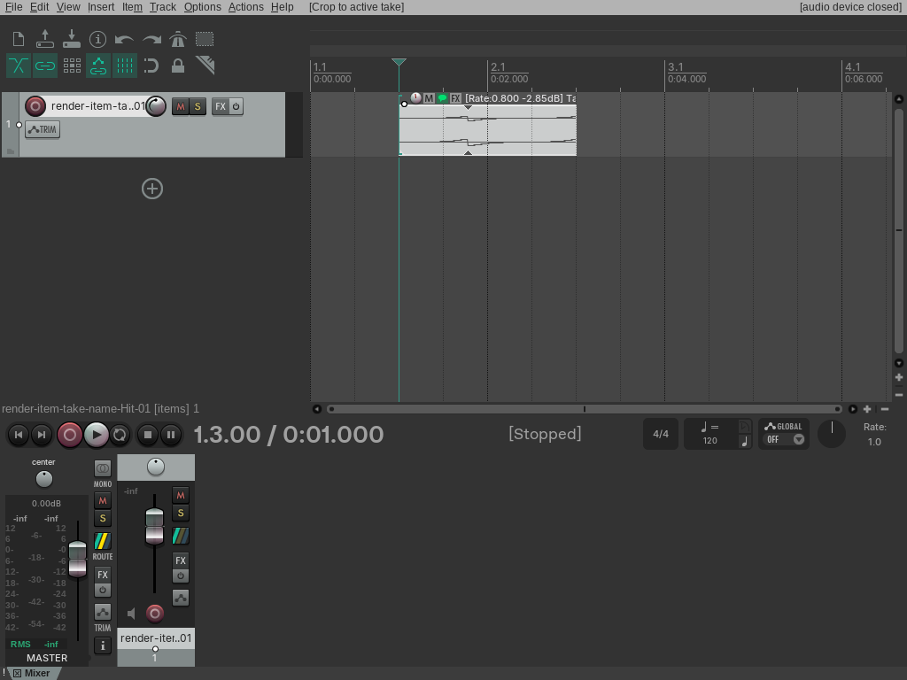
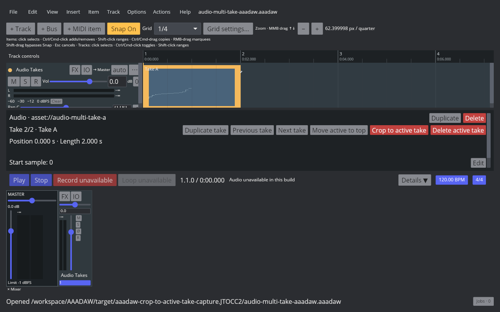
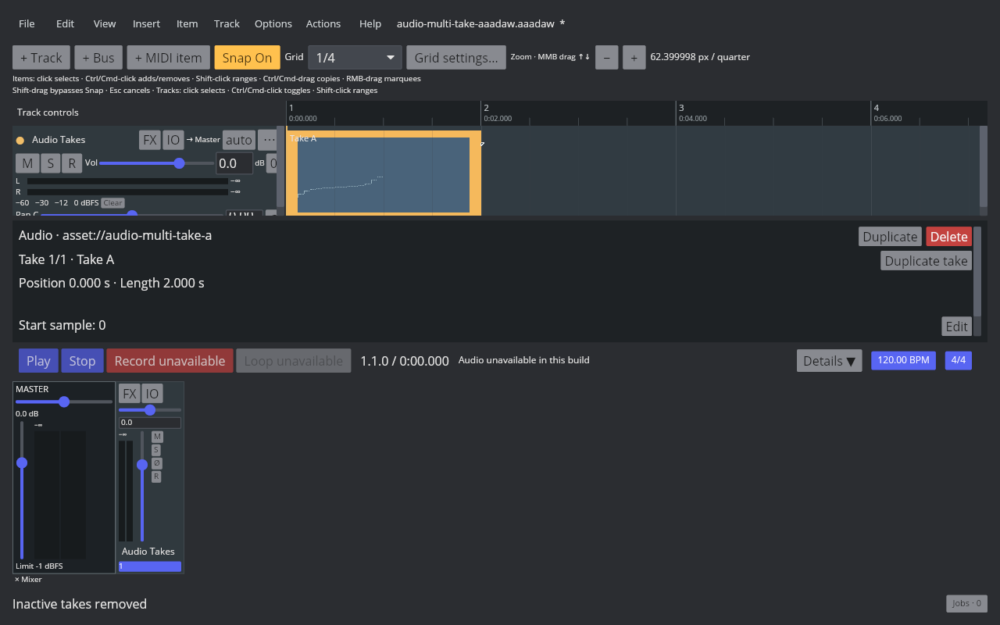

# Crop to the active take

## REAPER 7.82 reference

The reference is Linux REAPER 7.82 with the Default 7 theme. Main action 40131 is **Take: Crop to active take in items** and has no default shortcut. With either Take A active at index 1 or Take B active at index 0, the action removes the other take, keeps the active source as the sole take at index 0, and preserves item position, length, item volume, and the active take's source offset, volume, pan, and playback rate. Undo restores both takes and the original active index; redo removes the inactive take again. Running the action on a single-take item changes neither the item nor the undo history. The native probe readback and saved RPP states are listed in the [fixture manifest](fixtures/audio-crop-to-active-take-aaadaw.tsv).

## AAADAW implementation

The Core action clears inactive takes and sets the active index to zero while preserving the active source and all its playback properties. The edit is undoable and snapshot-persistent; cropping an already single-take item is a history-free no-op. Frozen render items are rejected, and the desktop route uses the standard project-edit busy guard. The playback graph stays valid because the active source does not change.

The Action List and Item menu expose **Crop to active take in items**, with no default shortcut. REAPER Main KeyMap action 40131 maps to the matching command. The selected multi-take Audio Item Inspector exposes a destructive **Crop to active take** control. The paired live captures show Take A before cropping and the retained Take A as the sole active take afterward.

The [capture script](../../../scripts/reaper_parity/capture-audio-crop-to-active-take-aaadaw.sh) opens a temporary copy of the two-take fixture under an isolated XDG profile and uses a temporary shortcut to invoke the shortcut-free command. The manifest records the binary, captures, tests, and hashes. Screenshots verify the live window and take state, not audio audibility.

## Remaining parity work

`EDIT-TAKE-001` remains `in_progress`. Multi-item crop, recording-created takes, lane layouts, full Item Properties interactions, comp areas, MIDI-item take handling, and cross-project clipboard behavior remain open.
