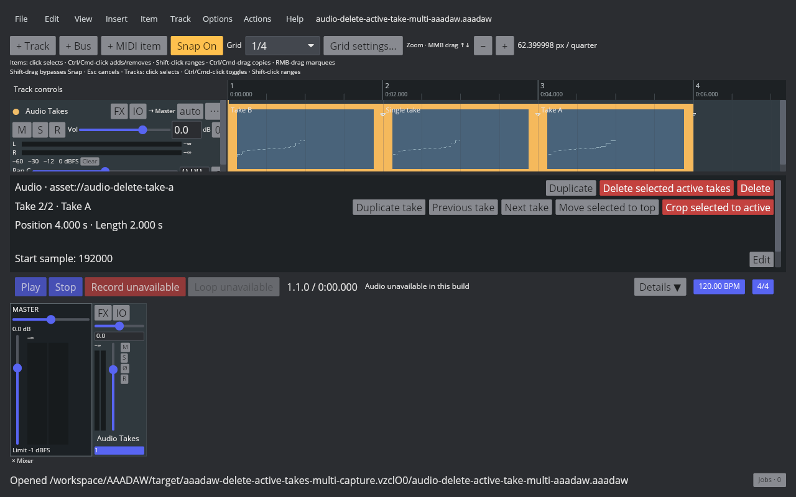
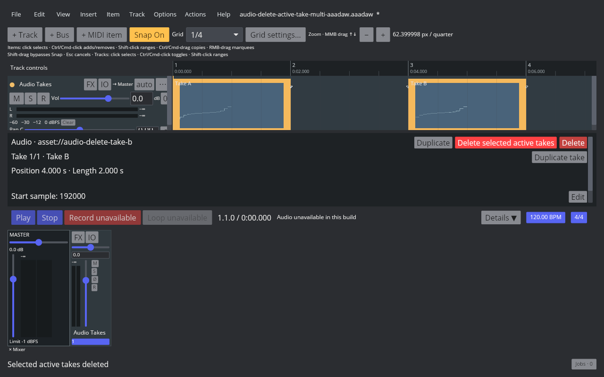
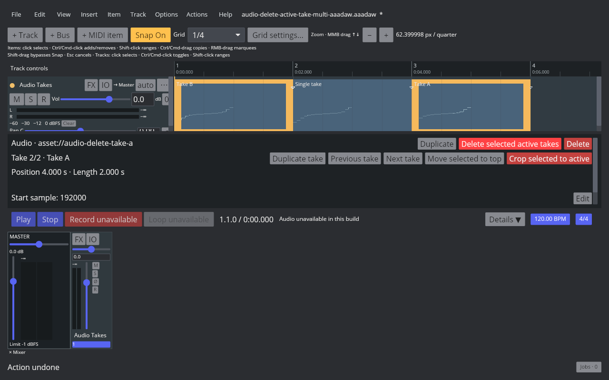
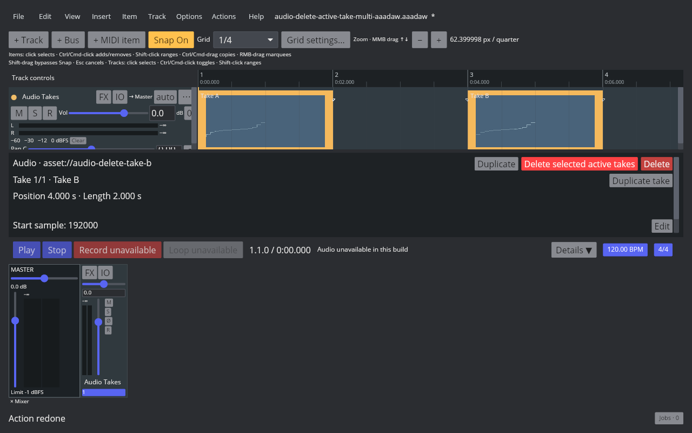

# Delete the active audio take

## REAPER 7.82 reference

The probe used Linux REAPER 7.82 with the Default 7 theme. Main action 40129 is **Take: Delete active take from items** and has no default shortcut. Removing the active take from a two-take item leaves the other take active at index 0, whether the removed take was first or last. Removing the only take removes the entire item. Undo and redo restore or repeat each operation, including the source and active index. The native probe readback, saved RPP states, and live Arrange capture are in the [fixture manifest](fixtures/audio-delete-active-take.tsv).

The multi-selection probe confirms that one invocation applies to every selected Audio Item. It removes the active take from items with multiple takes, deletes a selected one-take item, and groups the complete edit into one native Undo/Redo step. The before/after/undo/redo RPP states and Arrange capture are listed in the [multi-selection manifest](fixtures/audio-delete-active-take-multi-aaadaw.tsv).

## AAADAW implementation

`DeleteActiveAudioItemTake` is one undoable Core action. It removes the active source from a multi-take item and activates the next source in take order; when the removed take is last, the previous source becomes active. When an item contains only one take, the action removes that item and undo restores it. Item position and length stay fixed when another take remains. The selection-level command applies to selected Audio Items in project order, including one-take items, and commits multiple targets in one `BatchTransaction`. A frozen render target rejects the whole operation. Batched deletes mark the desktop playback graph dirty so active-source changes and item removal reach the normal graph rebuild path.

The REAPER action is registered in the Action List and Item menu with no default shortcut, matching the measured Main KeyMap. The Audio Item Inspector exposes **Delete active take** for one selected Audio Item and **Delete selected active takes** for a selection. The multi-selection control covers both multi-take and single-take targets, matching action 40129's native behavior.

The fixture, capture script, binary identity, checks, and hashes are recorded in the [AAADAW manifest](fixtures/audio-delete-active-take-aaadaw.tsv).

The multi-selection screenshots show the real 1280×800 AAADAW window before and after deleting both active takes and the selected single-take item, then after one Undo and Redo. The application reports **Audio unavailable in this build**, so these captures verify the visible state and history behavior, not audio audibility. Their fixture, capture script, binary identity, and hashes are in the [multi-selection manifest](fixtures/audio-delete-active-take-multi-aaadaw.tsv).

The [reproducible capture script](../../../scripts/reaper_parity/capture-audio-delete-active-take-aaadaw.sh) uses an isolated Xvfb display, clean XDG directories, a temporary copy of the project fixture, and a temporary key binding only to invoke the shortcut-free Action List command. The screenshot verifies the real desktop window and take state; it does not verify audio audibility.

## Remaining parity work

`EDIT-TAKE-001` remains `in_progress`. Multi-selection deletion is covered; other take actions still need multi-selection behavior. Take reordering, lanes and full Item Properties interaction, recording-created takes, comp areas, MIDI-item take handling, and cross-project clipboard behavior remain open.
