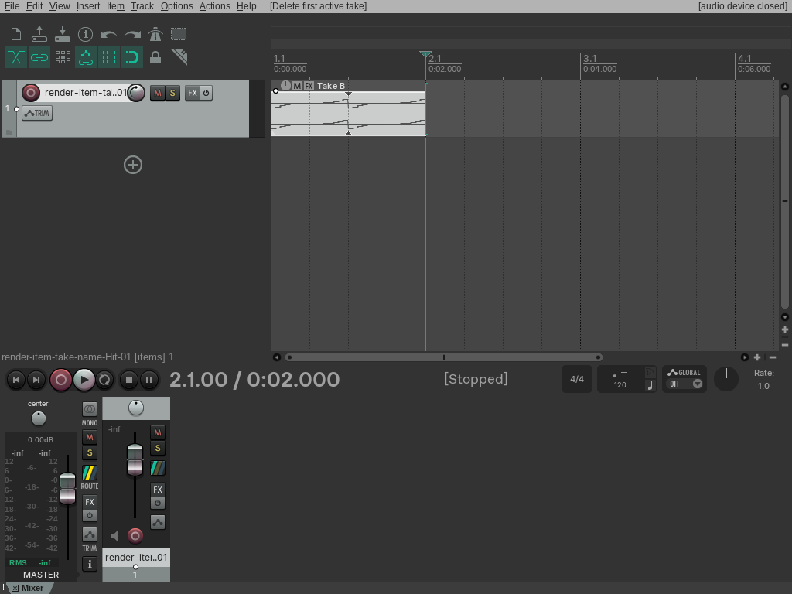
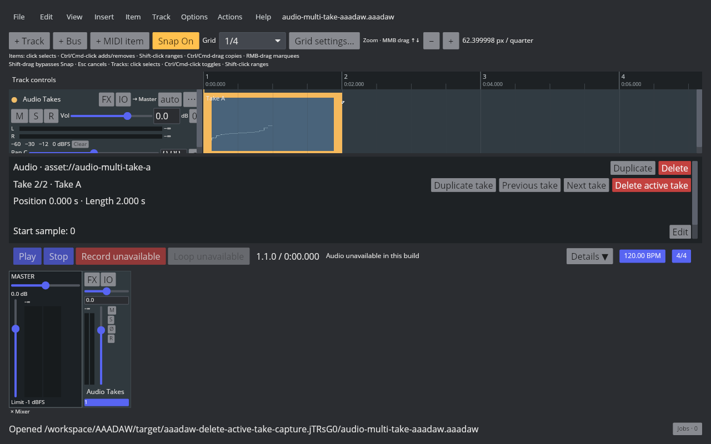
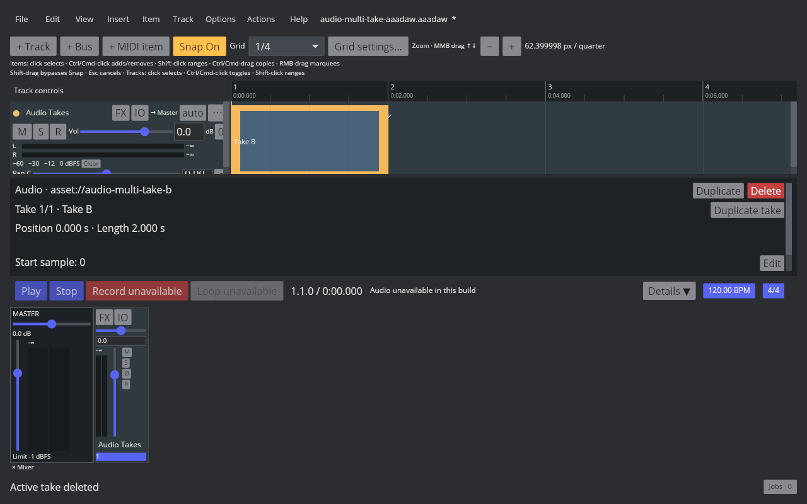

# Delete the active audio take

## REAPER 7.82 reference

The probe used Linux REAPER 7.82 with the Default 7 theme. Main action 40129 is **Take: Delete active take from items** and has no default shortcut. Removing the active take from a two-take item leaves the other take active at index 0, whether the removed take was first or last. Removing the only take removes the entire item. Undo and redo restore or repeat each operation, including the source and active index. The native probe readback, saved RPP states, and live Arrange capture are in the [fixture manifest](fixtures/audio-delete-active-take.tsv).

## AAADAW implementation

`DeleteActiveAudioItemTake` is one undoable Core action. It removes the active source from a multi-take item and activates the next source in take order; when the removed take is last, the previous source becomes active. When an item contains only one take, the action removes that item and undo restores it. Item position and length stay fixed when another take remains. Frozen render items are rejected, and the desktop playback graph is marked dirty so the active source changes on the normal graph rebuild path.

The REAPER action is registered in the Action List and Item menu with no default shortcut, matching the measured Main KeyMap. The selected multi-take Audio Item Inspector exposes a destructive **Delete active take** control. The paired live AAADAW captures show the selected Take A with that control and Take B active after deleting Take A.

The fixture, capture script, binary identity, checks, and hashes are recorded in the [AAADAW manifest](fixtures/audio-delete-active-take-aaadaw.tsv).

The [reproducible capture script](../../../scripts/reaper_parity/capture-audio-delete-active-take-aaadaw.sh) uses an isolated Xvfb display, clean XDG directories, a temporary copy of the project fixture, and a temporary key binding only to invoke the shortcut-free Action List command. The screenshot verifies the real desktop window and take state; it does not verify audio audibility.

## Remaining parity work

`EDIT-TAKE-001` remains `in_progress`. Multi-selection behavior, take reordering, lanes and full Item Properties interaction, recording-created takes, comp areas, MIDI-item take handling, and cross-project clipboard behavior remain open.
