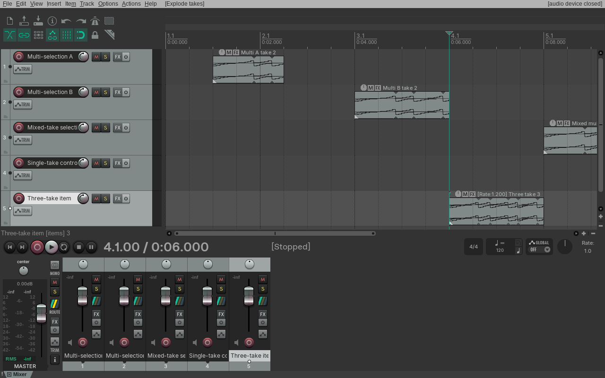
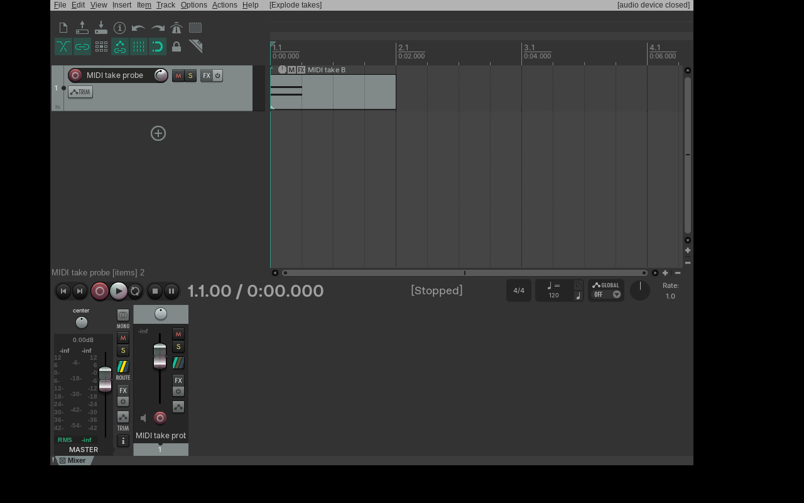
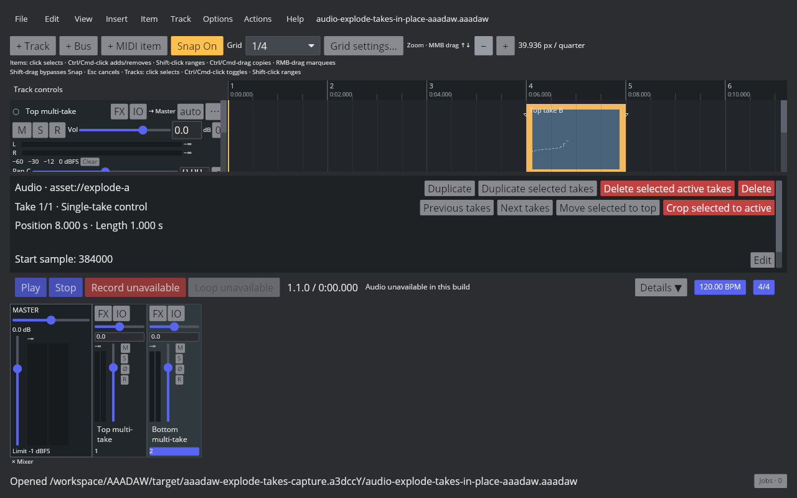
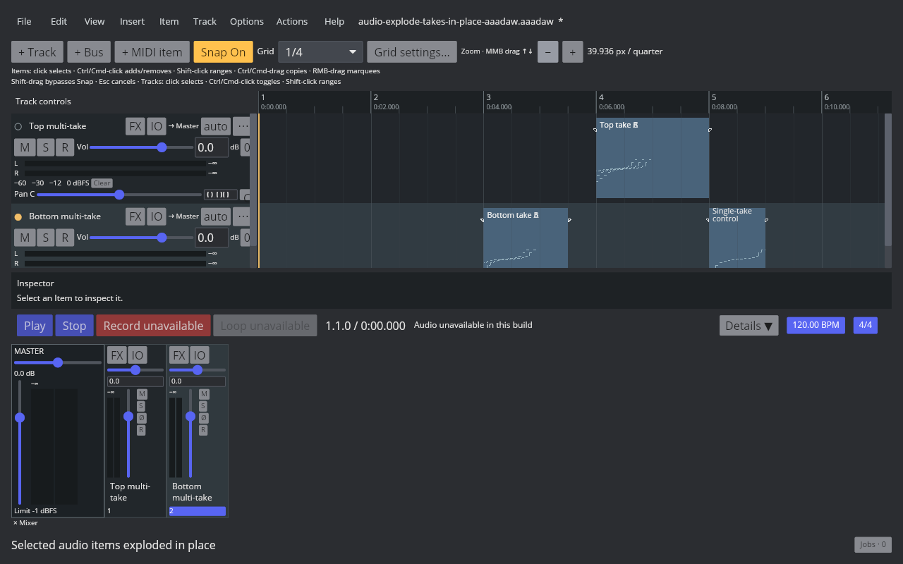
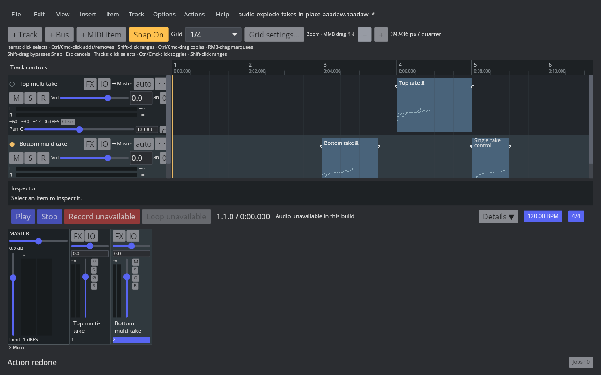

# Explode takes of items in place

Linux REAPER 7.82 with the Default 7 theme maps Main action 40642 to **Take: Explode takes of items in place**. The native probe confirms that each selected multi-take audio item becomes one single-take item per take, in take-list order. The new items keep the source item's track, position, and length; the original active-take index does not change the output order. A selected single-take item stays intact. REAPER clears item selection after the action, and one Undo/Redo restores or reapplies the complete edit.

The audio native cases cover two selected two-take items on different tracks, a three-take item with index 1 active, a mixed multi-take/single-take selection, and a singleton-only control. The per-item and per-take source, name, offset, rate, selection, count, and project states are recorded in the [native readback](fixtures/audio-explode-takes-in-place-native.tsv); the corresponding saved RPP files are in `fixtures/`. The live REAPER capture shows the action in the Arrange window.

The native probe also confirms that action 40642 handles MIDI items: a selected two-take MIDI item with index 1 active becomes two one-take MIDI items in take order, each retaining its notes, name, position, and length. Selection clears; one Undo restores the original selected multi-take item, and Redo splits it again and clears selection. The [MIDI state readback](fixtures/midi-explode-takes-in-place-native.tsv), saved RPP states, and live Arrange capture record this behavior.

AAADAW implements the audio and MIDI item variants as Core project transactions, available through the Item menu and Action List under the native action name. A mixed audio/MIDI selection is split in one project history entry; each item retains its own type, track, position, length, ordered take content, and MIDI events. Selected single-take items remain intact, selection clears, and singleton-only invocation adds no project history. Frozen audio renders and MIDI items on frozen tracks are rejected before modification. MIDI take metadata and alternate event sets persist in SQLite schema 67; the active take continues to use the established MIDI event tables, and the playback plan compiles only that active take.

Multi-take MIDI splitting is implemented in `SplitMidiItem`; it partitions each Take's source events and retains the ordered list, active index, and Undo/Redo state. Native and AAADAW verification is recorded in [MIDI multi-take splitting](midi-item-multi-take-split.md). MIDI Take creation and event editing remain open under EDIT-TAKE-001.

The reproducible AAADAW project is generated by [the fixture generator](../../../crates/aaadaw/examples/generate_audio_explode_takes_in_place_fixture.rs). It contains a three-take item with active index 1, a two-take item on another track, and a single-take control. The [capture script](../../../scripts/reaper_parity/capture-audio-explode-takes-in-place-aaadaw.sh) opens the real Cranelift desktop binary at 1280×800 under an isolated Xvfb display, selects the items, invokes the Action List mapping, and captures before/after/Undo/Redo. The [manifest](fixtures/audio-explode-takes-in-place-aaadaw.tsv) records the binary identity and SHA-256 hashes for all evidence files.

The prior audio slice passed Stable LLVM workspace Nextest **1623/1623** across 79 test binaries. For the MIDI follow-up, Storage tests passed **104/104**, Core take tests **2/2**, the active-take playback-plan test, and the App mixed-selection Undo/Redo test. The first full workspace run passed **1622/1626**; two CLAP GUI tests lacked an X11 server, and two legacy-schema tests exposed duplicated active-take metadata. The metadata issue is fixed and Storage passes **104/104**; both CLAP tests now pass individually under Xvfb. A full rerun under Xvfb could not compile because the workspace disk filled. Strict all-target Clippy, formatting, diff checks, and the Cranelift 1280×800 before/after/Undo/Redo capture passed. The [MIDI take foundation note](midi-item-takes.md) and [artifact manifest](fixtures/midi-item-takes-aaadaw.tsv) record this slice. Take-aware MIDI splitting is now implemented and verified separately in the [multi-Take split evidence](midi-item-multi-take-split.md). Recording-created takes, MIDI take editing UI, take display modes, Fixed Lanes, Comp Areas, and cross-project clipboard remain open under `EDIT-TAKE-001`.
