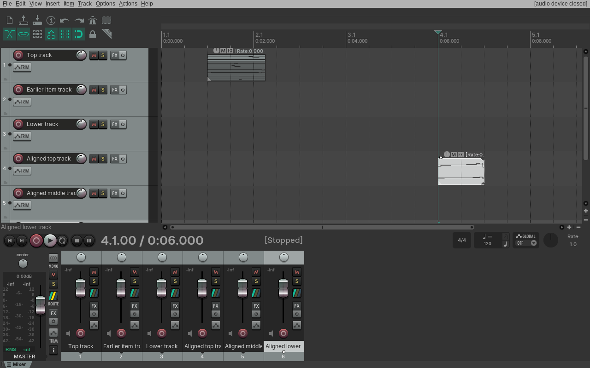
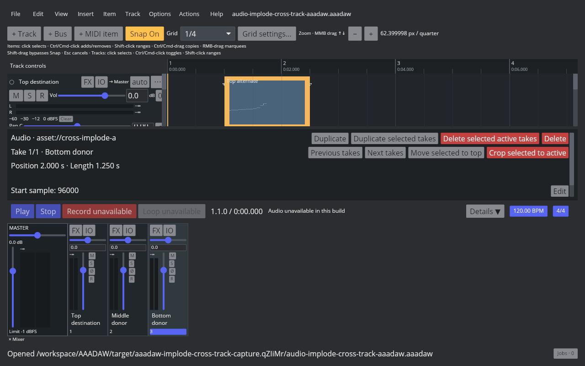
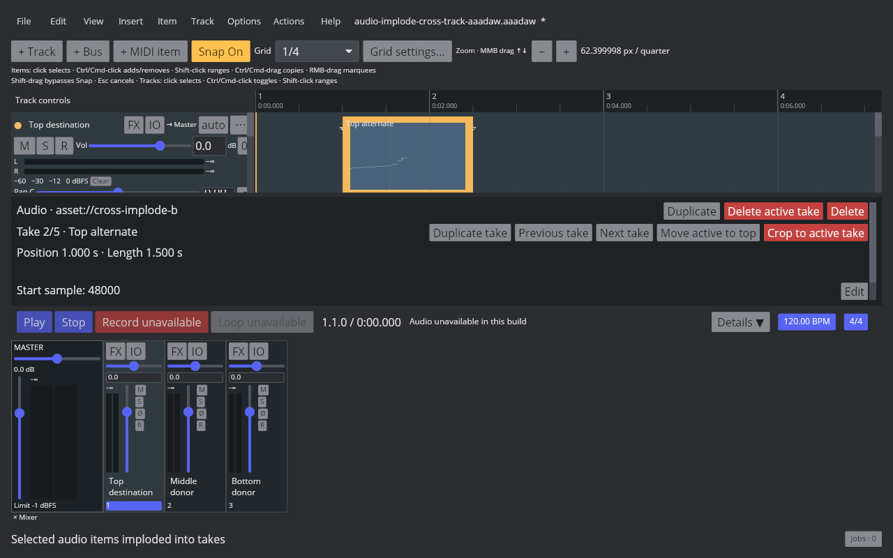
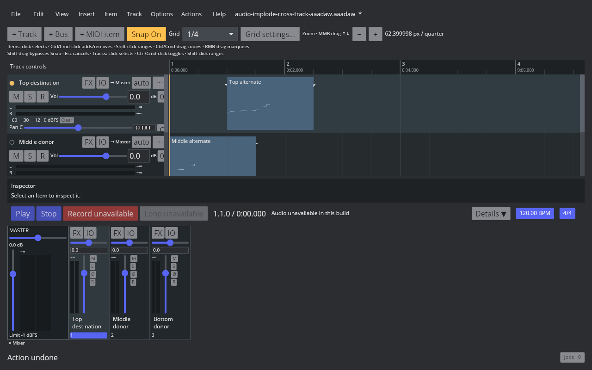
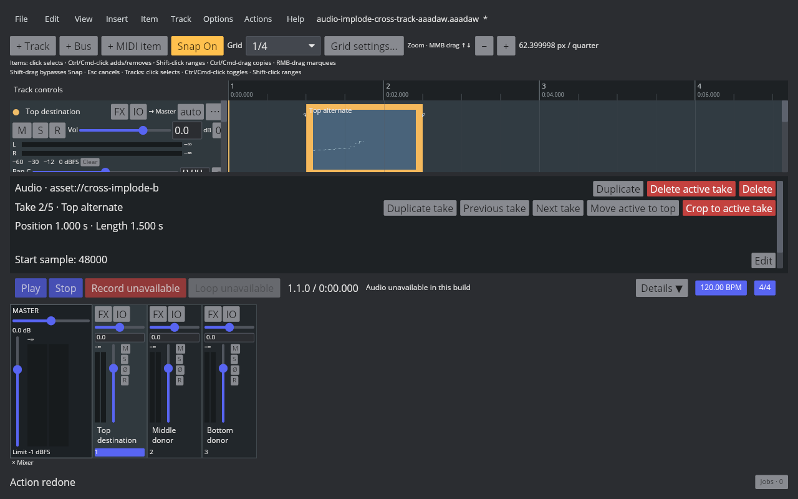

# Implode audio items across tracks into takes

## REAPER 7.82 reference

Linux REAPER 7.82 / Default 7 Main action 40438, **Take: Implode items across tracks into takes**, uses the selected item on the topmost track as its destination, even when a selected donor starts earlier. It leaves donor tracks in place, appends their takes in track order and item order, and keeps the destination's position, length, existing take order, and active take. For donors at a different project position, each take's source offset shifts by the project-time difference multiplied by that take's playback rate and converted to the source sample rate. Loop-source items are accepted; a donor may retain a negative source offset. A measured abutting pair is a no-op; AAADAW enables the command only when at least one selected pair overlaps. One Undo restores the source items and clears their selection; Redo restores the merged destination and selects it. The [native probe](../../../scripts/reaper_parity/probe-audio-implode-cross-track.lua), full [readback](fixtures/audio-implode-cross-track-native.tsv), and saved RPP states record staggered, aligned, same-track no-op, abutting no-overlap, and loop-source cases.

## AAADAW implementation

The Item menu and Action List expose **Implode items across tracks into takes**, mapped to action 40438. The command requires selected audio items from at least two tracks and at least one pair with overlapping time ranges. It chooses the topmost selected item as destination, orders donors by track and project position, rebases every donor Take by its own sample rate and playback rate, appends complete Take metadata, restores the destination's active index, and deletes donor items in one `BatchTransaction`. Frozen render items reject the operation. Project history and selection-aware Undo/Redo preserve the native one-step behavior.

Loop sources remain valid with REAPER's signed offsets. The Core project validator accepts negative loop offsets; the media worker resolves them to their equivalent point in the bounded loop section or full source cycle. When a decoder does not report the source frame count, the worker counts frames off the real-time audio thread and restarts the decoder before playback.

The project fixture is generated by `crates/aaadaw/examples/generate_audio_implode_cross_track_fixture.rs`. The reproducible capture script launches the actual desktop binary in an isolated 1280×800 Xvfb window, selects all three source items, runs the command, and captures before, after, Undo, and Redo. The [AAADAW manifest](fixtures/audio-implode-cross-track-aaadaw.tsv) records the binary identity, screenshots, project fixture, native evidence, test results, and artifact hashes.

The live screenshots verify the actual window and project state. This Cranelift capture build has audio-device disabled, so it does not measure audible playback; the media worker regression separately verifies negative-offset loop decoding.

## Remaining parity work

This completes the cross-track implode slice of `EDIT-TAKE-001`. In-place take explosion is covered separately; recording-created takes, take display modes, MIDI takes, Fixed Lanes, Comp Areas, and cross-project clipboard behavior remain open.
