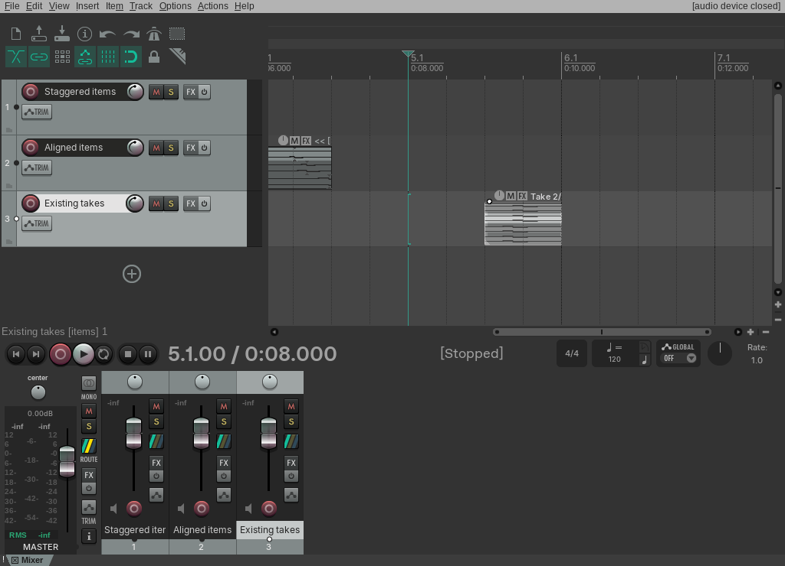
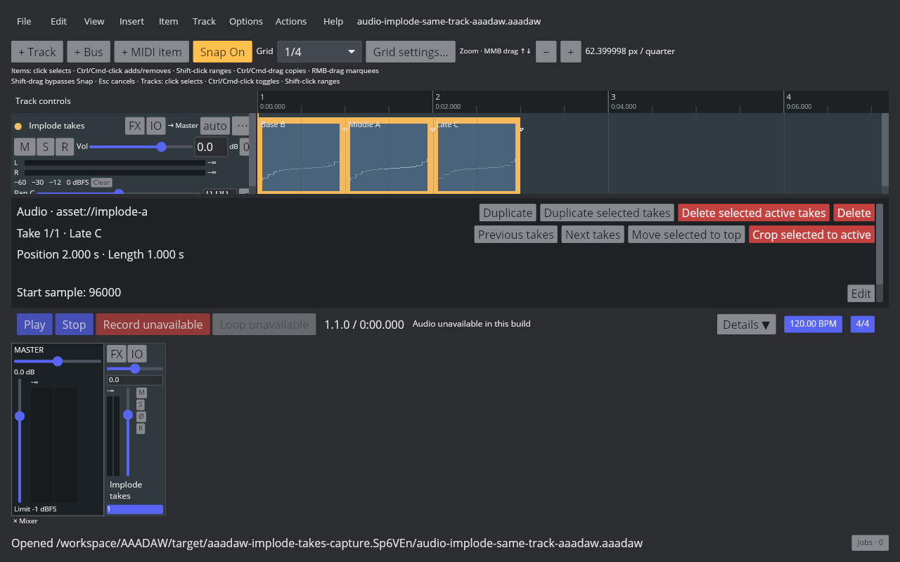
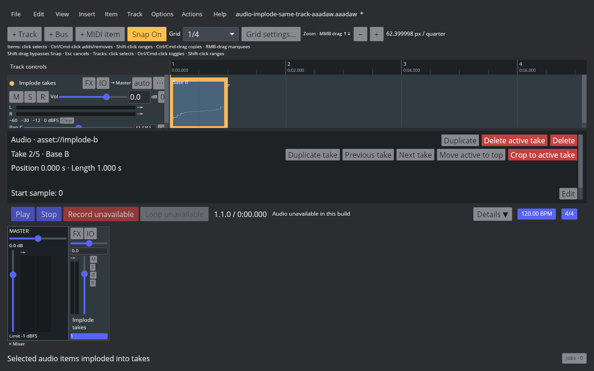
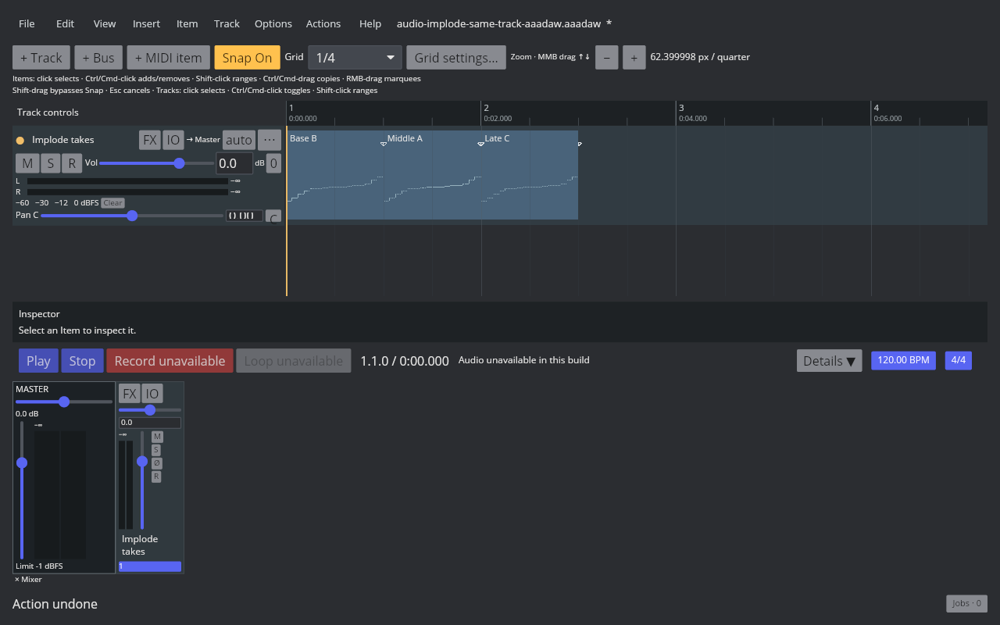
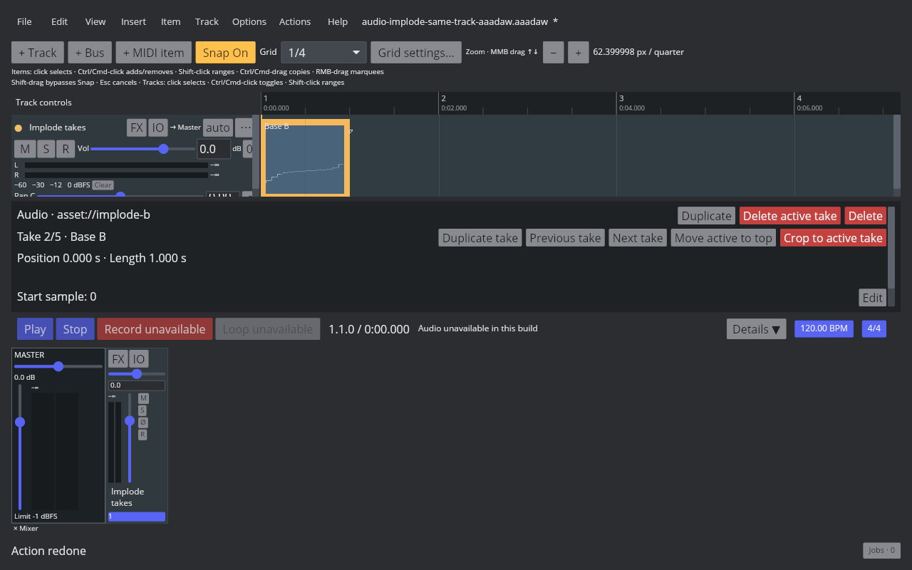

# Implode same-track audio items into takes

## REAPER 7.82 reference

Linux REAPER 7.82 / Default 7 Main action 40543, **Take: Implode items on same track into takes**, was measured with staggered items, three items sharing one start, and a pair of items that already had two takes each. The earliest item becomes the destination for staggered selections. For equal start positions, the topmost item in Arrange becomes the first take. REAPER retains the destination's position, length, take order, and active take; appends every take from each donor in Arrange order; and removes the donor items. The action preserves each take's source, name, source offset, rate, volume, and pan. One Undo restores all source items and clears item selection; Redo restores the merged item and selects it. The probe and detailed before/after/undo/redo project readbacks are listed in the [native manifest](fixtures/audio-implode-same-track-native.tsv).

## AAADAW implementation

The Item menu and Action List expose **Implode items on same track into takes**, mapped to REAPER action 40543. The command requires at least two selected Audio Items on one track and rejects frozen render items. It orders the destination and donors by Arrange position, appends each donor's complete ordered take list, restores the destination's original active take, and deletes the donor items in one `BatchTransaction`. The destination keeps its original position and length. The action selects that destination, while Undo restores the source items with no items selected and Redo selects the merged destination.

The project fixture is generated by `crates/aaadaw/examples/generate_audio_implode_same_track_fixture.rs`. `scripts/reaper_parity/capture-audio-implode-same-track-aaadaw.sh` opens that project in an isolated 1280×800 Xvfb window, runs the action, and captures the before, after, Undo, and Redo states. Artifact hashes, the Cranelift binary identity, and regression results are recorded in the [AAADAW manifest](fixtures/audio-implode-same-track-aaadaw.tsv).

## Remaining parity work

Same-track MIDI implode is also implemented under action 40543; see [the MIDI evidence](midi-item-implode-same-track-takes.md). This is one slice of `EDIT-TAKE-001`; it does not complete multi-take parity. Imploding across tracks, recording-created takes, take display modes, Fixed Lanes, Comp Areas, and cross-project clipboard behavior remain open. The native screenshot reports the audio device closed, and the AAADAW capture build has audio-device disabled, so these artifacts verify project state and UI behavior rather than playback audibility.
