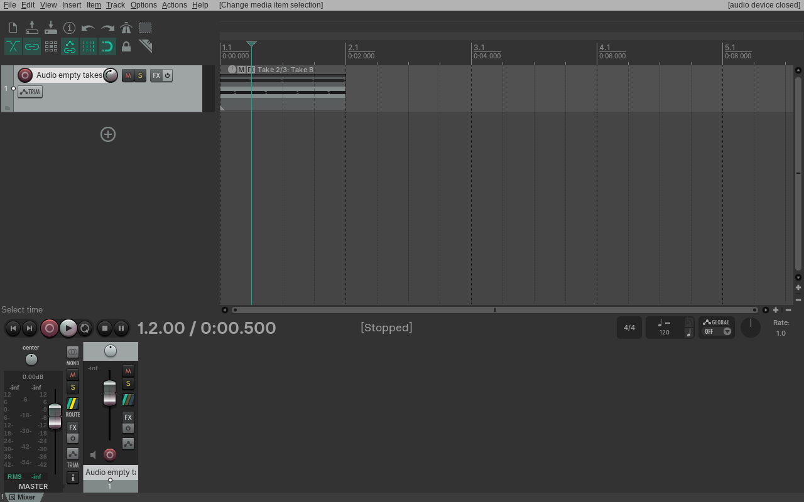
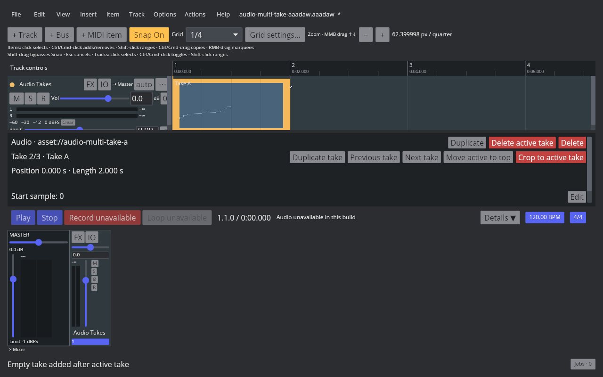
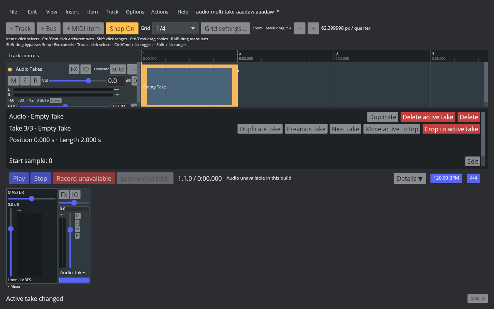

# Audio Item empty Take insertion

Linux REAPER 7.82 / Default 7 Main actions 41351 and 41352 insert an empty Take before or after the active Take. With Take B active at index 1, action 41351 places the empty slot at index 1 and moves Take B to index 2; action 41352 places it at index 2 and leaves Take B active at index 1. The item remains selected, and one Undo/Redo removes or restores the matching slot. The native probe confirms the empty slot is a `TAKE NULL` with no media source or API take object. Readback, RPP states, and screenshot hashes are in the [evidence manifest](fixtures/audio-empty-takes-evidence.tsv).

AAADAW exposes the same Item > Take action entries for selected Audio and MIDI items. Audio Takes now have explicit empty state in project snapshots and SQLite schema 70. The storage layer writes a reserved internal reference to satisfy existing non-empty database constraints, then restores it as an empty media reference from the explicit marker; it creates no audio asset. Empty active Takes can be selected, persisted, undone, and redone.

The playback builder skips source hashing and file resolution for an empty active Take and supplies an allocation-free silent consumer to the render graph. Its frame availability is unbounded, reads zero samples, and reports no underrun, including in offline rendering. The 27-case audio playback suite includes a missing-media-source regression proving that an active empty Take prepares and renders silence. The Inspector and Arrange item label both display “Empty Take”; the captured UI moves from Take 2/2 to 2/3, and then shows Take 3/3 after switching to the empty slot.

Verification passed for the complete Core suite, the 884-test AAADAW desktop suite, all 108 Storage tests, and all 27 audio playback tests. The 15-case Core Take suite also covers empty Take paste plus Undo/Redo and snapshot restoration. Stable `cargo check` passed for Core, Engine, Storage, App, and desktop crates. The live interface captures use the rebuilt nightly Cranelift desktop binary with audio-device support disabled; they verify UI/project state, while playback behavior is checked by the Engine render path tests.

`EDIT-TAKE-001` remains `in_progress`: recording-created Takes, other Take creation/editing paths, full Audio/MIDI cross-media Take behavior, cross-project clipboard, Show all takes, Fixed Lanes, Comp Areas, and remaining REAPER Take workflows remain open.

