# Audio item takes

## REAPER 7.82 reference

The native probe used Linux REAPER 7.82 with Default 7 and two WAV sources. Action 40639, **Take: Duplicate active take**, appends a copy after the existing take order and activates that new last take; a single-take item becomes a two-take item with index 1 active. For three selected items with starting take counts 2, 1, and 2, the action produces counts 3, 2, and 3, activates the appended take in each, and preserves all original take order. One real Undo restores all three starting states and one Redo reapplies the action. This multi-selection probe supersedes the old inference from the single-action fixture below: that earlier script changed a take source after duplication, so its final RPP could not establish where REAPER had inserted the copy. The multi-selection readback, before/after/undo/redo RPP files, and native screenshots are listed in the [multi-selection fixture manifest](fixtures/audio-duplicate-active-take-multi-aaadaw.tsv); its screenshots show the live Arrange with an evaluation panel partially occluding the left side, so the state readback and RPP are authoritative.

In the two-take project, action 40125 switches from index 1 to 0 and 40126 switches from 0 to 1. Switching is recorded in project history and undo/redo restores the prior active take. Action 40435 displays the takes in separate lanes when there is room. The saved RPP marks the active `<TAKE SEL>` block and stores each take's name, source, offset, rate, and mix properties in its own block.

For multi-selection, REAPER 7.82 actions 40125 and 40126 move selected multi-take items to a shared take slot. With selected items at indices `0/0/2` and take counts `2/1/3`, Next sets them to `0/0/0`; Previous then sets them to `1/0/2`. A second mixed-index control starts at `1/0/0`: Next yields `1/0/2`, then Previous yields `1/0/1`. These states show that the action advances the highest active index across the selected multi-take items within the largest selected take list, clamps shorter multi-take items to their last slot, and leaves single-take items unchanged. One Undo and Redo restore and reapply the native Next or Previous operation. The [multi-selection switch manifest](fixtures/audio-switch-takes-multi-aaadaw.tsv) records the primary probe, the mixed-index control probe, RPP states, and a live Arrange capture.

The native readback, saved RPP, and screenshots of Arrange and Media Item Properties are in the [fixture set](fixtures/audio-multi-take-native.tsv). The Arrange capture shows the selected take lane and the `Take 2/2: Take A` label; Media Item Properties shows both take names and the active-take selector.

The native Properties capture lists `1: Take B` and `2: Take A`, with the active take selected. AAADAW's F2 Media Item Properties now has the same numbered, named list. Choosing an entry changes the active Take immediately; one Undo/Redo restores and reapplies the selection while the Properties window remains open. The [selector evidence manifest](fixtures/audio-take-properties-selector-aaadaw.tsv) includes the native reference, AAADAW list-open screenshot, and four live state captures.

Native action 40603 also accepts multiple copied source items: it appends the full clipboard sequence, in order, to each selected audio target and activates the last copied take. AAADAW now follows this behavior; the separate [multiple-source paste evidence](audio-paste-as-takes-multiple-sources.md) includes pairwise target readback, a one-target case, and one-step Undo/Redo.

Native action 40543, **Take: Implode items on same track into takes**, keeps the earliest selected item (topmost item for equal starts), appends every take from each selected donor in Arrange order, and removes the donor items. AAADAW now applies the same operation as one undoable transaction while preserving the destination's position, length, take order, and active index. See the [same-track implode evidence](audio-implode-same-track-takes.md) for native readback, screenshots, and one-step Undo/Redo verification.

Native action 40438, **Take: Implode items across tracks into takes**, instead keeps the selected item on the topmost track, even if a lower selected item starts earlier. It retains the donor tracks, appends takes in track order, and shifts each donor Take's source offset by the project-position difference at that Take's own playback rate. Loop sources remain supported, including negative offsets; at least one selected-item pair must overlap for the native action to run. AAADAW implements the operation as one transaction and wraps signed loop offsets into their equivalent source-cycle position in the media worker. See the [cross-track implode evidence](audio-implode-cross-track-takes.md) for native RPP/readback states, screenshots, and Undo/Redo verification.

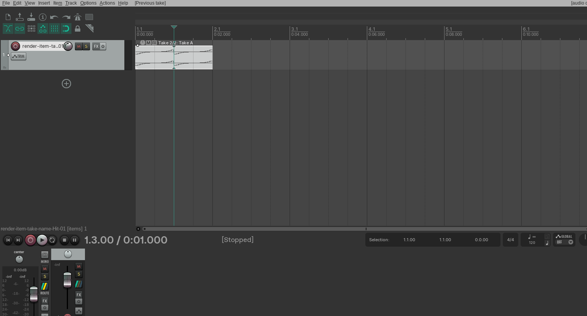

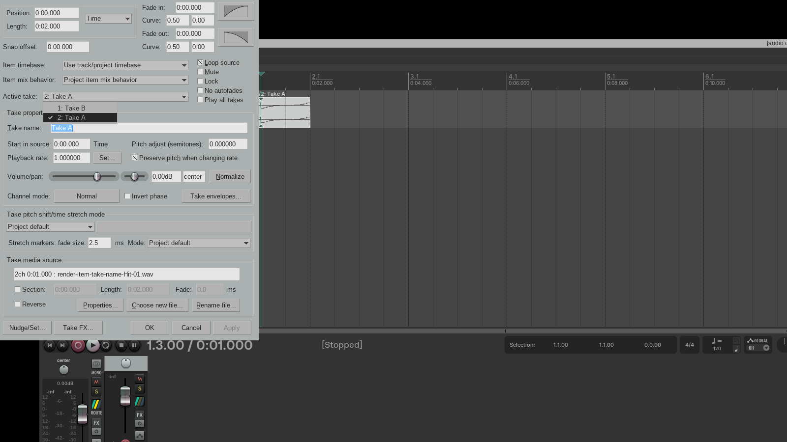

## AAADAW implementation slice

Audio items now preserve an ordered active and inactive take list in Core snapshots and SQLite schema 66. Duplicate active take appends a copy after the existing order and activates it. Next/previous actions update the active take through `Project.apply(DawAction)`, so edits participate in undo and redo. Because the active take can point to a different media source, the desktop playback graph is marked dirty for rebuild after a switch; this remains off the audio callback thread. Copying multiple selected audio items stores their active takes in project order; Paste as takes appends the full ordered sequence to each selected audio target in one transaction, as measured for REAPER action 40603.

The selected Audio Item Inspector shows the active take number and name, with Duplicate, Previous, Next, Move active to top, Crop to active take, and Delete active take controls. For a multi-selection it exposes selection-level Duplicate, Next takes, Previous takes, Move, Crop, and Delete actions. The F2 Media Item Properties window lists ordered Audio take names in its Active take selector; choosing one applies `SetAudioItemActiveTake` immediately and refreshes the active Take fields. Undo/Redo and any later active-take action refresh the open selector, while playback and frozen-render guards block the change. For multi-selection, actions 40125/40126 compute a shared slot from the highest active index and largest selected multi-take list, then clamp that slot to each target's available takes; singleton items stay unchanged. The Action List, Item menu, and Inspector apply the operation through one batch transaction, and any frozen target rejects the whole batch. Action List registers the matching REAPER action names, and the REAPER KeyMap registry maps native action IDs 40639, 40125, 40126, 40057, 40603, 40129, 41380, 40131, 40543, and 40438 to these commands. Deleting a take preserves the remaining source and chooses the next take in order; deleting the only take removes the item. Action 41380 moves every selected multi-take audio item whose active take is below index 0 in one undoable transaction, leaving selected singleton and already-top items unchanged. Cropping removes inactive takes while preserving the active source and take properties. Action 40131 crops all selected multi-take audio items in one undoable transaction and leaves selected single-take items unchanged. See [Paste audio items as takes](audio-paste-as-takes.md), [Delete the active audio take](audio-delete-active-take.md), [Move the active take to the top](audio-move-active-take-to-top.md), and [Crop to the active take](audio-crop-to-active-take.md). Paste from multiple sources, recording-created takes, and other take-list operations remain open.

The earlier live desktop capture used the Linux Stable LLVM binary at 1280×800; the current multi-selection four-state capture uses the Linux nightly Cranelift desktop binary at 1280×800. The selected-state screenshot shows `Take 2/2 · Take A`; the second capture follows the Next take control and shows `Take 1/2 · Take B`, the changed Arrange label, and the alternate source reference in the Inspector. The self-contained [AAADAW project](fixtures/audio-multi-take-aaadaw.aaadaw), [generator](fixtures/audio-multi-take-aaadaw-generator.rs), and [hash/test manifest](fixtures/audio-multi-take-aaadaw.tsv) accompany the captures. The current multi-selection capture verifies the Inspector action, all three Take counts and active sources, and one-step Undo/Redo in the live AAADAW window; its project and screenshot hashes are in the [multi-selection fixture manifest](fixtures/audio-duplicate-active-take-multi-aaadaw.tsv).

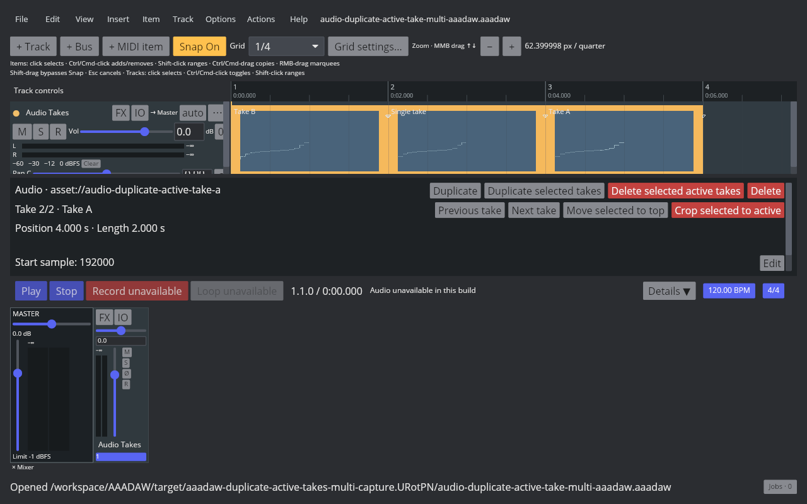

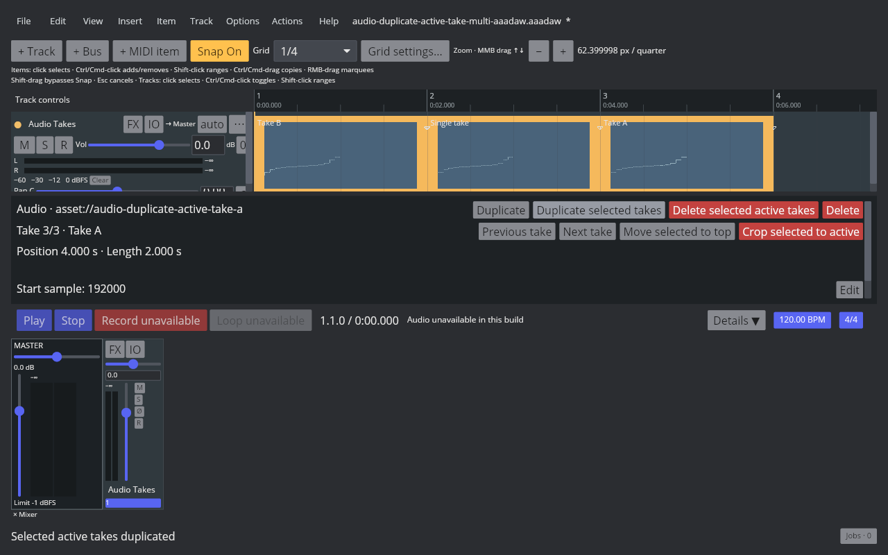

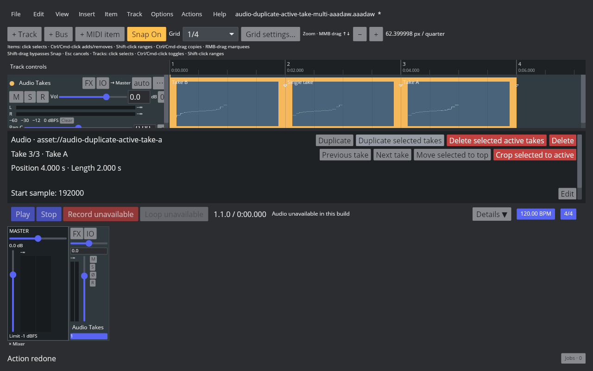

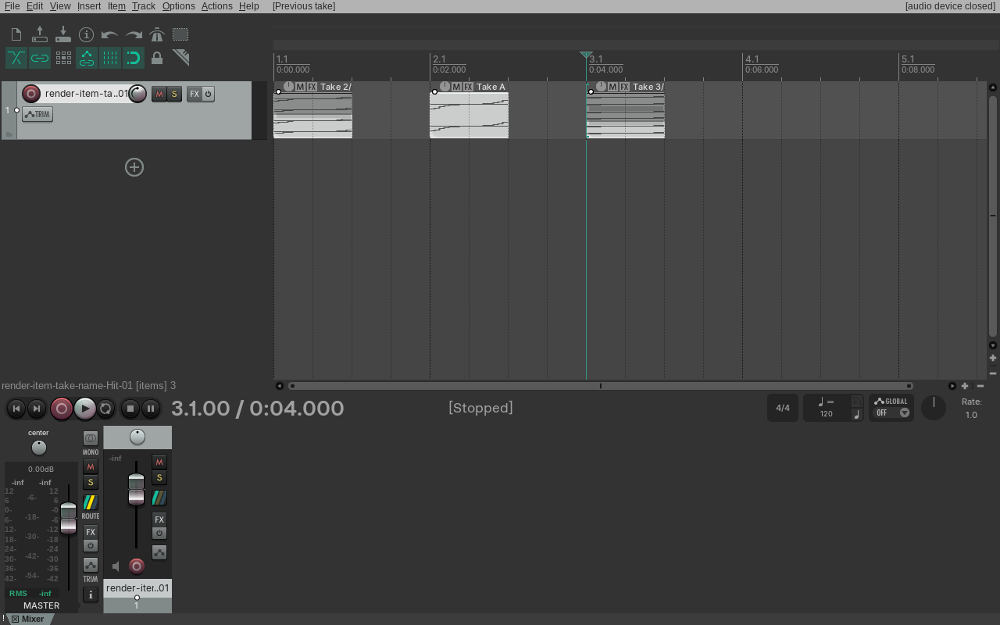

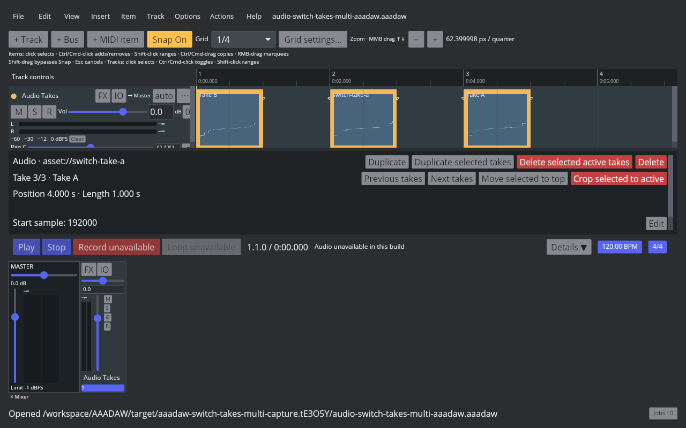

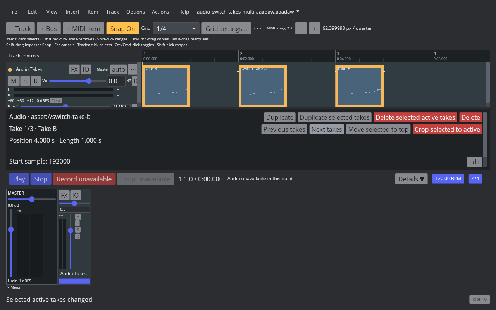

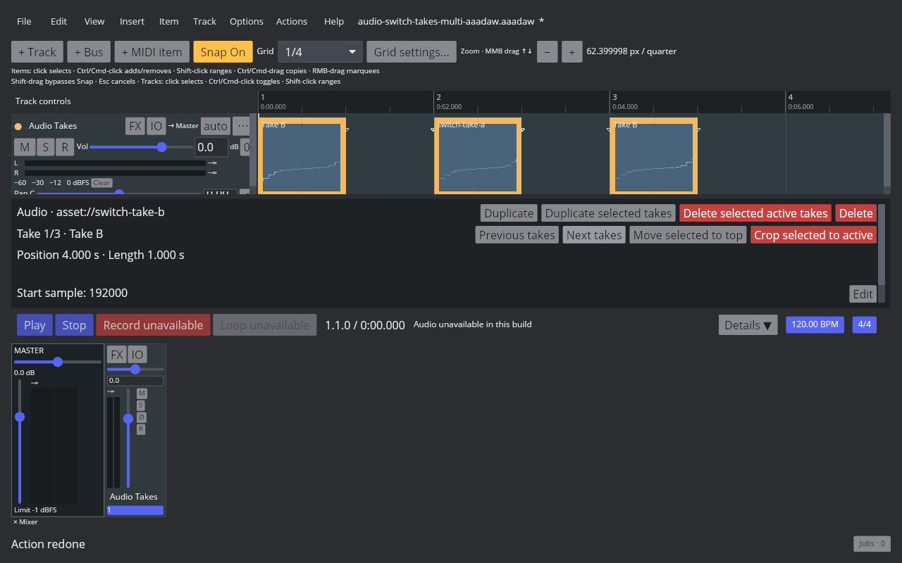

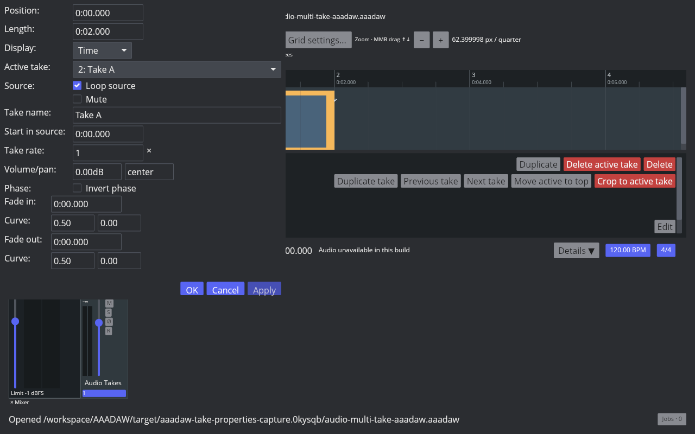

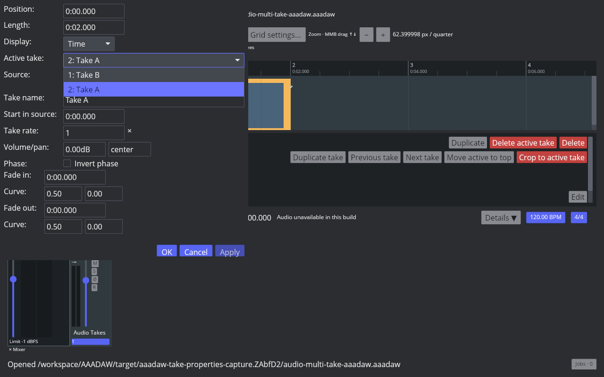

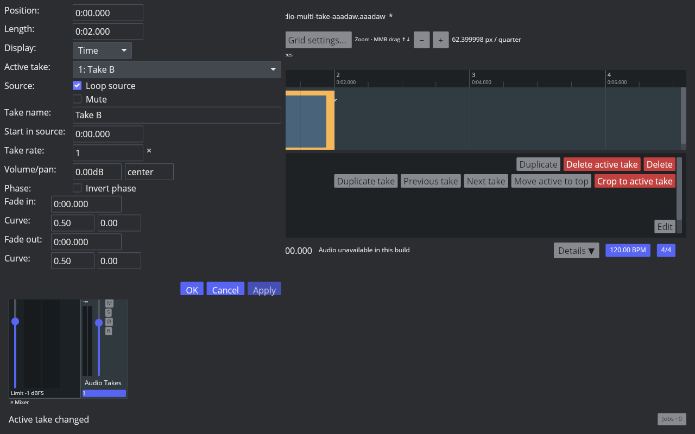

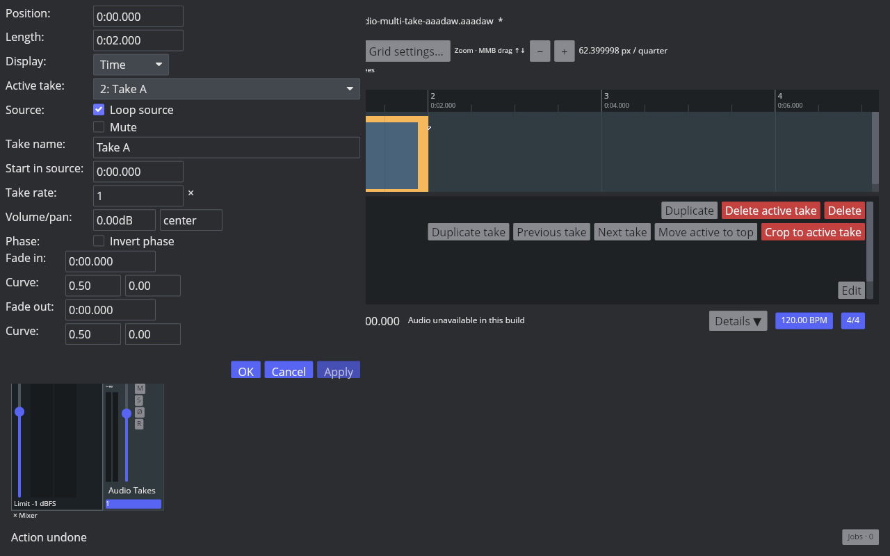

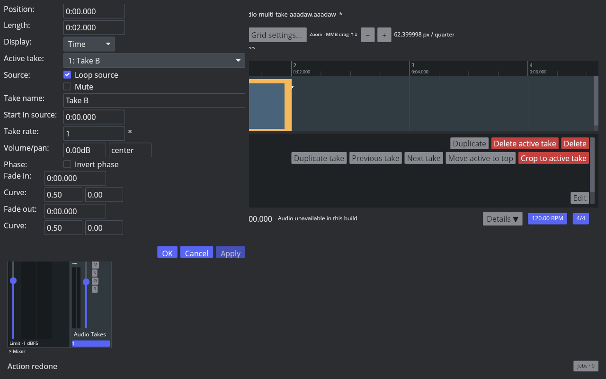

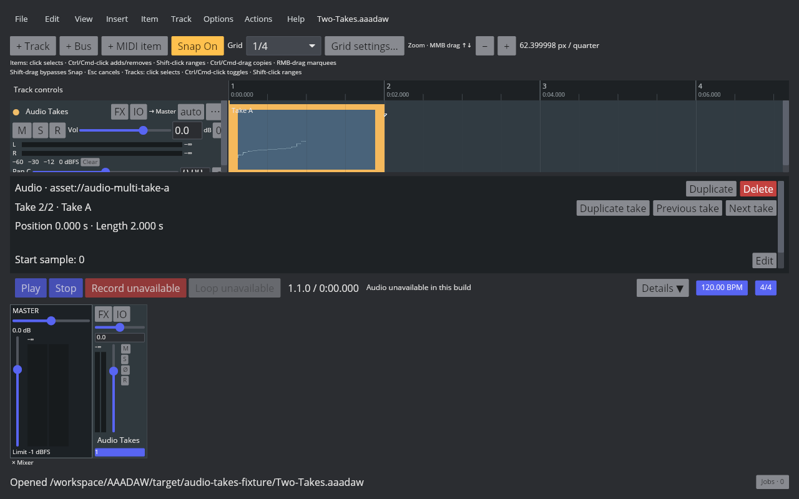

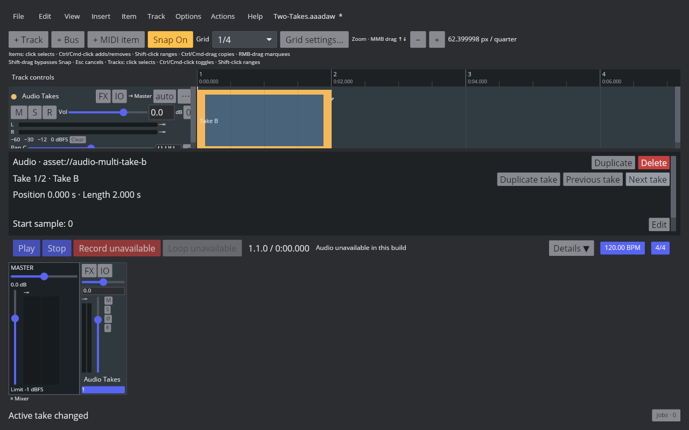

This build reports `Audio unavailable in this build`; these screenshots verify the real window, selection, and take-switch UI, while playback audibility remains unverified.

Stable LLVM verification for multi-selection switching passes the focused app tests and the workspace suite; strict all-target Clippy, formatting, the capture script, and diff checks are recorded in the [switch manifest](fixtures/audio-switch-takes-multi-aaadaw.tsv). The live four-state AAADAW capture uses the nightly Cranelift desktop binary. Audio playback remains unverified in this audio-device-disabled screenshot build.

## Remaining parity work

This does not complete `EDIT-TAKE-001`. Duplicate, delete, switch, reorder, crop, same-track and cross-track implode, single- and multiple-source Paste as takes, and the F2 Active take selector now cover more of the measured behavior. Recording-created takes, other take-order operations, and cross-project clipboard behavior remain open. The REAPER `Show all takes (when room)` lane layout and further take interaction still need implementation and native measurement. Fixed lanes, comp areas, and cross-item comp remain open P5 work. Full Media Item Properties parity remains tracked separately under `ITEM-PROPERTIES-001`; both matrix entries remain `in_progress`.

The AAADAW screenshot, test results, binary identity, and artifact hashes are recorded alongside the native evidence in the fixture set.
