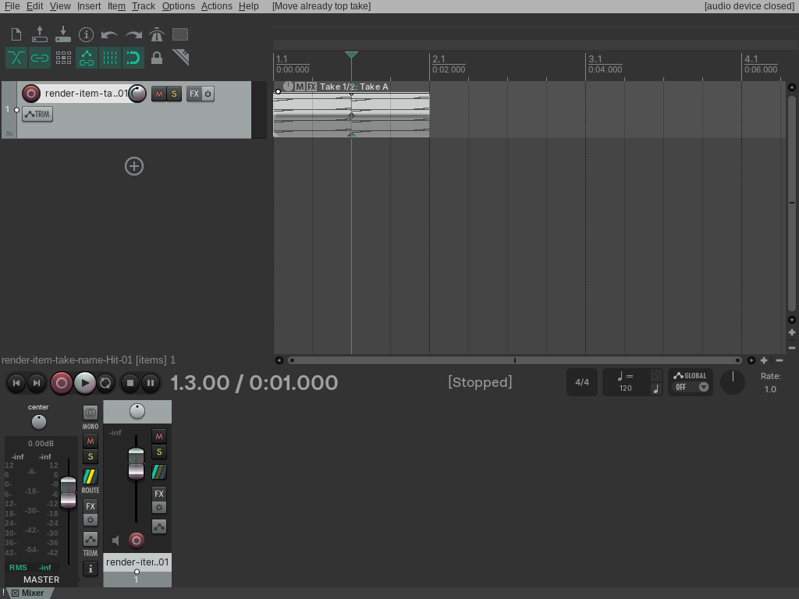
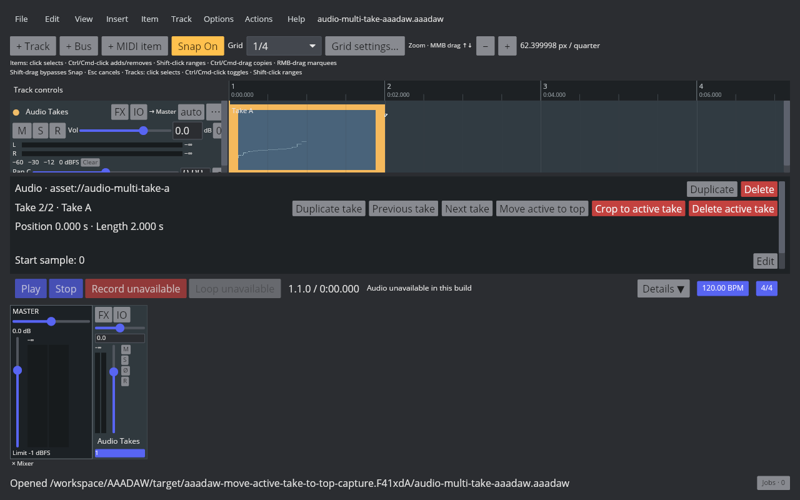
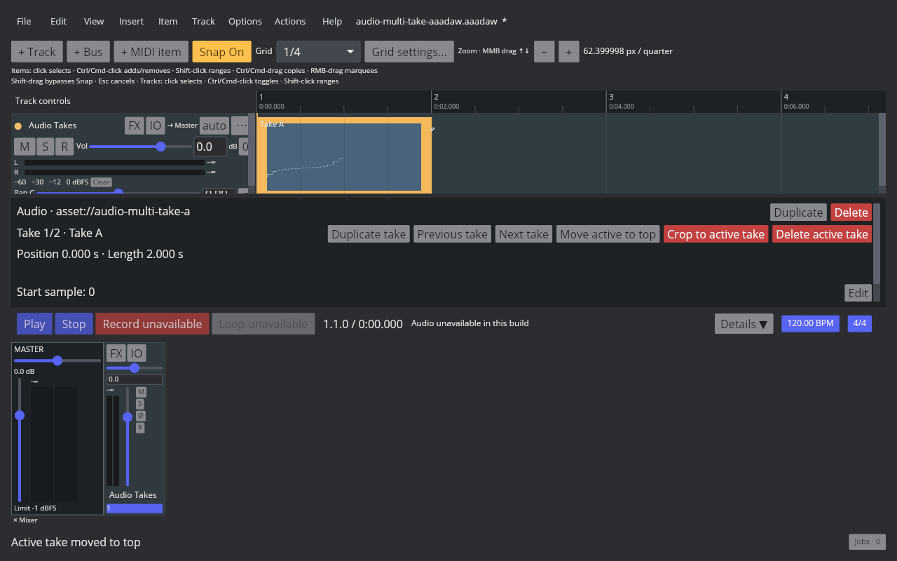
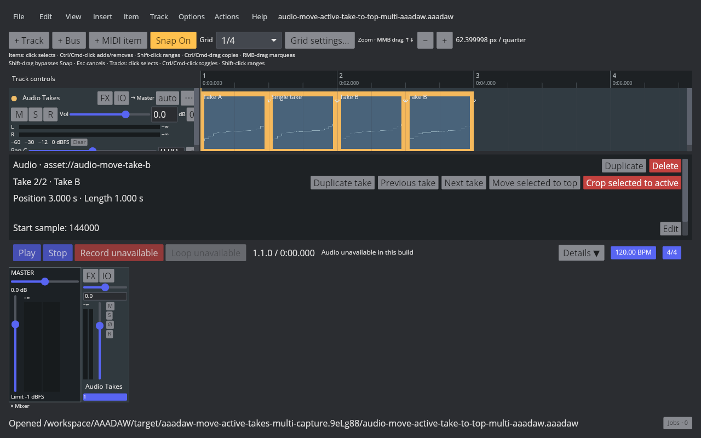
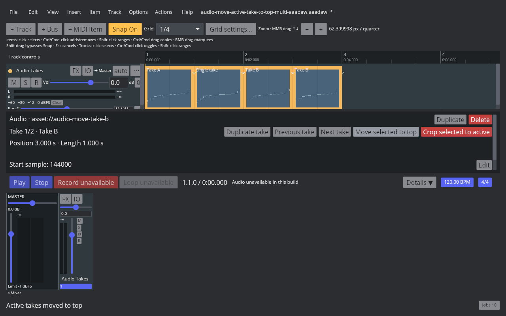
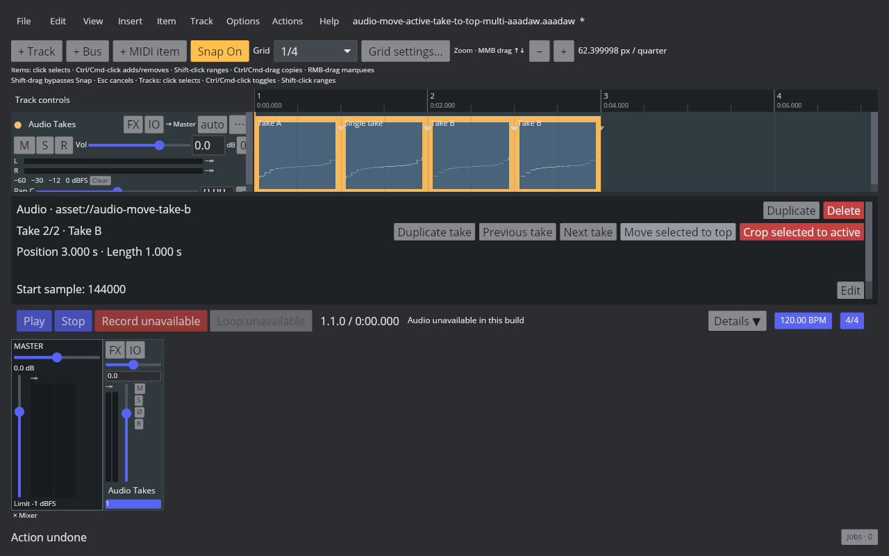

# Move the active take to the top

## REAPER 7.82 reference

The reference is Linux REAPER 7.82 with the Default 7 theme. Main action 41380 is **Item: Move active takes to top** and has no default shortcut. With Take B at index 0 and Take A active at index 1, the action moves Take A to index 0 and keeps Take A active; Take B moves to index 1. Undo restores the prior order without changing the active source, and redo reapplies the new order. Running the action when the active take is already at index 0 does not add an undo step. The native probe readbacks and saved RPP states are listed in the [fixture manifest](fixtures/audio-move-active-take-to-top-aaadaw.tsv).

## AAADAW implementation

The Core action moves the active take's index to zero and shifts earlier takes down one position. It preserves the active source and its mix properties, participates in snapshot persistence and Undo/Redo, and treats an already-top take as a history-free no-op. Since the active source does not change, the action does not rebuild the playback graph. Frozen render items are rejected; the desktop route also follows the normal project-edit busy guard.

The Action List and Item menu expose **Move active takes to top**, with no default shortcut. REAPER Main KeyMap action 41380 maps to the matching command. For one selected multi-take item, the Inspector exposes **Move active to top**. For a multi-selection it exposes **Move selected to top** and moves every selected multi-take audio item whose active take is below index 0, in project order, as one undoable transaction. Single-take and already-top items are left unchanged; any frozen render target rejects the whole batch. The active source and its mix properties remain unchanged, so the playback graph is not rebuilt.

The [capture script](../../../scripts/reaper_parity/capture-audio-move-active-take-to-top-aaadaw.sh) runs the desktop binary with an isolated XDG profile, a temporary copy of the project fixture, and a temporary shortcut to invoke the shortcut-free command. The manifest records the exact binary, screenshots, project fixture, test runs, and hashes. Screenshots verify the live window and take state, not audio audibility.

The four-item REAPER probe confirms action 41380 moves both selected active index-1 takes, while leaving a selected single-take item and an already-top multi-take item unchanged. A real Ctrl+Z restores both original orders in one step, Ctrl+Shift+Z reapplies them, and running the action again leaves its undo description unchanged. The native before/after/undo/redo RPP states and Arrange capture are in the [multi-selection manifest](fixtures/audio-move-active-take-to-top-multi-aaadaw.tsv). AAADAW's paired captures show the selected Take B item changing from 2/2 to 1/2; one Undo restores 2/2 and one Redo restores 1/2.

## Remaining parity work

`EDIT-TAKE-001` remains `in_progress`. Other multi-item take actions, recording-created takes, lane layouts, full Item Properties interactions, comp areas, MIDI-item take handling, and cross-project clipboard behavior remain open.
