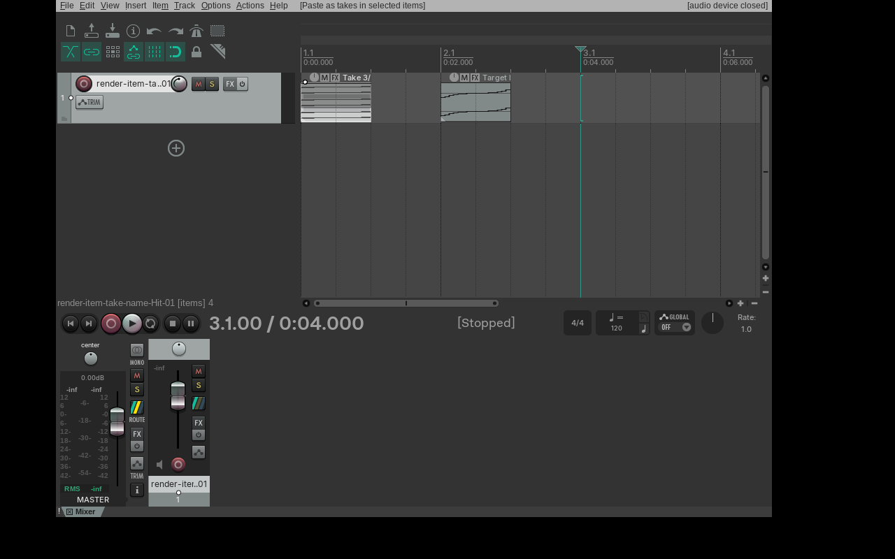
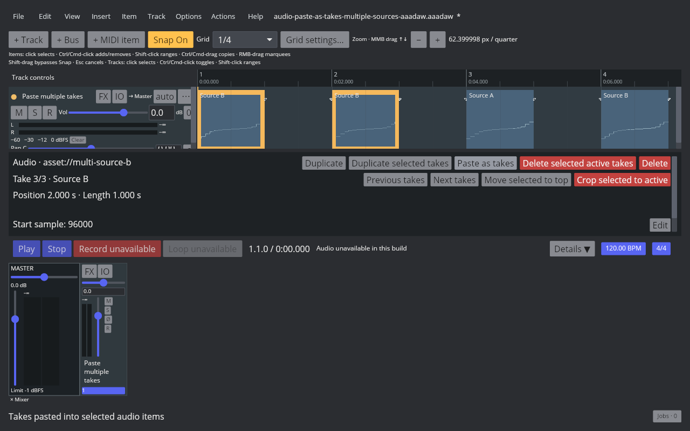
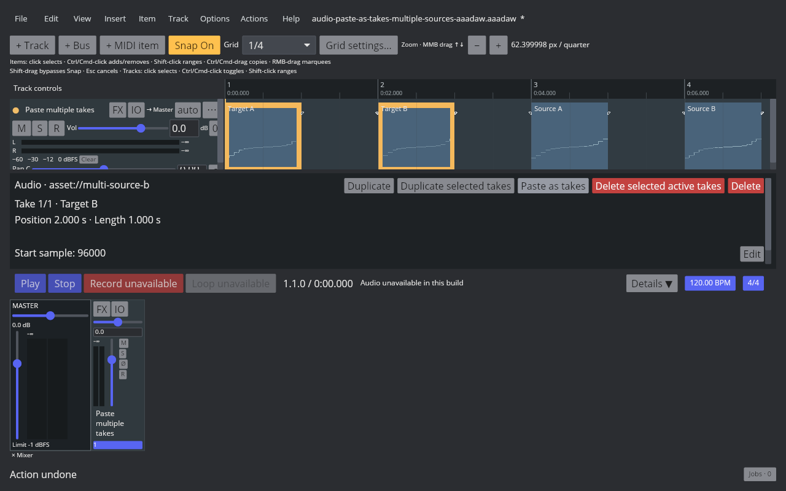
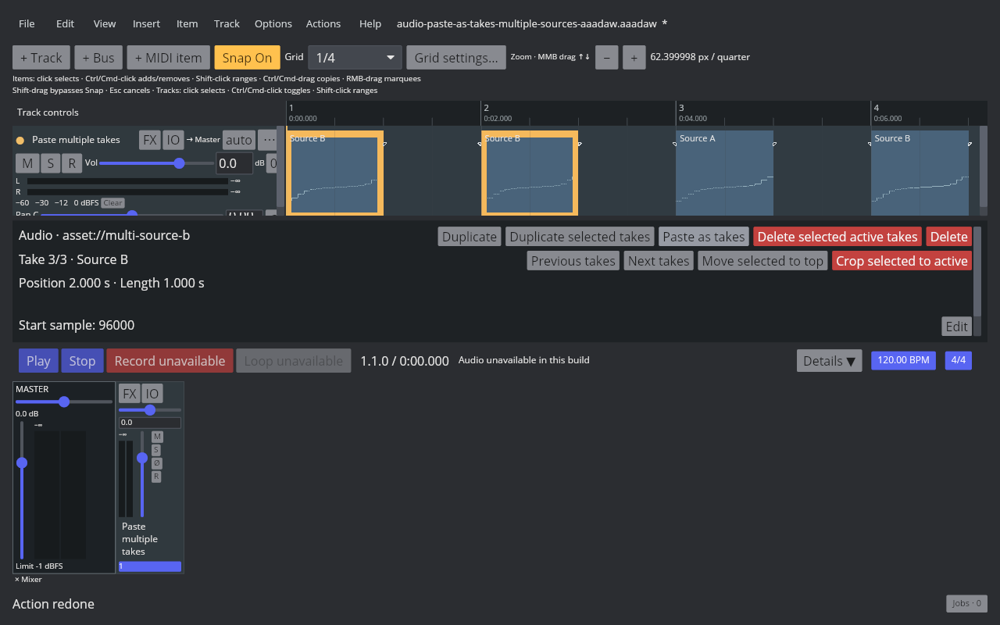

# Paste multiple audio items as takes

## REAPER 7.82 reference

The Linux REAPER 7.82 / Default 7 probe selected and copied two audio source items, then ran Main action 40603, **Take: Paste as takes in items**, on two different selected targets. REAPER appended both copied active takes to each target in source-item order and activated the last copied take. It left every source item in Arrange and preserved the target positions and lengths. With one target selected, the same action appended both copied takes to that target. One Undo and one Redo restored and reapplied the two-target operation. The ReaScript probe, readback, and before/after/undo/redo RPP files are in the [native fixture set](fixtures/audio-paste-as-takes-multiple-sources-native.tsv).

## AAADAW implementation

Copy items now captures the active take from each selected Audio Item in project order. Paste as takes appends the ordered clipboard list to every selected Audio Item, so one source broadcasts to many targets and multiple sources broadcast to one or many targets. The whole target set and all appended takes use one `BatchTransaction`; a frozen target rejects the command for the complete selection. Copied source items remain unchanged. Take source references, names, offsets, source sections, phase, loop, gain, pan, and playback rate travel with each copied take.

The reusable project fixture is generated by `crates/aaadaw/examples/generate_audio_paste_as_takes_multiple_sources_fixture.rs`; the real 1280×800 AAADAW capture script is `scripts/reaper_parity/capture-audio-paste-as-takes-multiple-sources-aaadaw.sh`. The four captures cover the selected targets, pasted takes, Undo, and Redo. Native and AAADAW artifact hashes are recorded in the [verification manifest](fixtures/audio-paste-as-takes-multiple-sources-aaadaw.tsv).

## Remaining parity work

This advances but does not complete `EDIT-TAKE-001`. The clipboard still belongs to one open project, and MIDI/track copying, recording-created takes, take display modes, other take operations, Fixed Lanes, and Comp Areas remain open. Cross-project clipboard transfer and full REAPER Arrange/Item Properties parity still need separate measurement and implementation.
