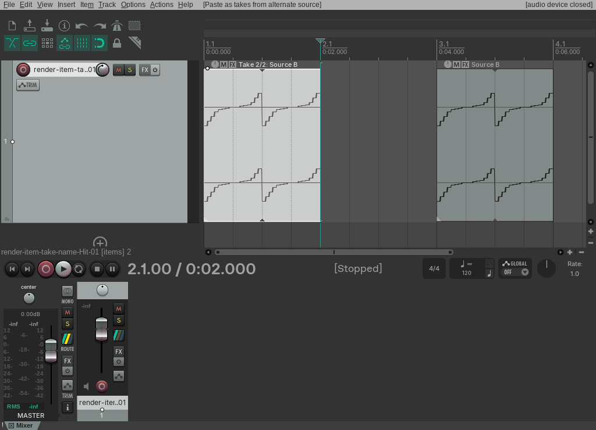
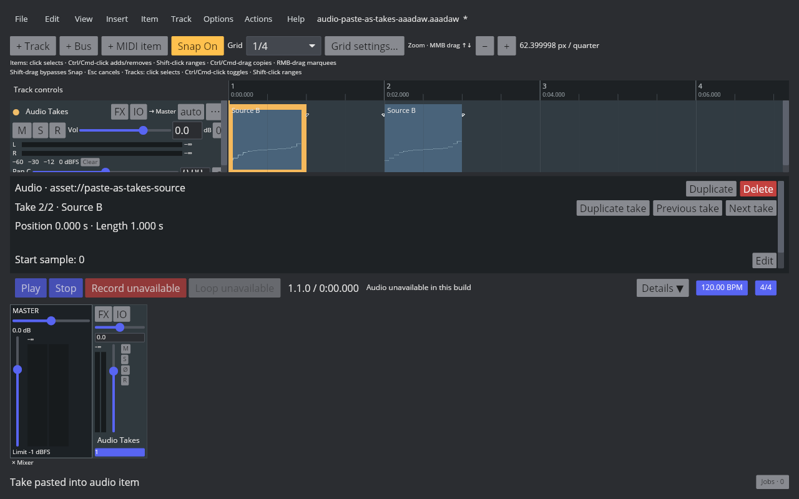
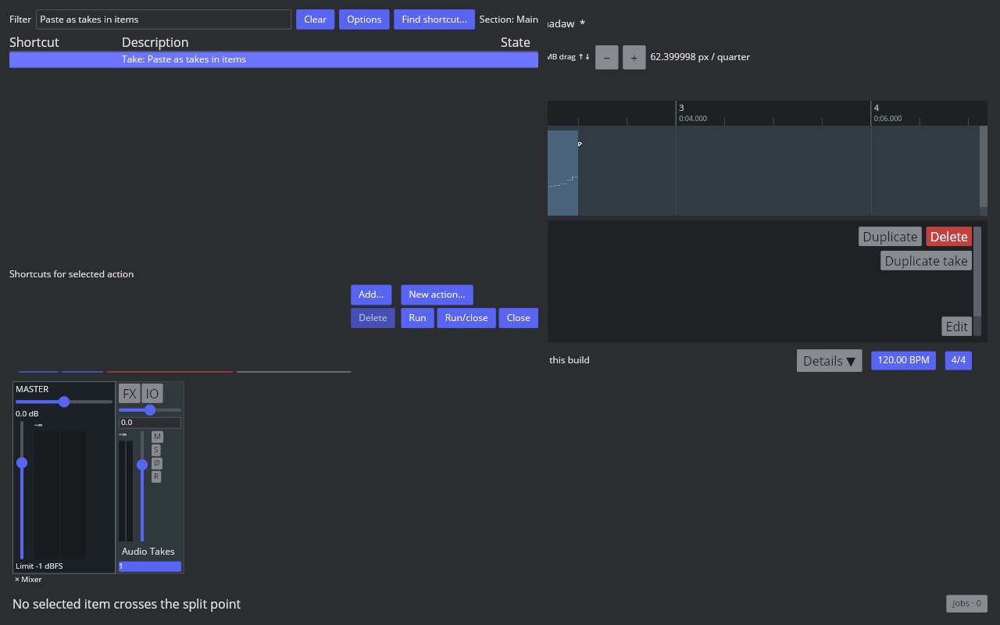

# Paste audio items as takes

## REAPER 7.82 reference

The native probe used Linux REAPER 7.82, Default 7, and two audio sources. Main action 40057 copies the selected source item; action 40603, **Take: Paste as takes in items**, appends its active source to the selected target item and activates the new take. The original target take stays at index 0, the pasted take becomes active at index 1, and the copied source item remains on the track. The target item keeps its timeline position and length. Native undo removes the appended take and redo restores it as active.

The measured action names are in [the native action catalogue](fixtures/audio-paste-as-takes-native-action-catalog.tsv). The probe output and before/after/undo/redo RPP states are in [the native TSV](fixtures/audio-paste-as-takes-native.tsv); artifact hashes and the paired AAADAW captures are in [the verification manifest](fixtures/audio-paste-as-takes-aaadaw.tsv). The native Arrange screenshot shows the active Source B take and the unchanged source item.

## AAADAW implementation

Copy selected audio item stores a snapshot of its active take in a project-scoped clipboard. Paste as takes in items applies a single undoable Core action that appends that source to one selected audio target and activates it. Source media reference, name, source offset/section, polarity, loop state, take gain, pan, and playback rate travel with the copied take. The target item keeps its timeline placement and the copied source remains a separate item. Clipboard data is rejected after a project transition, and frozen render items cannot be edited.

The Action List exposes **Take: Paste as takes in items** and the REAPER 7.82 Main KeyMap maps actions 40057 and 40603. Copy uses Ctrl+C. The paste-as-takes action has no default shortcut, matching the measured REAPER setup. The verification screenshot uses a temporary Ctrl+Alt+Shift+T binding solely to invoke that Action List command; the binding lives in the isolated capture profile.

The [AAADAW project fixture](fixtures/audio-paste-as-takes-aaadaw.aaadaw) contains Target A and Source B as separate one-second items. Its [generator](fixtures/audio-paste-as-takes-aaadaw-generator.rs) embeds the two existing WAV fixtures. The live Xvfb capture shows Target A switched to Source B while the original Source B item remains in Arrange. A separate [Action List capture](fixtures/audio-paste-as-takes-aaadaw-action-list.png) shows the registered command.

The reproducible [capture script](../../../scripts/reaper_parity/capture-audio-paste-as-takes-aaadaw.sh) opens the embedded fixture, copies Source B, selects Target A, runs Paste as takes in items, and records the desktop window at 1280×800. Audio is unavailable in the captured build, so this verifies the live UI behavior and source selection, not audibility.

Stable LLVM validation passed 846/846 AAADAW desktop tests and 371/371 Core/Storage tests. Core tests cover copied source properties, append ordering, unchanged item placement, invalid source data, and undo/redo. App tests verify the copied source stays on the timeline and the selected target receives the new active take.

## Remaining parity work

`EDIT-TAKE-001` remains `in_progress`. This slice supports one selected audio source and one selected audio target in the current project. Multi-item copying, cross-project media clipboard behavior, MIDI items, track copying, recording-created takes, lane display modes, take removal/reordering, comp areas, and multi-selection take actions remain open.
