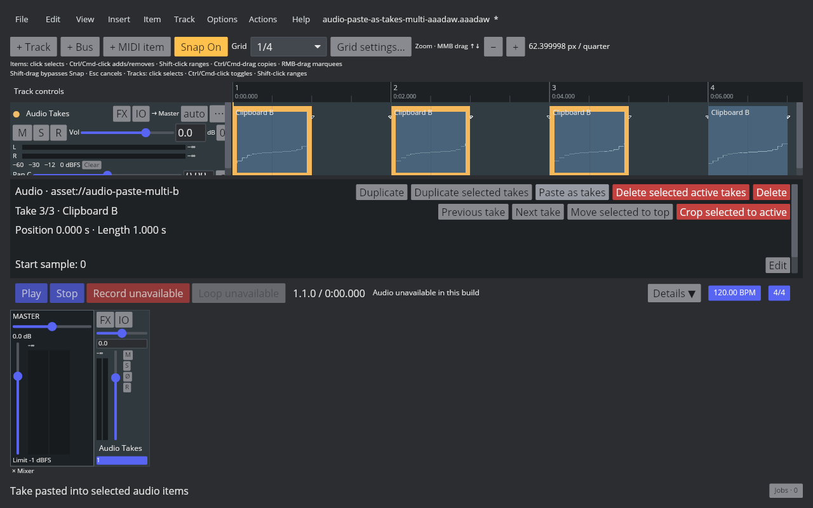

# Paste audio items as takes

## REAPER 7.82 reference

The native probe used Linux REAPER 7.82, Default 7, and two audio sources. Main action 40057 copies the selected source item; action 40603, **Take: Paste as takes in items**, appends the clipboard's active source to each selected target and activates the new take. The copied source item remains on the track, and every target keeps its position and length. With targets that start at 2/1/2 takes, one action produces 3/2/3 takes with the copied source active at the end of each list. One native Undo restores all three target states and one Redo reapplies the full selection. The single-item native state and the multi-selection before/after/undo/redo RPP files are listed in the [multi-selection fixture manifest](fixtures/audio-paste-as-takes-multi-aaadaw.tsv).

The measured action names are in [the native action catalogue](fixtures/audio-paste-as-takes-native-action-catalog.tsv). The probe output and before/after/undo/redo RPP states are in [the native TSV](fixtures/audio-paste-as-takes-native.tsv); artifact hashes and the paired AAADAW captures are in [the verification manifest](fixtures/audio-paste-as-takes-aaadaw.tsv). The native Arrange screenshot shows the active Source B take and the unchanged source item.

## AAADAW implementation

Copy selected audio item stores a snapshot of its active take in a project-scoped clipboard. Paste as takes in items appends that source to every selected audio target in project order, activates each new take, and records multiple targets in one `BatchTransaction`. Source media reference, name, source offset/section, polarity, loop state, take gain, pan, and playback rate travel with the copied take. Target items keep their timeline placement and the copied source remains a separate item. Clipboard data is rejected after a project transition, and a frozen render target disables/rejects the whole batch.

The Action List exposes **Take: Paste as takes in items** and the REAPER 7.82 Main KeyMap maps actions 40057 and 40603. Copy uses Ctrl+C. The paste-as-takes action has no default shortcut, matching the measured REAPER setup. The verification screenshot uses a temporary Ctrl+Alt+Shift+T binding solely to invoke that Action List command; the binding lives in the isolated capture profile.

The original [single-target AAADAW project fixture](fixtures/audio-paste-as-takes-aaadaw.aaadaw) contains Target A and Source B as separate one-second items; its [generator](fixtures/audio-paste-as-takes-aaadaw-generator.rs) embeds the two existing WAV fixtures. The new [multi-target fixture](fixtures/audio-paste-as-takes-multi-aaadaw.aaadaw) contains two multi-take targets with opposite active indices, a singleton, and a separate clipboard source; its [generator](../../../crates/aaadaw/examples/generate_audio_paste_as_takes_multi_fixture.rs) recreates that project. The live Xvfb capture copies Source B, selects the three destinations while leaving the source item on Arrange, and invokes the Inspector **Paste as takes** button. The registered Action List command remains shown in the separate [Action List capture](fixtures/audio-paste-as-takes-aaadaw-action-list.png).

The reproducible [capture script](../../../scripts/reaper_parity/capture-audio-paste-as-takes-aaadaw.sh) opens the embedded fixture, copies Source B, selects Target A, runs Paste as takes in items, and records the desktop window at 1280×800. Audio is unavailable in the captured build, so this verifies the live UI behavior and source selection, not audibility.

The multi-target capture and its action-button interaction are reproducible with [the multi-selection capture script](../../../scripts/reaper_parity/capture-audio-paste-as-takes-multi-aaadaw.sh). Its four 1280×800 screenshots use the nightly Cranelift desktop binary, with audio-device disabled, and are accompanied by native and AAADAW state/hash evidence in the [multi-target manifest](fixtures/audio-paste-as-takes-multi-aaadaw.tsv). Audio is unavailable in that capture build, so it verifies the real UI and take/source state, not audibility.

The earlier single-target slice passed Stable LLVM AAADAW desktop tests 846/846 and Core/Storage tests 371/371. The multi-target slice passed Stable LLVM workspace Nextest 1609/1609 and strict all-target Clippy. Core tests cover copied source properties, append ordering, unchanged item placement, invalid source data, and undo/redo; the App regression verifies project-order multi-selection, single-take destinations, source retention, one history step, and complete snapshot Undo/Redo.

## Remaining parity work

`EDIT-TAKE-001` remains `in_progress`. Clipboard copy still captures one selected audio source take, and Paste as takes supports that source across multiple selected audio targets in the current project. Cross-project media clipboard behavior, multiple-source clipboard copy, MIDI items, track copying, recording-created takes, lane display modes, other take-list operations, and comp areas remain open. Active-take deletion is measured separately in [Delete the active audio take](audio-delete-active-take.md).
