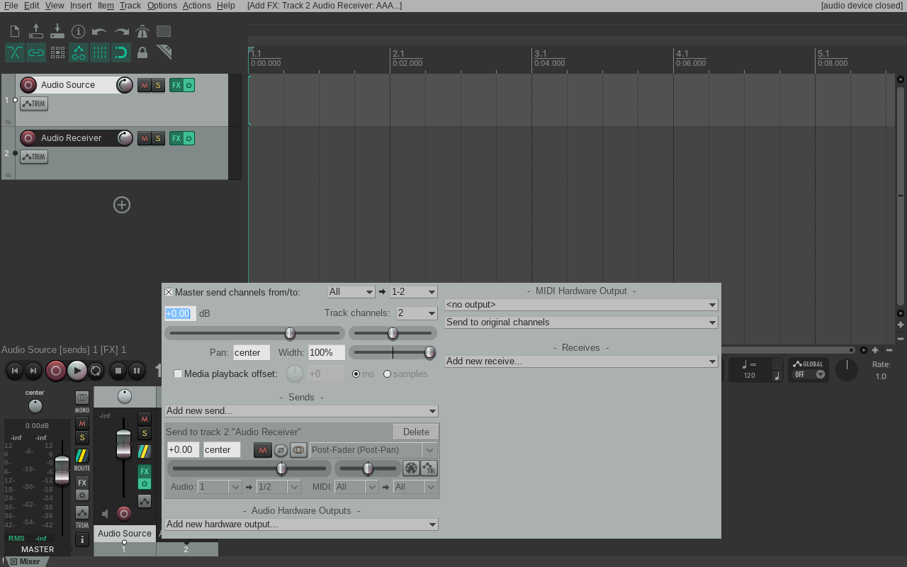
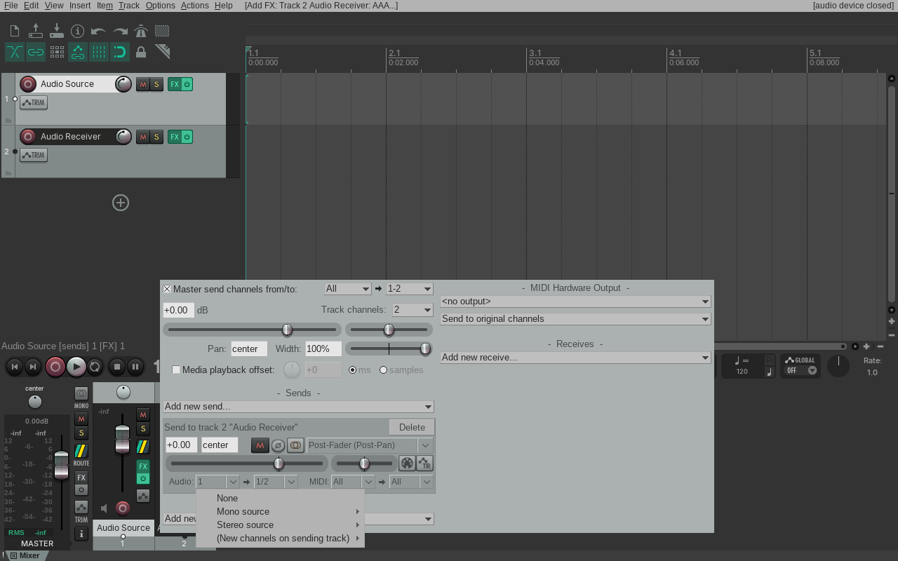
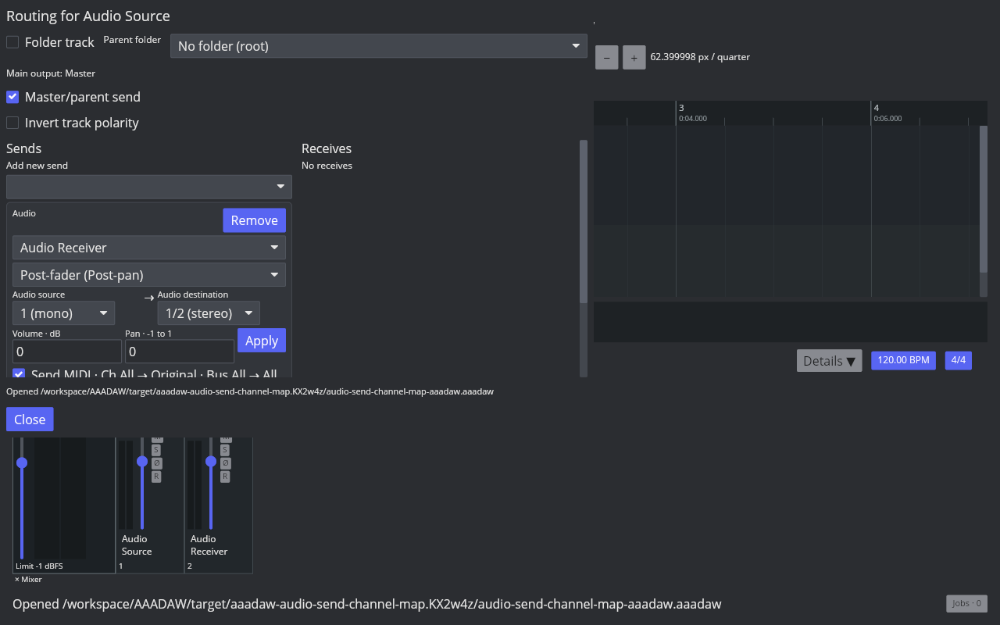

# Audio Send channel mapping

Reference: Linux REAPER 7.82 / x86_64 / Default 7. The native REAPER screenshots and render probe use an isolated profile and disposable project. The captured UI is a behavioral reference, not pixel-match certification.

REAPER offers audio source and destination selectors on each Send. For two-channel tracks, the source modes are stereo channels 1/2, mono channel 1, and mono channel 2; destination modes are stereo channels 1/2, mono channel 1, and mono channel 2. The native API values are `0`, `1024`, and `1025` respectively. The source selector menu and the active mono-to-stereo setting are visible in the native captures:

The native JSFX probe emitted `0.25` on source channel 1 and `0.75` on source channel 2, then measured both destination channels before the receiver track fader. REAPER duplicates a selected mono source into a stereo destination. A stereo source sent to one destination channel is averaged and placed on that channel. All nine source/destination combinations were measured:

| Source → destination | Stereo 1/2 | Mono 1 | Mono 2 |
| --- | --- | --- | --- |
| Stereo 1/2 | `(0.25, 0.75)` | `(0.50, 0)` | `(0, 0.50)` |
| Mono 1 | `(0.25, 0.25)` | `(0.25, 0)` | `(0, 0.25)` |
| Mono 2 | `(0.75, 0.75)` | `(0.75, 0)` | `(0, 0.75)` |

The probe also measured Send Pan at `0.5`: stereo 1/2 → mono 1 produced `0.4375` on destination channel 1, while mono 1 → stereo 1/2 remained `(0.25, 0.25)` and mono 1 → mono 2 remained `(0, 0.25)`. In this native behavior, Send Pan changes stereo-source balance and does not attenuate a mono-source mapping. The measured values and API settings are in the [native TSV](fixtures/audio-send-channel-map-native.tsv), with the saved native projects and artifact hashes in the [native evidence manifest](fixtures/audio-send-channel-map-native-evidence.tsv).

AAADAW exposes matching source and destination selectors in each Send card. These settings are stored with the route, copied through project snapshots and Undo/Redo, and applied in the precompiled audio graph without callback allocations. Existing projects migrate at schema 73 with both selectors set to stereo 1/2. The current engine models two audio channels per track, so the controls cover the three modes for channels 1/2 and preserve native conversion behavior within that scope.

The [AAADAW capture manifest](fixtures/audio-send-channel-map-aaadaw-evidence.tsv) records the live Cranelift desktop binary, fixture, and screenshot hashes. The fixture is reproducible with `cargo run -p aaadaw --example generate_audio_send_channel_map_fixture -- <path>`.

Core/engine regressions compare all nine rendered combinations with the native results, including non-default Send Pan for mono-source mappings. Storage regressions cover non-default round-trip and schema 72 → 73 default migration. The realtime allocation probe exercises non-default channel modes. Stable package tests passed: Core audio sends 4/4, Engine audio sends 10/10, Engine realtime allocation 1/1, and Storage project store 73/73. An App regression confirms channel-map changes Undo and Redo as one route update; the desktop suite passed 886/886 and the full workspace Nextest run under Xvfb passed 1676/1676. Strict Stable workspace all-target Clippy, App all-target check, and Cranelift desktop build passed.

This implements the first channel-pair slice. Track channel counts above two, channel offsets beyond 1/2, arbitrary multichannel pair mapping, Hardware I/O, Wiring, and the complete REAPER routing window remain open; `ROUTE-SEND-001` and P3 remain `in_progress`.
