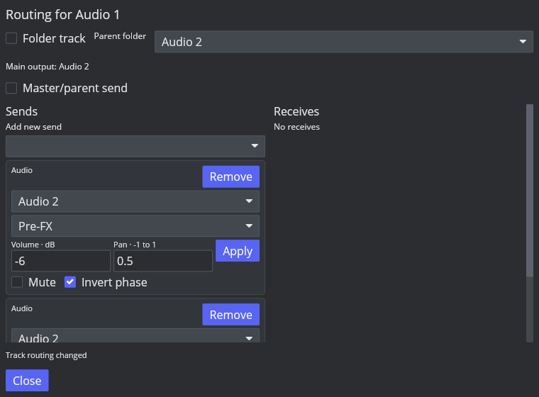
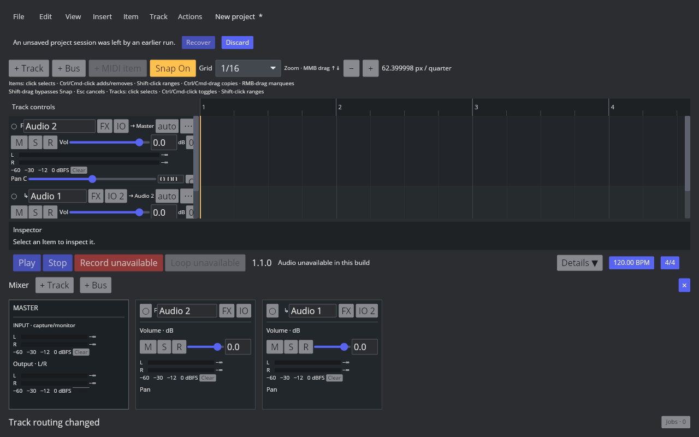
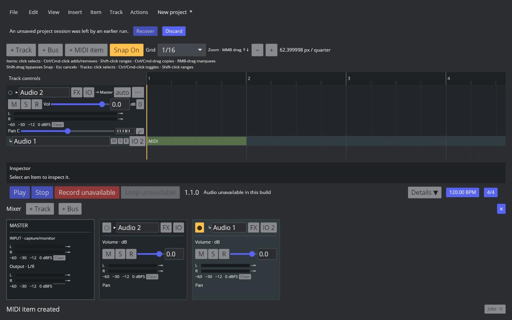
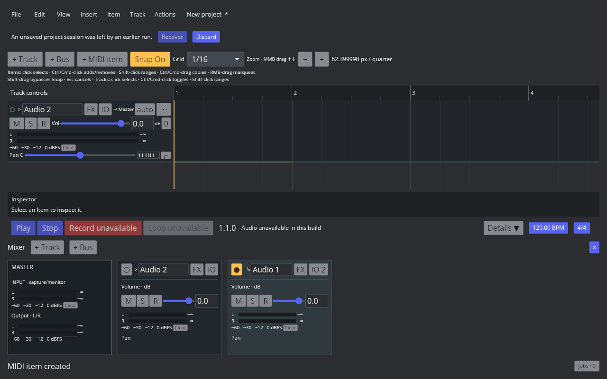
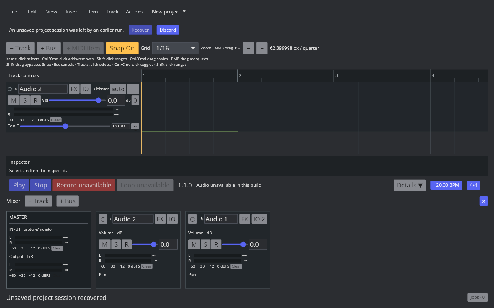
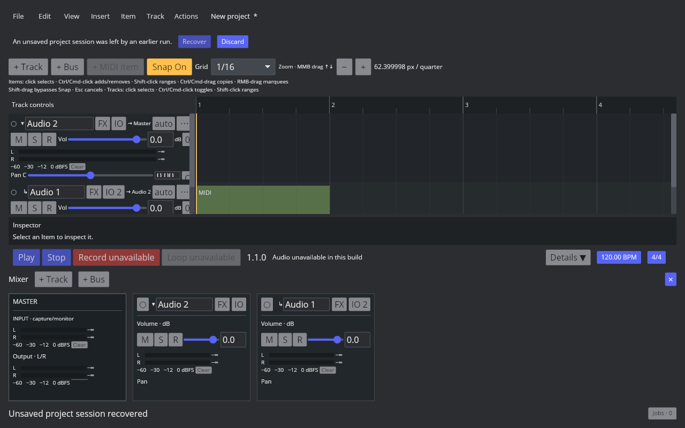

# AAADAW-ROUTING-004：嵌套文件夹与 Parent Send 基础

2026-10-09；Linux REAPER 7.82 / Default 7 / 默认配置；ROUTE-FOLDER-001 仍在进行。

## 实机参照

Outer 自身常量 0.25，Inner 无媒体，Leaf 0.125，Sibling 0.125，Outside 无媒体；Inner 属于 Outer，Leaf 属于 Inner，Sibling 属于 Outer。默认 Parent Send 开启，Folder Compact 为 0。

| 场景 | 左右中间样本 |
| --- | --- |
| 默认嵌套汇总 | 0.5 |
| Inner Parent Send 关闭 | 0.375 |
| Solo Inner | 0.125 |
| Solo Leaf | 0.125 |
| Solo Outer | 0.5 |

复现脚本 [probe-folders.lua](../../../scripts/reaper_parity/probe-folders.lua) 使用隔离配置及临时空工程，输入和环境变量同其他路由探针，不保存用户工程。

另外实测 Outer I_FOLDERCOMPACT=0/1/2：默认配置中 Outer、Outside 始终 74 px；其全部后代分别为 74/25/4 px。Small/Tiny 尺寸已实现；普通展开仍为 AAADAW 的 128 px，未匹配 REAPER 的 74 px。

## 实现及验证

is_folder 与稳定 parent_track_id 表示森林；Project 验证父节点为文件夹、父先子后、子树连续，拒绝层级/路由环路。重新指定父文件夹或移动轨道时带完整子树移动；Undo 仅恢复顺序/父关系/角色元数据，保留对应媒体、FX 和 TrackId。有效主输出默认走父节点，显式旧 output_track 优先，主输出开关仍独立。Receive 保留 Send 的单份反向视图。

schema 21 对旧轨道默认 is_folder=false / parent=NULL，不把历史 Bus 转成文件夹。保存重载保留嵌套关系和媒体所有权。引擎与 MIDI 计划均使用有效 Parent 路径，回调分配回归包括文件夹与前级发送。

767 项 workspace 测试通过，Clippy -D warnings 与默认构建通过；覆盖实际汇总、Parent 开关、嵌套 Solo/静音、身份/顺序/Undo/Snapshot、无效父节点/删除/环路、旧 schema 20 Bus 迁移、SQLite 往返、MIDI 上游来源及回调零分配。

后续补齐了 MIDI 主输出沿有效 Parent 路径的事件传播：子轨与每层 Folder 的 `main_send_enabled` 都控制是否继续向上游传递；Note attack/release 与 seek 时的 active-note chase 使用同一目标轨集合。`folder_parent_midi_forwarding_obeys_each_main_send_switch` 覆盖两层嵌套及子轨/中间 Folder 分别关闭主发送；`soloed_folder_keeps_events_on_child_instruments_through_parent_send` 同时确认事件到达子轨和 solo Folder。该路径在 MIDI 计划编译阶段展开，回调仍仅读取预编译事件。新增回归后的 workspace Nextest 通过 **1395/1395、0 skipped**，严格 all-target Clippy (`-D warnings`) 通过；nightly Cranelift 桌面构建 Build ID 为 `2c07e46c0a5b2902ddd65527696a6c0a46d962a3`，SHA-256 `9d52772861108cd0db1ef6ea7f61cd2773e1c53c8f20026f8493f46fa5dc24ad`。此次没有重新采集 REAPER 专项 MIDI 输出录音，原厂文件夹验证仍是本页记录的音频汇总行为。

GUI 已把 Audio 2 标为 Folder，Audio 1 设为其子轨；TCP/MCP 同步重排、层级标识和主输出目标更新。路由窗口可建层级，Track menu/Action List 注册 track.toggle-folder。

## 尚未完成

文件夹拖动/深度调整手势、MCP 文件夹显示策略与完整默认主题均待下一步。当前冻结仍只支持原有独立 instrument 角色，Folder Freeze 未开发；拒绝冻结文件夹或把已冻结轨道改为文件夹，避免烘焙/接收路径错误。GUI 原生保存与 MIDI 动态计划限制仍见前一切片。P3 和产品全量对齐未关闭。

## 文件夹压缩显示续项

[probe-folder-compact.lua](../../../scripts/reaper_parity/probe-folder-compact.lua) 在上述隔离五轨工程中测量 0/1/2 三态。TCP/MCP 的文件夹按钮及注册动作 `track.cycle-folder-compact` 依次切换 Normal → Small → Tiny → Normal；后代继承祖先最强压缩，文件夹自身保持其父级决定的高度。压缩时暂隐藏 FX/音量自动化编辑区域，展开恢复；媒体坐标限制在 25/4 px 行内。

schema 22 新增 arrangement_folder_compact，按稳定 TrackId 保存模式；旧工程默认为 Normal。压缩只修改视图，不进入 Project Undo；无效模式回滚整次保存，加载仅接受有效文件夹。771 项 workspace 测试通过，Clippy warnings denied 与默认构建通过。

实际 GUI 创建子轨 MIDI Item，检查三态边界；重启并 Recover 后 Tiny 和媒体恢复，再展开正常显示。此处验证会话恢复，原生 Save/Reopen 仍未验收。

