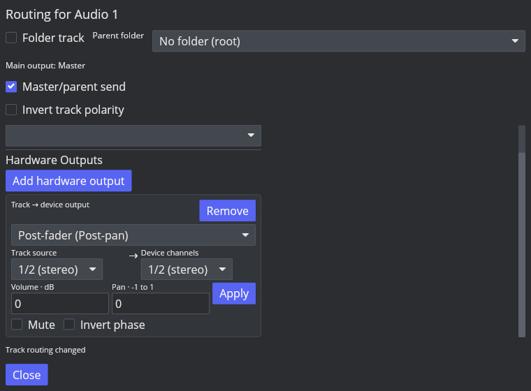

# Audio Hardware Outputs

Reference: Linux REAPER 7.82 / x86_64 / Default 7 theme and factory project settings. The native API probe verifies the routing category, route defaults, editable channel selectors, Send Mode values, and saved project state. A separate live probe now captures REAPER output through a 44.1 kHz stereo PulseAudio null sink monitor under Xvfb. This measures the software device path without a physical audio device; physical-device setup, timing and channel availability remain unverified.

## Native baseline

`CreateTrackSend(source, nil)` creates a Hardware Output and returns index `0`. `GetTrackNumSends(source, 2)` reports one Hardware Output; category `0` (ordinary Sends) remains zero. In the same project, category `1` reports one Receive for the Master path. This confirms that the Hardware Output belongs to its own route collection.

The created output defaults to `I_SRCCHAN=0`, `I_DSTCHAN=0` (stereo channels 1/2), `D_VOL=1`, `D_PAN=0`, `B_MUTE=0`, `B_PHASE=0`, `I_SENDMODE=0`, and `I_MIDIFLAGS=0`. The API accepts and reads back source channel values `0`, `1024`, `1025`, destination values `0`, `1024`, `1025`, and Send Mode values `0` through `3`. REAPER's [ReaScript API](https://www.reaper.fm/sdk/reascript/reascripthelp.html) documents modes 0=post-fader, 1=pre-FX, 2=deprecated post-FX, and 3=post-FX; mode 8 (pre-receive) is unsupported for hardware outputs.

The native TSV, final RPP and a mono-channel-map RPP are reproducible with [`capture-hardware-output-native.sh`](../../scripts/reaper_parity/capture-hardware-output-native.sh). Their binary and source hashes are recorded in the [native evidence manifest](fixtures/hardware-output-native-evidence.tsv).

## Live software-device sample probe

[`capture-hardware-output-live.sh`](../../scripts/reaper_parity/capture-hardware-output-live.sh) creates a private PulseAudio null sink, keeps its clock active, launches REAPER with the PulseAudio backend in an isolated Xvfb profile, records the sink monitor, and runs [`probe-hardware-output-live.lua`](../../scripts/reaper_parity/probe-hardware-output-live.lua). [`verify-hardware-output-live.py`](../../scripts/reaper_parity/verify-hardware-output-live.py) checks the captured samples. The captured source is 44.1 kHz stereo S16 PCM with 997 Hz left-channel and 613 Hz right-channel tones between 0.15 and 1.35 seconds; peak levels are 5000 and 9000.

The native probe confirmed these live results:

- With Main Send disabled, a default stereo Hardware Output produces non-zero samples on device channels 1/2 with peaks 5000/9000.
- Muting that Hardware Output yields silence while the track meter still reports signal. Setting its gain to 0.5 yields peaks 2500/4500.
- Phase inversion produces the exact sign-inverted active source samples. Hard-right pan leaves device channel 1 silent and preserves the right-channel 9000 peak.
- Mapping mono source channel 1 to stereo duplicates it to both device channels at a 5000 peak. Mapping that source to device channel 2 leaves channel 1 silent and produces a 5000 peak on channel 2.
- All four native Send Modes were measured with the stock `JS: Volume Adjustment` at −6 dB and a track fader at 0.5: mode 0 applies the fader (peaks 2500/4500); mode 1 bypasses both the FX and fader (5000/9000); modes 2 and 3 include the FX but bypass the fader (2500/4500). This also confirms that deprecated mode 2 and current mode 3 share the measured post-FX signal stage.
- Track mute silences the direct output. Soloing the routed track preserves it; soloing a second track that has no Hardware Output suppresses the unsoloed route. A Master fader at 0.5 and a −6 dB Master JSFX leave the direct Hardware Output at 5000/9000, confirming that this path bypasses both Master stages.

The Master Send baseline also reaches the monitor with the expected peak levels, but its monitor capture contains only part of the source's active interval. No bitwise Main-versus-Hardware sample comparison is claimed from these files. The full WAV captures, saved RPPs, per-block meter reads, and SHA-256 manifest are in [`fixtures/hardware-output-live`](fixtures/hardware-output-live/). Each project uses the fixture-local `source.wav`, and the verifier checks its media references and all fixture artifact hashes. The capture used the official REAPER binary SHA recorded in `live-evidence.tsv` and PulseAudio 17.0.

## AAADAW implementation status

AAADAW now has a track-owned Hardware Output route collection that is independent of ordinary audio Sends and carries no MIDI route state. The Routing window can add/remove an output and edit its REAPER Send Mode, source/device channel pair, gain, pan, mute and phase. The current menu exposes modes 0, 1 and 3; compatibility mode 2 is preserved in project state and displayed as Post-FX without offering the deprecated value as a new choice. Modes 2 and 3 use the same post-FX buffer while retaining distinct serialized values. Routes are part of undo/redo and project snapshots; schema 74 persists them in `track_hardware_outputs`.

The real-time render graph accumulates direct outputs into preallocated stereo scratch and includes them in CPAL, JACK and PipeWire device callbacks. These routes continue when the track Main Send is disabled. They bypass the Master mix stage and enter the final output safety guard. Offline `render_into` deliberately excludes hardware outputs. Mono source and destination mapping uses the same channel-pair rules as normal sends. The callback path does not allocate for this feature.

The Routing window was opened in the built Linux desktop binary, a track Hardware Output was created, and the visible controls were checked in Xvfb. This screenshot verifies UI rendering and the available menu choices only; it is not evidence of live audio parity.

Screenshot SHA-256: `78008fd91e27e3b31305a9d48fc45159a5b35e84a76651ec43ca885e05f90c7d`.

The initial AAADAW Wiring canvas now displays Hardware Output paths; see [Track Wiring](routing-wiring.md). This is a first usable implementation slice, not complete REAPER parity. The live probe covers stereo 1/2 output with Main Send off, all four Send Modes, Hardware Output and track mute, basic solo behavior, gain/phase/pan, two mono channel mappings, and bypass of Master fader/FX on a virtual PulseAudio device. Exact Main-versus-Hardware sample equivalence, physical-device enumeration, device changes, outputs above channel 2, offline-render behavior and native per-channel Wiring behavior remain open. Keep `ROUTE-HW-OUTPUT-001` in progress.
