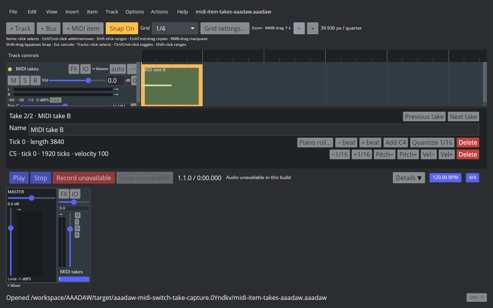
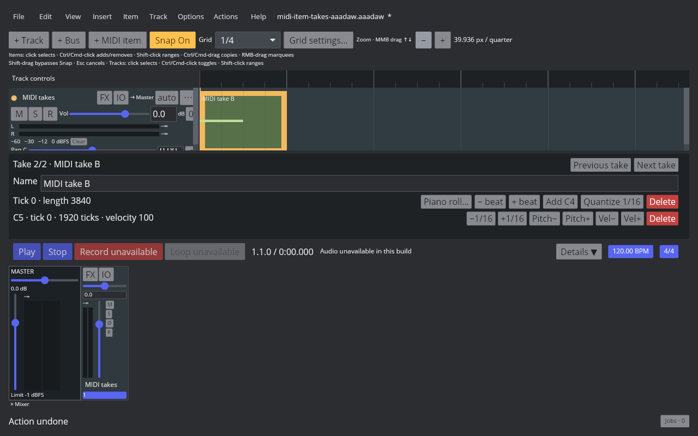

# MIDI Item Active Take Switching

Linux REAPER 7.82 / Default 7 Main actions 40125 and 40126 switch the selected MIDI item's active take. The native probe starts with Take B at index 1 and a distinct note (pitch 64), verifies Next selects Take A at index 0 (pitch 60), then checks Undo, Redo, and Previous. All states keep two takes on the same item and preserve selection. Readback and saved projects are listed in the [artifact manifest](fixtures/midi-item-switch-take-aaadaw.tsv).

AAADAW adds `SetMidiItemActiveTake` to the project action model. Switching swaps the active event buffers and metadata with the stored take while retaining both note identities and event lists. The selected MIDI item's Inspector now shows Previous take / Next take controls. Action List 40125/40126-style commands also include selected MIDI items and apply one shared slot in a single undoable batch. Frozen tracks and active project operations block the change. The native probe verifies a single MIDI target; shared-slot behavior for a mixed audio/MIDI selection still needs native readback.

The Core regression checks active and inactive take names, source offsets, note content, and Undo/Redo snapshots. The App regression exercises the Inspector command and Action List command; the existing multi-selection audio regression remains green. `EDIT-TAKE-001` stays in progress: MIDI Take creation, editing and reordering, a Take selector in MIDI Item Properties, take-aware splitting, recording-created Takes, Fixed Lanes, and Comp Areas remain open.

Cranelift AAADAW was captured in an isolated 1280×800 Xvfb window. The before image shows Take B and the Inspector controls; after Next the Inspector and note row show Take A; Undo and Redo restore the corresponding states.

