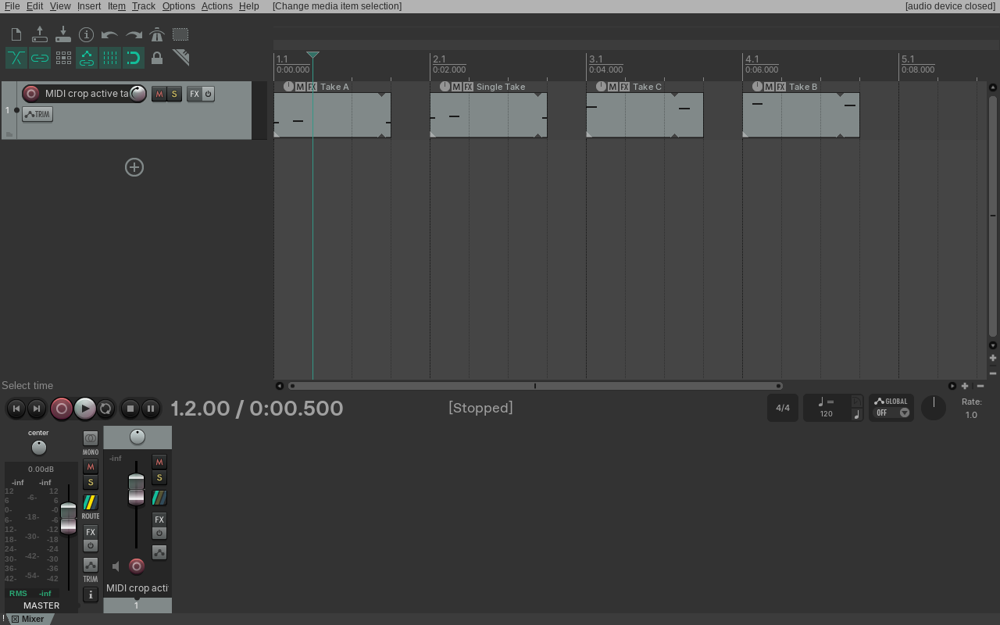
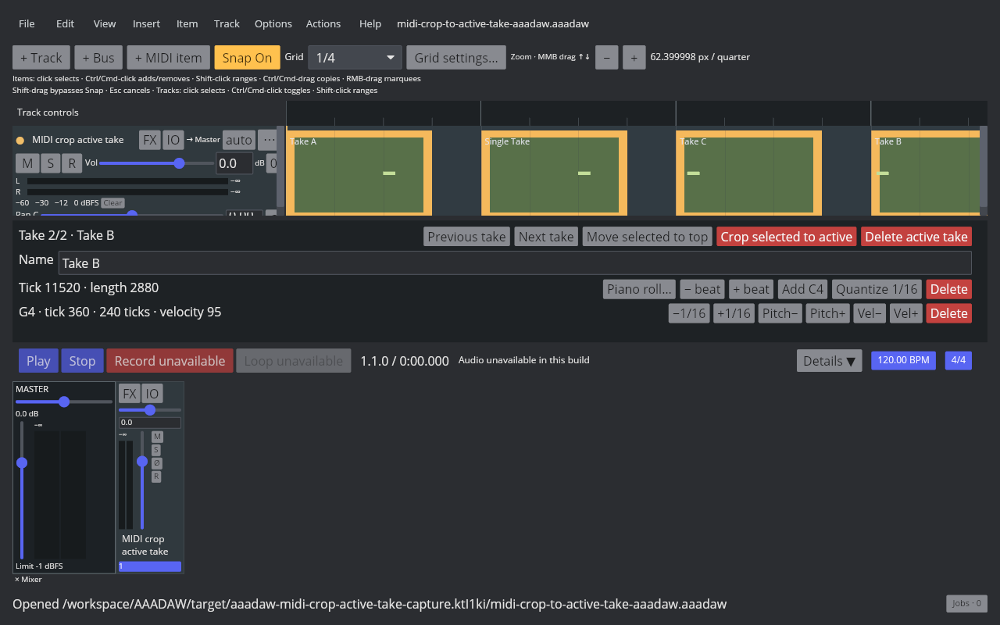
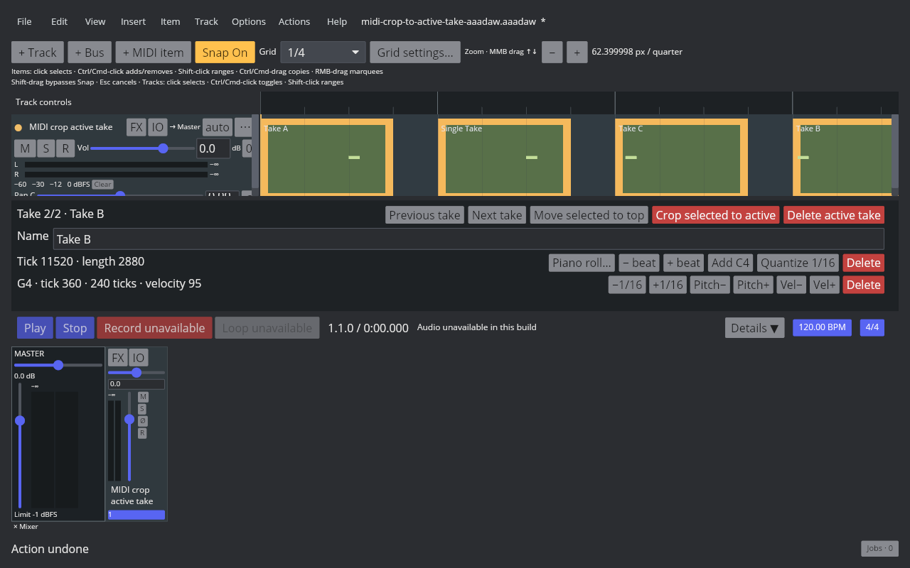
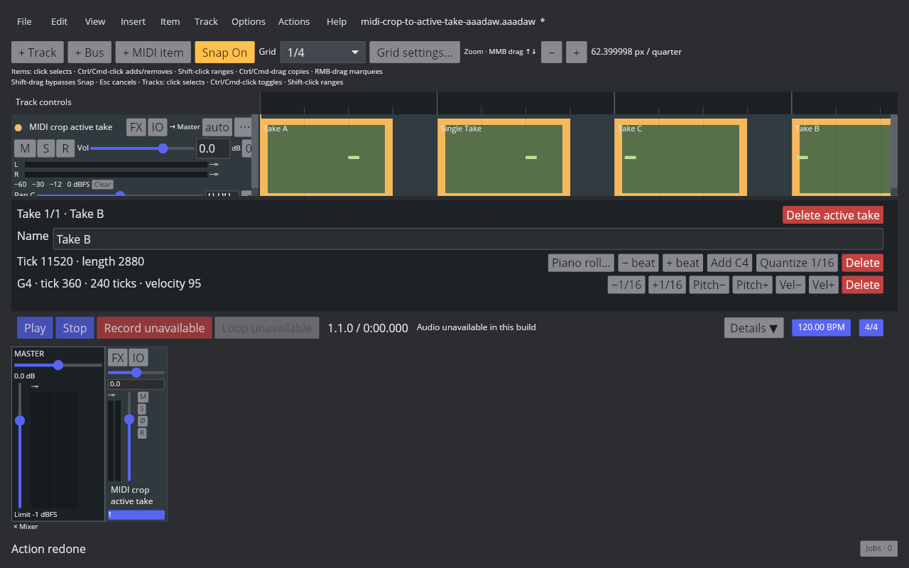

# Crop MIDI Items to the Active Take

Linux REAPER 7.82 / Default 7 Main action **40131**, `Take: Crop to active take in items`, removes every inactive Take from each selected multi-Take MIDI item. The formerly active Take becomes the sole Take at index 0. A selected single-Take item stays unchanged. Selection, item position and length, active Take name, source offset, and note data remain intact. One Undo restores all original Takes and active indices; Redo reapplies the crop. Repeating the action after the selection has only single-Take items adds no undo step.

AAADAW applies the action to MIDI, audio, and mixed Audio/MIDI selections in one project transaction. It preserves the active MIDI source/event collections, rejects a batch containing a frozen target, and leaves playback graph scheduling unchanged because the active source is unchanged. The Item menu and Action List share the command; the Inspector exposes **Crop to active take** and **Crop selected to active** for MIDI selections.

The [evidence manifest](fixtures/midi-crop-to-active-take-evidence.tsv) records native readback and RPP states, the REAPER Arrange screenshot, the matching AAADAW fixture, Cranelift binary identity, and four live AAADAW screenshots. The screenshots show `Take 2/2 · Take B` becoming `Take 1/1 · Take B`, with Undo and Redo restoring each state.

Verification passed:

- Stable Nextest: Core, Storage, and AAADAW library/binary/integration targets **1282/1282**.
- Strict all-target Clippy for Core, Storage, and AAADAW with `-D warnings -A future-incompatible`.
- Formatting, both native and AAADAW capture-script shell syntax, parity-matrix structure, and `git diff --check`.
- REAPER 7.82 and Cranelift AAADAW live-window captures at 1280×800 under isolated Xvfb; artifact SHA-256 values are in the manifest.

`EDIT-TAKE-001` remains `in_progress`. Take recording, remaining Take arrangement controls, Fixed Lanes, Comp Areas, and cross-project Take clipboard behavior remain open.
