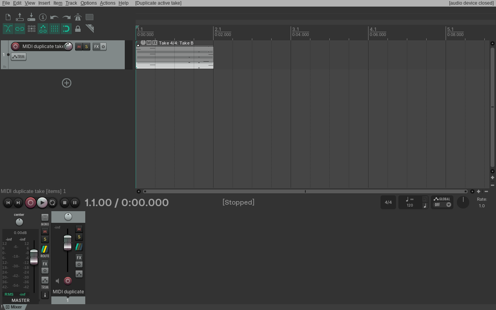
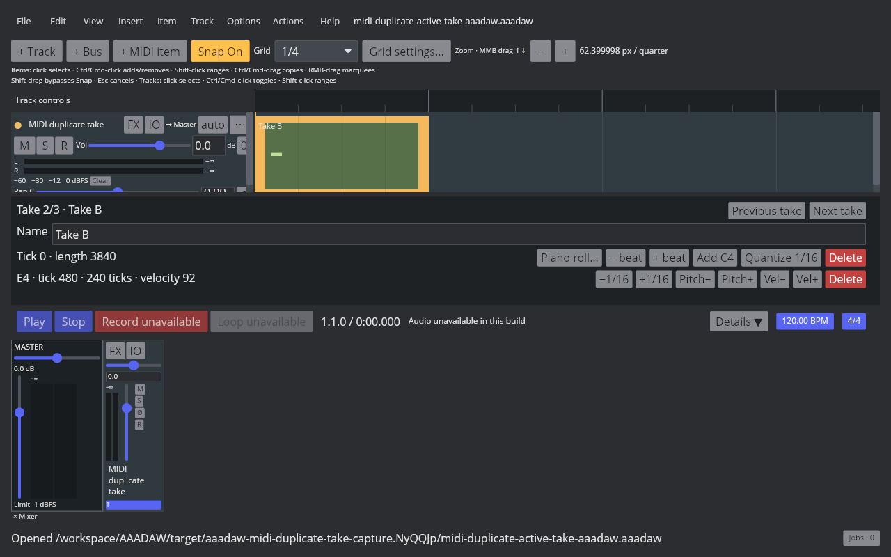
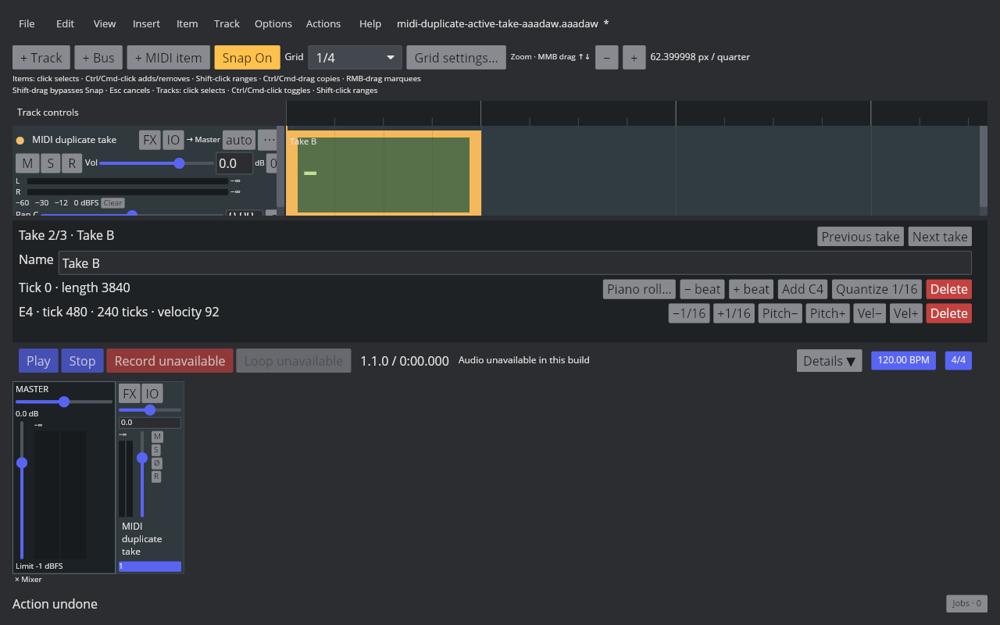

# MIDI Item duplicate active Take

Linux REAPER 7.82 / Default 7 Main action 40639 duplicates the active MIDI Take after the existing Takes, keeps the source Take unchanged, and makes the copy active. The probe starts with Take A, Take B, and Take C, with Take B active at index 1. After the action the order is A/B/C/B, the new Take B is active at index 3, and its notes and source offset match the original. The selected item remains selected. One Undo restores the original three Takes and active index; Redo restores the duplicate. Native readback, RPP states, and the Arrange screenshot are recorded in the [evidence manifest](fixtures/midi-duplicate-active-take-evidence.tsv).

AAADAW now exposes action 40639 for selected audio and MIDI items. For MIDI, it appends a snapshot of the active Take, assigns fresh note IDs, and activates the copy. Audio and MIDI selections are handled in one project transaction. The real-window capture shows the Inspector changing from `Take 2/3 · Take B` to `Take 4/4 · Take B`, then back to 2/3 on Undo and 4/4 on Redo.

Focused coverage:

- `crates/aaadaw-core/tests/midi_item_takes.rs::duplicating_active_midi_take_appends_activates_and_undoes_with_unique_note_ids` checks non-terminal active Take order, source properties, fresh note identities, and Undo/Redo.
- `crates/aaadaw/src/app/tests.rs::midi_take_action_list_switches_and_adds_empty_takes_with_undo` checks the Action List route for one selected MIDI item.
- `crates/aaadaw/src/app/tests.rs::duplicating_multiple_selected_audio_and_midi_takes_is_one_undoable_transaction` checks mixed audio/MIDI selection and atomic history.
- `crates/aaadaw-storage/tests/midi_item_takes.rs::duplicated_active_midi_take_round_trips_with_new_note_identity` checks SQLite persistence.

`EDIT-TAKE-001` remains `in_progress`. This action now covers active MIDI Take duplication; empty audio Takes, recording-created Takes, MIDI Take event editing, Fixed Lanes, Comp Areas, and cross-project Take clipboard behavior remain open.

