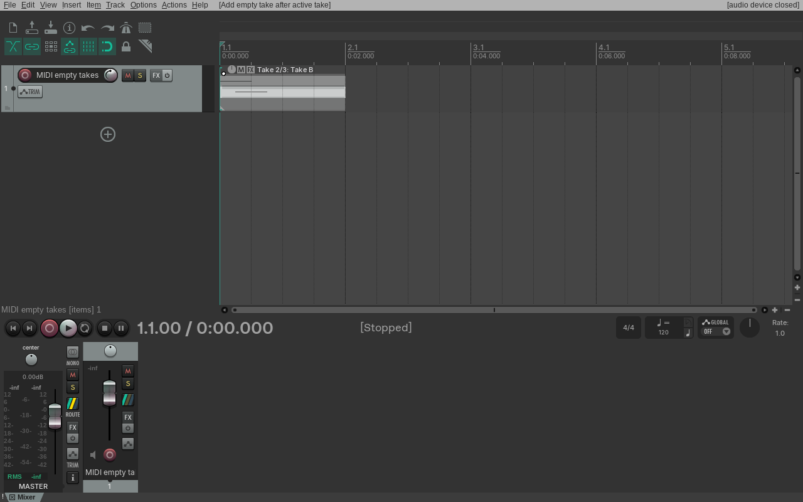
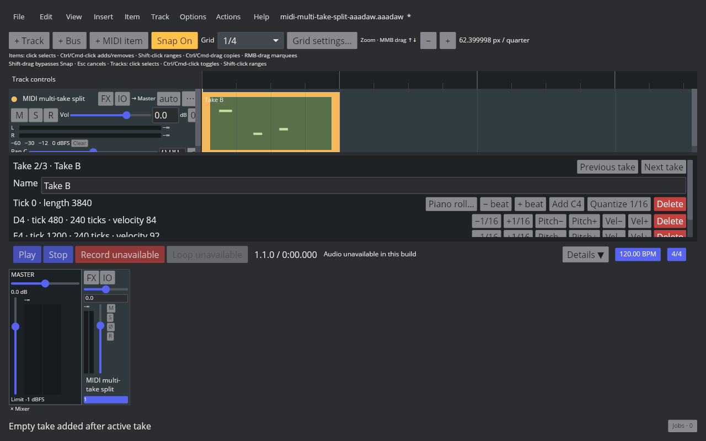

# MIDI Item empty Take insertion

Linux REAPER 7.82 / Default 7 Main actions 41351 and 41352 insert a `TAKE NULL` slot before or after the active Take. With two Takes and Take B active at index 1, action 41351 inserts the empty slot at index 1 and moves Take B to index 2; action 41352 inserts at index 2 and leaves Take B active at index 1. Neither action activates the empty slot or changes the existing Take sources. The selected item stays selected, and one Undo/Redo removes/restores the inserted slot. The native readback and RPP state files are listed in the [evidence manifest](fixtures/midi-empty-takes-evidence.tsv).

AAADAW adds both actions to the Item > Take menu and Action List with REAPER IDs 41351/41352. Core represents the empty MIDI Take with no modeled events, an empty name, and an item-length source bound; inserting before the active Take shifts its index, while inserting after it preserves the index. Both paths retain the active Take's events and properties and record one undoable `MidiItemChanged`. Empty Take names remain empty through snapshot and SQLite round-trips, including when the empty Take is made active. Schema 68 stores the active empty-name state with a compatibility marker and upgrades schema 67 projects without changing existing Take names. Multi-selected MIDI items are processed as one App history transaction.

The native and AAADAW four-state captures show the same selected MIDI item before insertion, after adding one empty Take after Take B, after Undo, and after Redo. The AAADAW Inspector changes from `Take 2/2 · Take B` to `Take 2/3 · Take B`, and returns to `2/2` on Undo. The real 1280×800 desktop capture uses the Cranelift build with audio-device support disabled; these screenshots verify project and interface state, not audio playback or pixel-level identity. Native readback confirms the matching Take count, active index, placeholder position, and one-step history behavior.

Focused coverage:

- `crates/aaadaw-core/tests/midi_item_takes.rs::adding_empty_midi_takes_preserves_the_active_source_and_round_trips` checks insertion order, active-index behavior, switching to the empty Take, snapshots, and Undo/Redo.
- `crates/aaadaw/src/app/tests.rs::midi_take_action_list_switches_and_adds_empty_takes_with_undo` checks Action List registration, both command paths, and the Inspector model state.
- `crates/aaadaw-storage/tests/midi_item_takes.rs::midi_item_takes_round_trip_all_event_kinds_and_active_index` checks persistence of empty and active-empty Takes alongside populated Takes; `schema_67_migrates_midi_items_without_changing_active_take_names` checks the schema 67 upgrade.
- The native ReaScript probe checks actions 41351/41352, `TAKE NULL` placement, selection, and Undo/Redo using REAPER 7.82 / Default 7.

`EDIT-TAKE-001` remains `in_progress`. These actions currently add empty Takes to MIDI items; empty audio Takes, recording-created Takes, other Take creation and event-editing paths, Fixed Lanes, Comp Areas, and cross-project Take clipboard behavior remain open.

The [manifest](fixtures/midi-empty-takes-evidence.tsv) records the native REAPER readback, all saved RPP states, capture scripts, source fixture, Cranelift binary identity, screenshots, and SHA-256 values.
