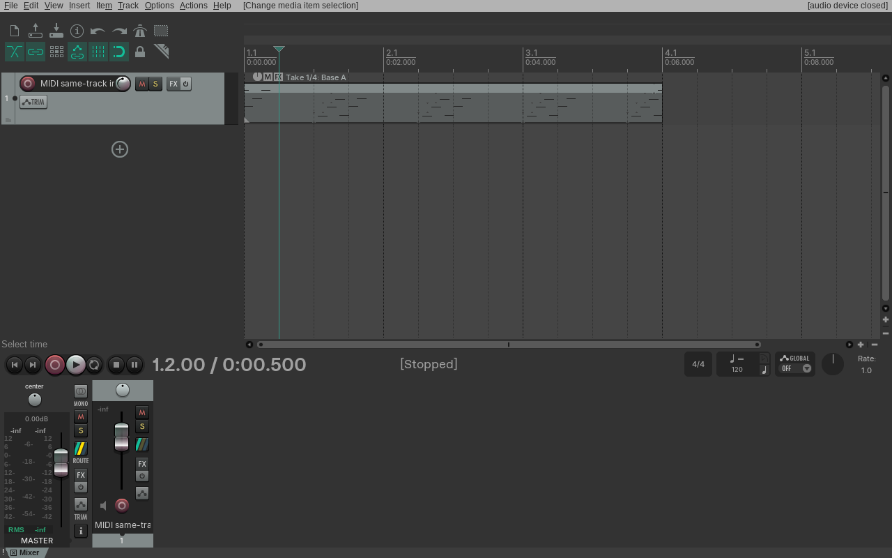
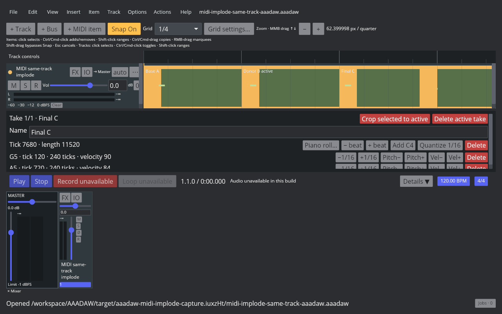
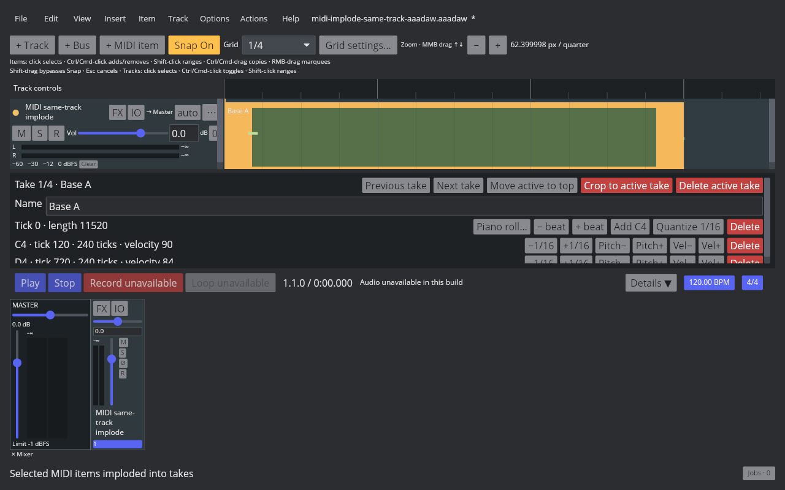
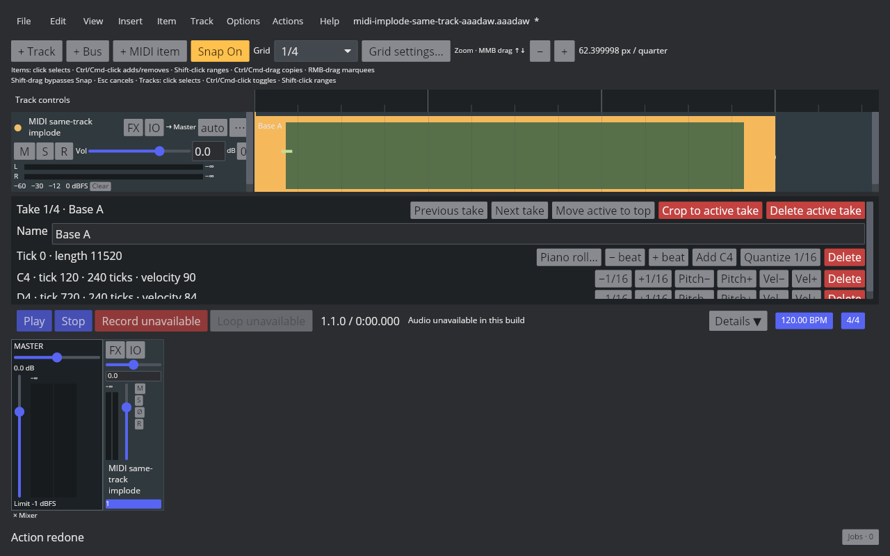

# Implode same-track MIDI items into takes

REAPER 7.82 / Linux / Default 7 Main action 40543, **Take: Implode items on same track into takes**, was run on three selected MIDI items starting at 0, 2, and 4 seconds. The first item remained the destination with its original 0–6 second range and active Take. REAPER appended every Take from each donor in Arrange order, including both Takes from the middle item, retained their names, source offsets, and notes, then removed the donor items. Afterward only the destination was selected. One Undo restored the three original items and their selection; Redo restored the four-Take item and selected it again. The native probe and before/after/Undo/Redo project readbacks are recorded in the [native manifest](fixtures/midi-implode-same-track-native.tsv).

AAADAW exposes the same 40543 command in the Item menu and Action List. It accepts at least two selected MIDI items on one track, rejects frozen tracks, retains the first Arrange item and its active Take, and appends donors' full Take lists in Arrange order. The Core action is a single transaction: it assigns fresh note IDs to copied takes, removes donor items, and causes the playback graph to rebuild so their formerly active MIDI sources stop contributing. The App stores the original selection for Undo and selects only the destination for Redo.

The fixture is generated by `crates/aaadaw/examples/generate_midi_implode_same_track_fixture.rs`. `scripts/reaper_parity/capture-midi-implode-same-track-aaadaw.sh` runs the Cranelift desktop binary under an isolated 1280×800 Xvfb display. The [AAADAW manifest](fixtures/midi-implode-same-track-aaadaw.tsv) records binary identity, artifact hashes, and validation results.

Core regression `same_track_midi_implode_preserves_take_order_data_and_round_trips_as_one_step` verifies take ordering, source offsets, notes, all modeled MIDI events, opaque events, event order, unique note IDs, and one-step Undo/Redo. App regression `imploding_selected_midi_items_matches_take_order_and_native_selection_history` verifies command registration, selection history, and destination range. An `audio-device`-feature regression checks that both MIDI implode and MIDI item deletion invalidate the playback graph. Cross-track MIDI implode, mixed Audio/MIDI implosion, and other open Take features remain outside this action's verified scope.
