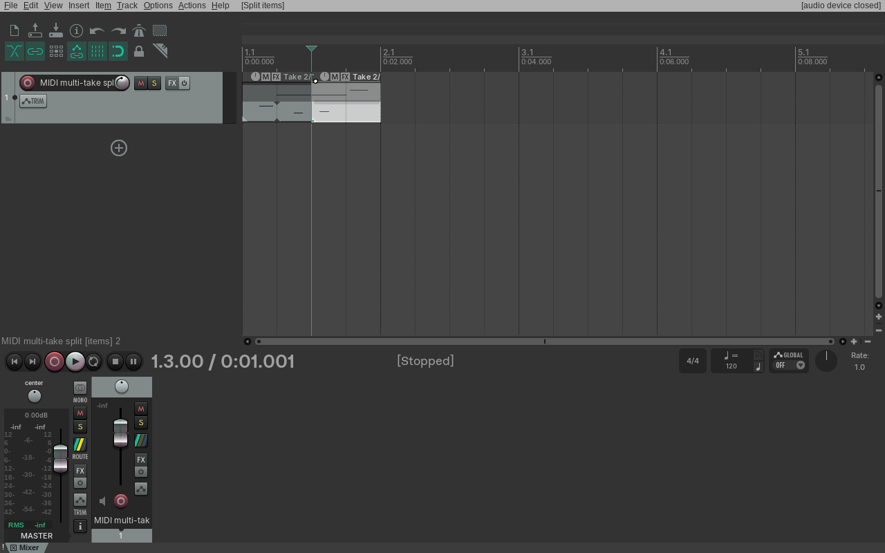
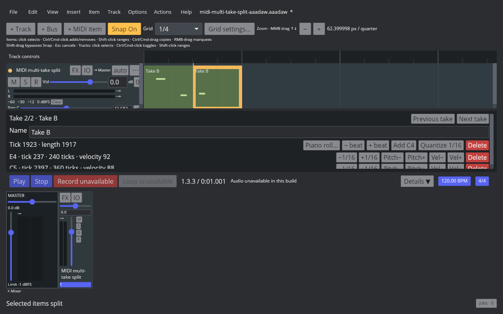

# MIDI Item multi-Take split

REAPER 7.82 / Default 7 Main action **40012**, `Item: Split items at edit or play cursor (select right)`, splits every Take in a selected MIDI Item. Both resulting Items retain the ordered Take list and active index; the new right Item is selected. One Undo restores the original selected Item and one Redo restores the split pair.

The native probe uses a two-second looping MIDI Item with Take A active at source offset 0 and Take B active at 1.5 seconds. Take A contains notes at ticks 960–2880 and 3000–3480. Take B contains notes at 480–720, 1200–1440, and 3360–3720. Both Takes use a 3840-tick source loop. The AAADAW live-window ruler click reads back as 1.0015625 seconds (tick 1923); the native probe sets that same edit-cursor position through ReaScript. The Core regression separately exercises the exact 1920-tick / 1-second boundary.

For each Take, REAPER partitions notes against that Take's own source offset and loop phase. Take A's pitch-60 note is cut at the boundary; the right copy begins at tick 0, while its later pitch-67 note is rebased to tick 1077. Take B's left Item retains its 1.5-second source offset and original events. Its right Item wraps source phase `(2880 + 1923) mod 3840 = 963`, resets the offset to 0, drops the earlier pitch-62 note, and rebases the pitch-64 and pitch-72 notes to ticks 237 and 2397. The active index remains 1 on both Items. The full before/after/Undo/Redo readback and four native RPP states are in the [native evidence manifest](fixtures/midi-multi-take-split-evidence.tsv).

AAADAW now applies the same source-phase rules independently to every MIDI Take, keeps Take order, names, active index, typed event order, and globally unique note IDs, and records the replacement as one project-history event. The application command selects the right segment and Undo/Redo restore the complete snapshots. The dedicated AAADAW fixture contains the same notes, source offsets, loop state, and active Take as the native probe.

The AAADAW before, after, Undo, and Redo screenshots show the real 1280×800 desktop window. The split-state screenshot's Inspector reports tick 1923 and length 1917; the native probe sets and reads back that same 1.0015625-second boundary. The Cranelift capture binary has audio-device support disabled; these captures verify Take and Arrange state, not audio playback.

The [Core regression](../../../crates/aaadaw-core/tests/midi_item_takes.rs) checks per-Take note partitioning, event-order targets, loop-phase wrapping, active index, and Undo/Redo. The [App regression](../../../crates/aaadaw/src/app/tests.rs) runs the selected-item cursor-split command and verifies right-segment selection plus one-step Undo/Redo. The storage regression round-trips alternate Take events and active index.

Native and AAADAW capture scripts, the matching fixture generator, binary identity, screenshots, RPP files, and SHA-256 values are recorded in [the evidence manifest](fixtures/midi-multi-take-split-evidence.tsv). Take creation and editing, recording-created Takes, Fixed Lanes, Comp Areas, and cross-project Take clipboard behavior remain open under `EDIT-TAKE-001`.
