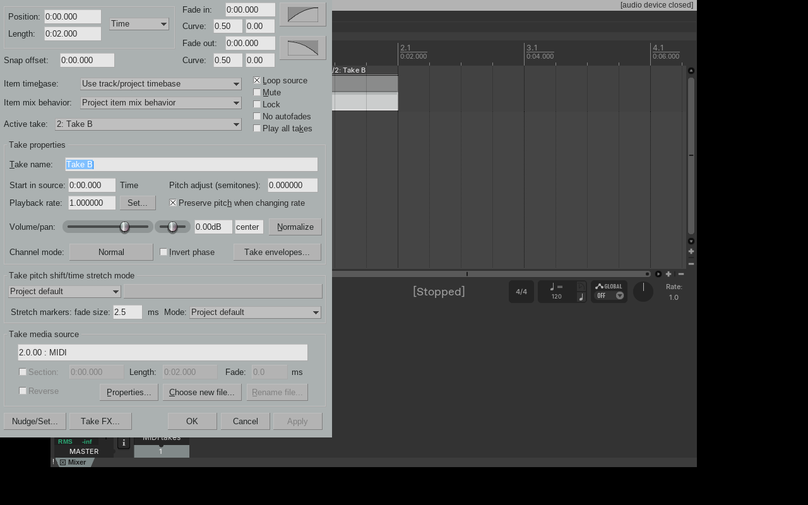
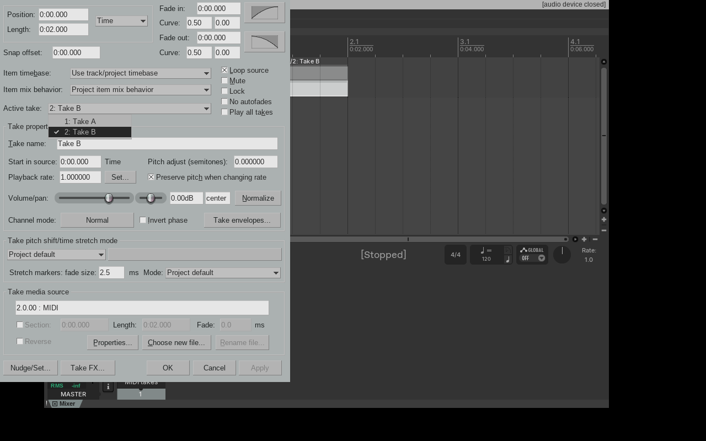
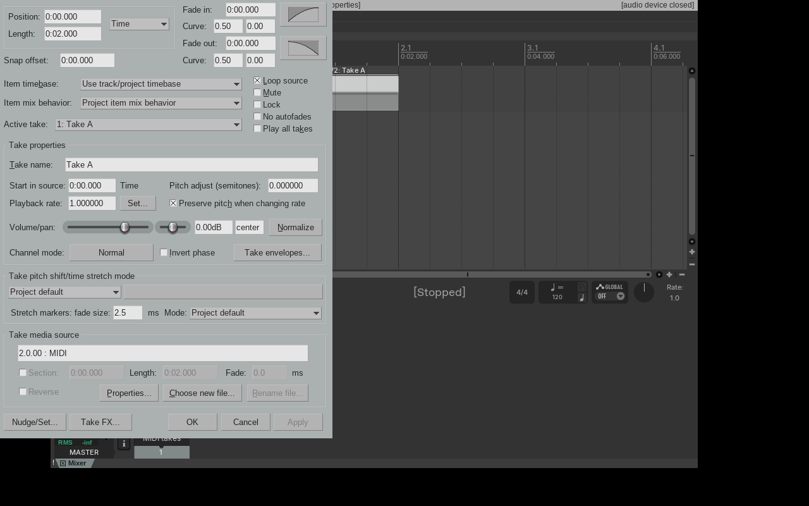
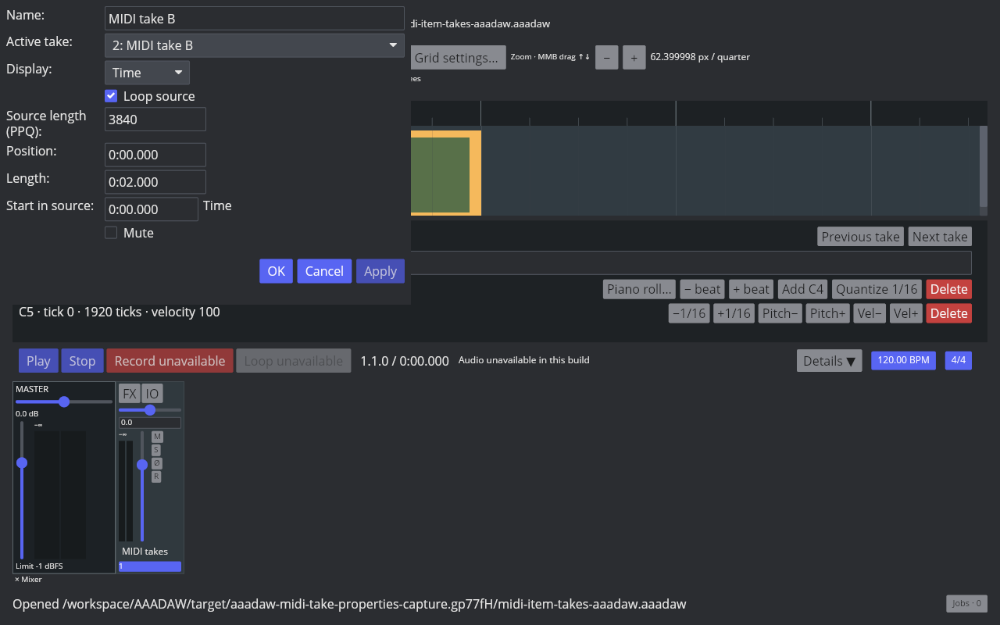
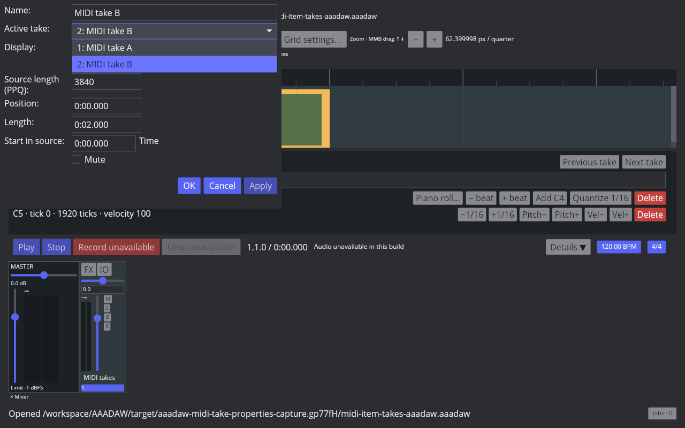
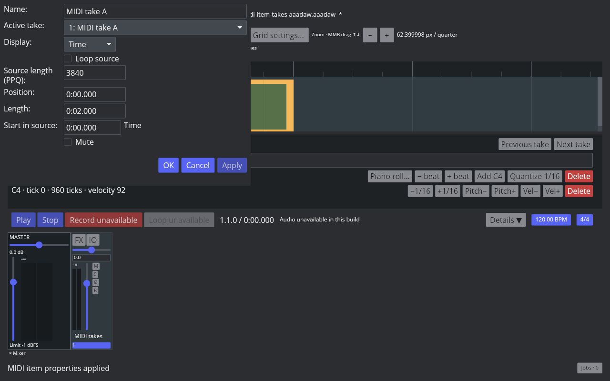

# MIDI Item Properties Take selector

Linux REAPER 7.82 with the Default 7 theme exposes the MIDI item's ordered Takes in the F2 Item Properties window. The two-Take fixture opens on `2: Take B`; opening the Active take list shows `1: Take A` and `2: Take B`. Selecting Take A stages the properties change, and Apply commits it. The native screenshots and saved project readback are listed in the [artifact manifest](fixtures/midi-item-properties-take-selector-aaadaw.tsv).

AAADAW now shows the same ordered Active take selector in MIDI Item Properties. Choosing a row updates the property draft, including that Take's name, source offset, loop-source state, and source length; it does not alter the project until Apply or OK. Applying routes through `SetMidiItemActiveTake` and the existing property actions as one project history step. Undo and Redo refresh the still-open selector. The lightweight Core `MidiItem::take_properties` API returns only the selected Take's property metadata and event-end boundary, without cloning its MIDI event collections.

The audio Item Properties selector now uses the same staged Apply behavior. It previews the selected Take's name, source offset, rate, mix, phase, and loop state, then switches and applies those values together. Audio and MIDI property tests check that the model and history remain unchanged before Apply, that one Apply changes the active Take and its metadata, and that Undo/Redo restores both model and open-window state.

AAADAW's live Cranelift screenshots cover the initial F2 window, expanded list, committed Take A, Undo, and Redo. The capture script starts an isolated Xvfb desktop and opens the two-Take project fixture. This slice leaves MIDI Take creation, event editing, reordering, take-aware splitting, recording-created Takes, Fixed Lanes, Comp Areas, and cross-project clipboard behavior open. `ITEM-PROPERTIES-001` and `EDIT-TAKE-001` remain `in_progress`.

