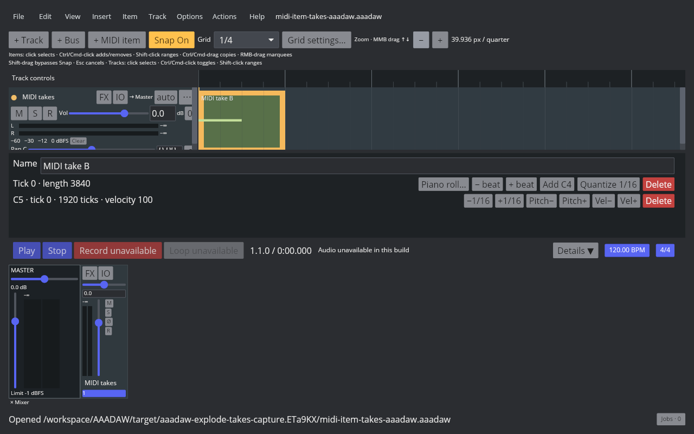
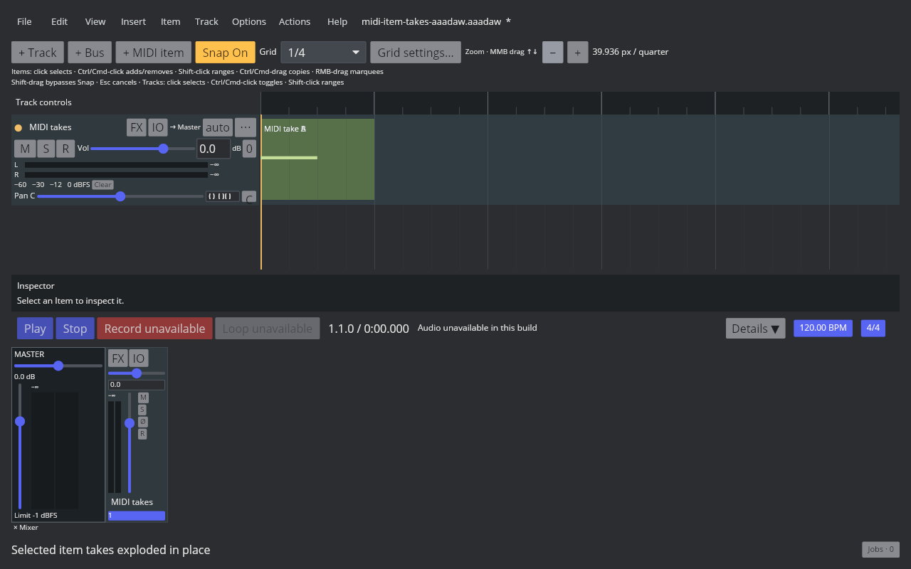
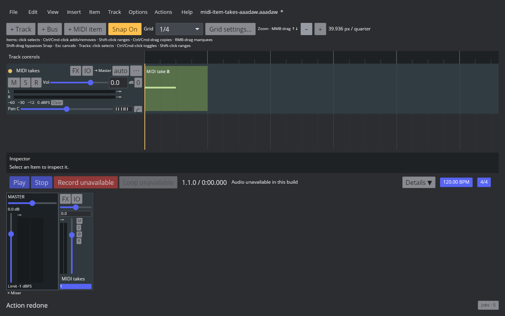

# MIDI Item Takes

REAPER 7.82 Default 7 stores multiple ordered MIDI takes on one media item. The native behavior measured for Main action 40642 is recorded in [the MIDI explode probe](fixtures/midi-explode-takes-in-place-native.tsv) and [the broader explode comparison](audio-explode-takes-in-place.md).

AAADAW now represents the active take index and alternate take snapshots in `MidiItemSnapshot`. Alternate snapshots retain source offset, loop metadata, notes, controllers, pitch bends, Program Changes, aftertouch, channel pressure, opaque Meta/SysEx events, and typed event order. Note IDs remain unique across all takes. SQLite schema 67 stores the active index separately and keeps alternate take metadata/events in `midi_item_takes` and `midi_take_events`; legacy single-take items load with active index 0.

Action 40642 can explode selected MIDI takes in take-list order. Mixed audio/MIDI selections run as one undoable project transaction; Undo and Redo restore all take contents. MIDI playback schedules the active take only. The active take continues to use the established event tables, so the callback and schedule representation do not allocate or inspect inactive take collections.

MIDI Item Properties and the Inspector can now select the active MIDI Take, and the Next/Previous actions switch selected MIDI items with Undo/Redo. REAPER actions 41351/41352 now add an empty MIDI Take before or after the active Take through the Item menu and Action List. The empty slot has no MIDI events and does not become active; insertion before shifts the active index, while insertion after leaves it unchanged. Snapshot and SQLite round-trips preserve the blank-name Take, including when active; schema 68 adds a compatibility marker and upgrades schema 67 projects without changing existing names. One Undo removes the inserted Take. Empty audio Takes remain unsupported. Splitting partitions every Take in order, preserves the active index and per-Take event order, applies each Take's source offset, and records the replacement as one undoable project event.

REAPER 7.82 / Default 7 action 40012 was measured with active Take A and active Take B, nonzero per-Take offsets, and loop-source phase wrap. Both split items retain the ordered Take list and active index; Undo restores the selected original and Redo restores the two split items. AAADAW's Core and App regressions verify each Take's notes, offsets, event-order targets, right-segment selection, and one-step Undo/Redo. See the [multi-take split evidence](midi-item-multi-take-split.md).

REAPER 7.82 / Default 7 actions 41351/41352 were measured with Take B active in a two-Take MIDI item. The native RPP stores each inserted slot as `TAKE NULL`; AAADAW preserves the same ordered placeholder and active index. The App capture and native readback cover before/after/Undo/Redo. See the [empty Take insertion evidence](midi-item-empty-take-insertion.md).

REAPER action 40639 duplicates a selected MIDI item's active Take after all existing Takes and activates the copy. AAADAW preserves the copied source properties and event data, gives copied notes new IDs, and handles mixed Audio/MIDI selections as one undoable transaction. See the [active Take duplication evidence](midi-item-duplicate-active-take.md).

REAPER action 40129 deletes the active MIDI Take, activates the preceding Take when possible (otherwise the new first Take), and removes the Item when it had only one Take. AAADAW supports MIDI and mixed Audio/MIDI selections as one undoable transaction. Native readback covers middle, first, last, and single-Take cases; the live 1280×800 captures show before/after/Undo/Redo. See [Delete the active MIDI Take](midi-item-delete-active-take.md).

The current Cranelift desktop binary was run under an isolated Xvfb display at 1280×800. The [four-state capture manifest](fixtures/midi-item-takes-aaadaw.tsv) records the fixture, binary, script, and before/after/Undo/Redo screenshot hashes. The overlapped takes share one Arrange range, so the image alone does not reveal the item count; Core/App assertions and native REAPER's item-count readback provide that check.

Focused verification:

- `crates/aaadaw-core/tests/midi_item_takes.rs` checks ordered explosion, per-Take split partitioning, loop-phase wrapping, event order, and Undo/Redo.
- `crates/aaadaw-core/tests/midi_item_takes.rs::adding_empty_midi_takes_preserves_the_active_source_and_round_trips` checks empty Take insertion before and after the active Take, switching to it, snapshots, and Undo/Redo.
- `crates/aaadaw-core/tests/midi_item_takes.rs::duplicating_active_midi_take_appends_activates_and_undoes_with_unique_note_ids` checks action 40639 ordering, active source preservation, unique note identities, and Undo/Redo.
- `crates/aaadaw/src/app/tests.rs::cursor_split_preserves_multi_take_midi_and_selects_the_right_segment` checks the selected-item command path, right-segment selection, and Undo/Redo.
- `crates/aaadaw/src/app/tests.rs::midi_take_action_list_switches_and_adds_empty_takes_with_undo` checks action registration and both empty Take commands.
- `crates/aaadaw-storage/tests/midi_item_takes.rs` round-trips all modeled event kinds, opaque payloads, event order, active index, an empty Take placeholder, and active-empty Take persistence.
- `crates/aaadaw-engine/tests/midi_schedule.rs::midi_playback_compiles_only_the_active_take` checks that inactive notes do not enter the playback plan.
- `crates/aaadaw/src/app/tests.rs::exploding_mixed_audio_and_midi_takes_is_one_undo_step` checks the registered action's mixed selection, one-step Undo/Redo, and deselection.

Other MIDI Take creation and event editing, empty audio Take support, recording-created Takes, more complete Take arrangement controls, Fixed Lanes, Comp Areas, and cross-project Take clipboard behavior remain open under `EDIT-TAKE-001`.

