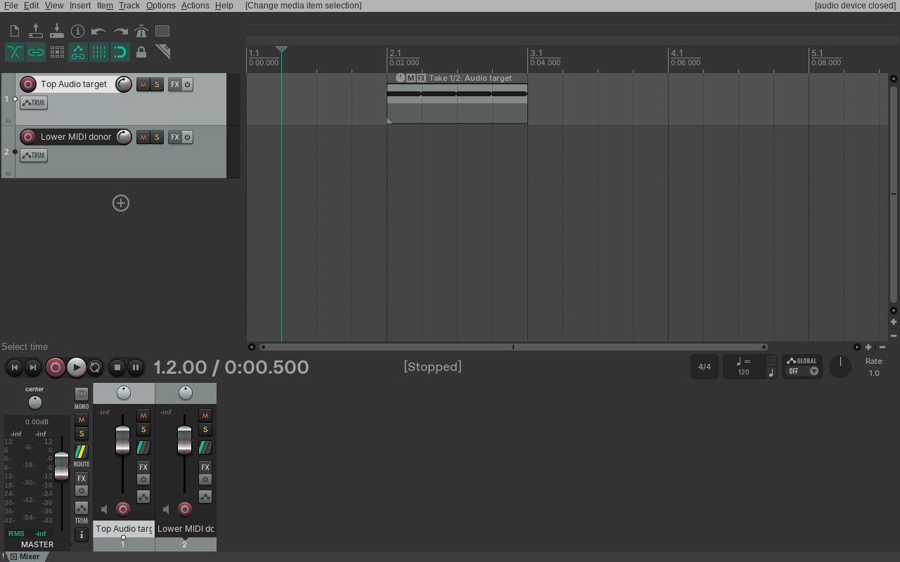
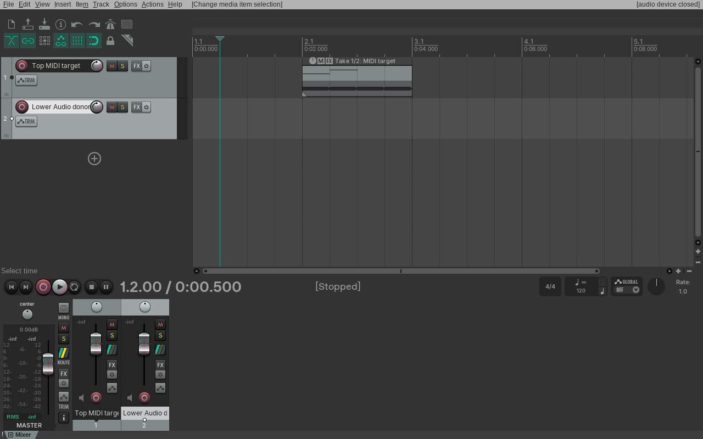

# Imploding mixed Audio and MIDI items into Takes

Linux REAPER 7.82 / Default 7 accepts a cross-track selection containing one Audio Item and one MIDI Item. Main action 40438 keeps the selected Item on the uppermost track as the destination, regardless of which Item starts earlier, and appends the donor as a Take of the other media type. The destination position, length, active Take, and source events remain intact; the donor Item is removed while its track remains. One Undo restores both selected Items and one Redo restores the mixed Take.

The Audio-target probe places an Audio Item at 2–4 seconds and a MIDI donor at 0–4 seconds. REAPER appends the MIDI source at a 2-second offset and preserves its two notes. The MIDI-target probe reverses the track order and media types: the MIDI Item at 2–4 seconds becomes the destination, and the Audio donor at 0–4 seconds is appended at a 2-second source offset. Native readback, before/after/Undo/Redo RPP states, and 1280×800 Arrange captures are recorded for both directions.

AAADAW does not yet implement this behavior. Its Audio and MIDI Items have separate Take lists, so each cross-track selection helper rejects a mixed selection and action 40438 is disabled. Correct support requires a heterogeneous Take representation that survives project save/reopen and can be activated, edited, rendered, and undone. This native result keeps that structural gap open under `EDIT-TAKE-001`; it is not counted as implemented parity.

The reproducible ReaScript probe is [`probe-item-implode-mixed-audio-midi-takes.lua`](../../../scripts/reaper_parity/probe-item-implode-mixed-audio-midi-takes.lua); the Xvfb capture script is [`capture-item-implode-mixed-audio-midi-native.sh`](../../../scripts/reaper_parity/capture-item-implode-mixed-audio-midi-native.sh). Fixture hashes and the REAPER reference identity are recorded in the [native evidence manifest](fixtures/mixed-audio-midi-implode-native-evidence.tsv). The screenshot verifies Arrange state only; no audio-device playback was tested.
