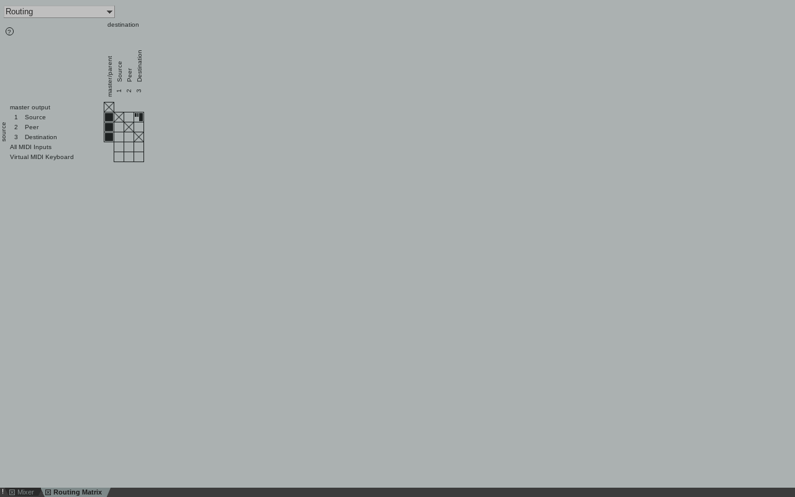
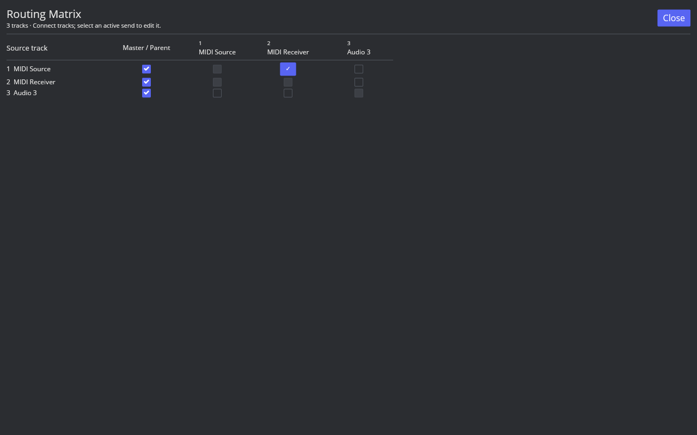
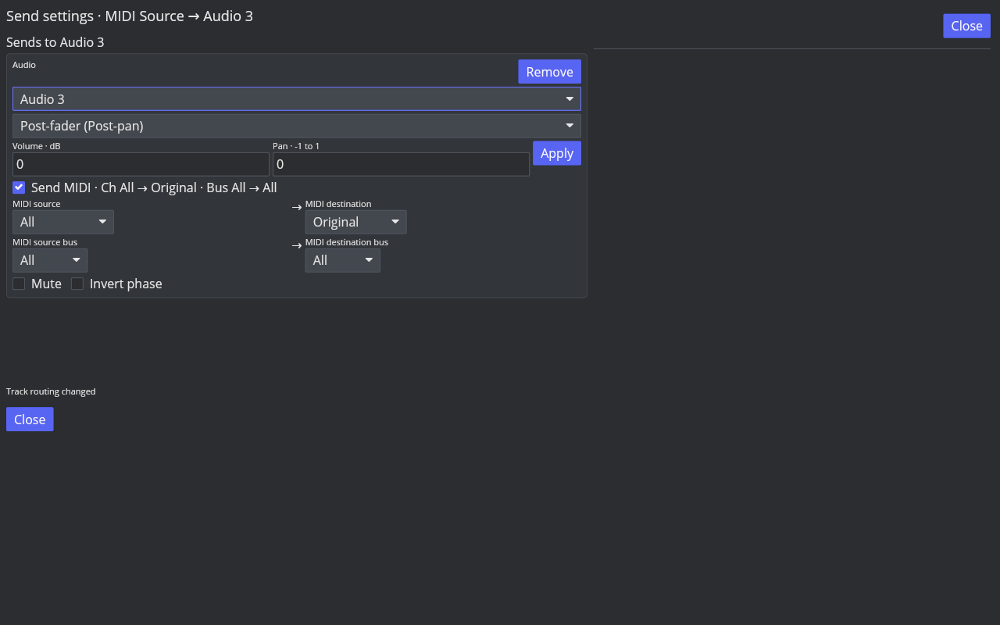
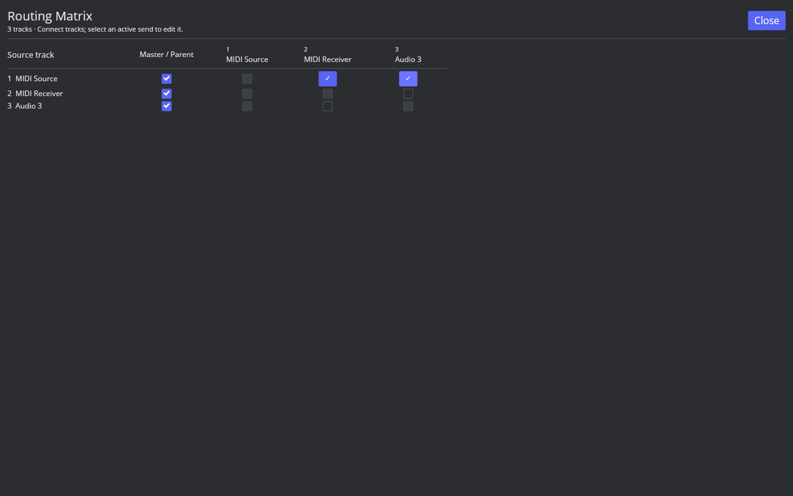
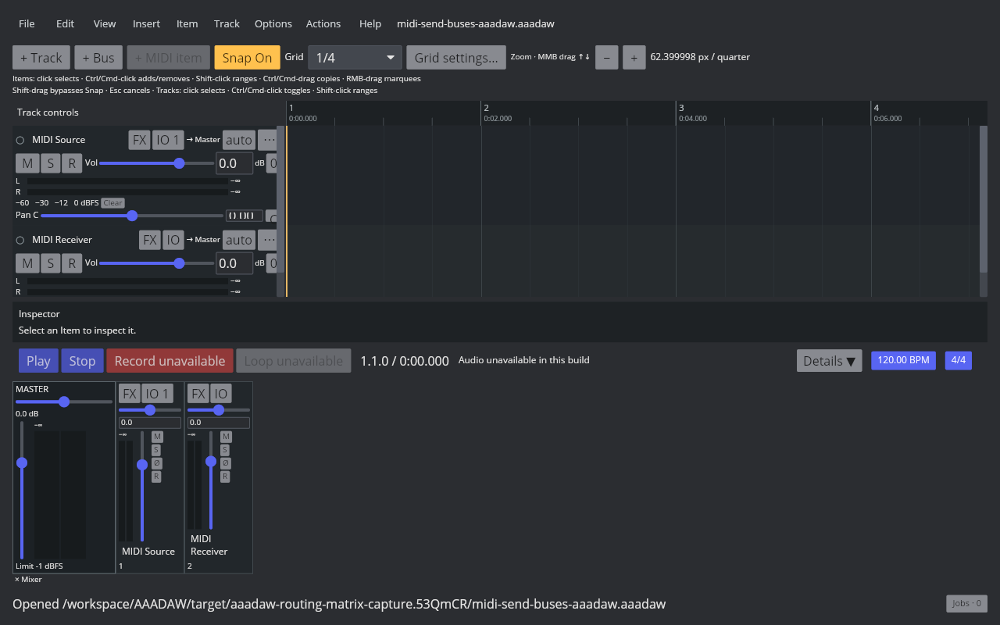

# Track Routing Matrix: first functional slice

Reference: Linux REAPER 7.82 / x86_64 / Default 7 / factory configuration. Native and AAADAW windows were captured at 1280×800. The screenshots record visible behavior; they are not pixel-match certification.

## Native behavior

The factory action is 40251, “View: Show routing matrix window,” and its default shortcut is `Alt+R`. The Routing Matrix is opened from the View menu or by that shortcut. Its track grid represents each source-to-destination connection with a cell. In a disposable three-track project, clicking an empty Source → Peer cell created one Send (total Sends 2 → 3, Source → Peer 0 → 1). Clicking that now-active cell again opened its Send settings and left all routes unchanged. Removing a Send required the Delete control in the Send settings; it removed that one connection (total Sends 3 → 2, Source → Peer 1 → 0). The readbacks and action identity are in [the native TSV](fixtures/routing-matrix-native.tsv); before/add/open/delete/duplicate RPP states and screenshot hashes are listed in [the native evidence manifest](fixtures/routing-matrix-native-evidence.tsv).

The same disposable project also has two parallel Sends from Source to Destination, at 0 dB and −6.02 dB. Clicking that active matrix cell opened both matching Send settings together, kept their values distinct, and left the route count at two. The [duplicate-cell screenshot](fixtures/routing-matrix-native-after-duplicate.png) and [RPP state](fixtures/routing-matrix-native-after-duplicate.rpp) capture the result.

## AAADAW behavior

AAADAW now exposes `View → Routing Matrix` and the confirmed `Alt+R` action. The independent window has a horizontally and vertically scrollable track grid, a Master / Parent checkbox for each track, and one cell per internal source/destination pair. Clicking an empty legal cell creates a default Audio Send through the project action interface and leaves the matrix open, matching the native two-step interaction; cycles and self-routes are disabled. Clicking an active cell opens a destination-filtered Send settings view. It lists every parallel Send from that source to the selected destination together, while hiding sends to unrelated destinations. Parallel sends are shown as a count. Main Send and route edits retain the project’s normal Undo/Redo behavior.

The Cranelift-built desktop binary was launched against a temporary copy of the saved MIDI Send Bus fixture in an isolated Xvfb desktop. The capture script adds a third track, clicks an empty Source → Audio 3 cell, confirms the matrix remains open with the new connection, then clicks the active cell to open Routing. These are real 1280×800 captures. The initial matrix shows the fixture’s MIDI Source → MIDI Receiver route; the added cell and Routing window show the new Audio 3 send.

Reproduce the captures with [the native REAPER probe/capture](../../../scripts/reaper_parity/capture-routing-matrix-native.sh) and [the AAADAW capture](../../../scripts/reaper_parity/capture-routing-matrix-aaadaw.sh). The native probe uses an unsaved disposable project and isolated configuration; it does not open or alter a user project. The AAADAW script copies its fixture into a temporary directory before launch. The AAADAW binary and screenshot hashes are listed in [its capture manifest](fixtures/routing-matrix-aaadaw.tsv).

The focused application regression covers Main Send and Send creation Undo/Redo, opening the source routing window, individual Send removal Undo/Redo, and route-cycle rejection: `crates/aaadaw/src/app/tests.rs::routing_matrix_cells_add_routes_and_send_deletion_remains_individually_undoable`. The command regression verifies the native shortcut and stable action ID in `crates/aaadaw/src/app/commands.rs::project_marker_command_tests::marker_actions_use_reaper_default_keys_and_stable_action_ids`.

## Open differences

This is a basic internal-track matrix, not the complete REAPER Routing Matrix. Hardware audio/MIDI outputs, channel-pair routing, wiring view, matrix filters and grouping, the native compact Send popup, and detailed theme/layout matching remain open. The AAADAW settings view filters the same source/destination pair and includes all parallel Sends, but it is a separate window. P3 and `ROUTE-SEND-001` remain `in_progress`.
