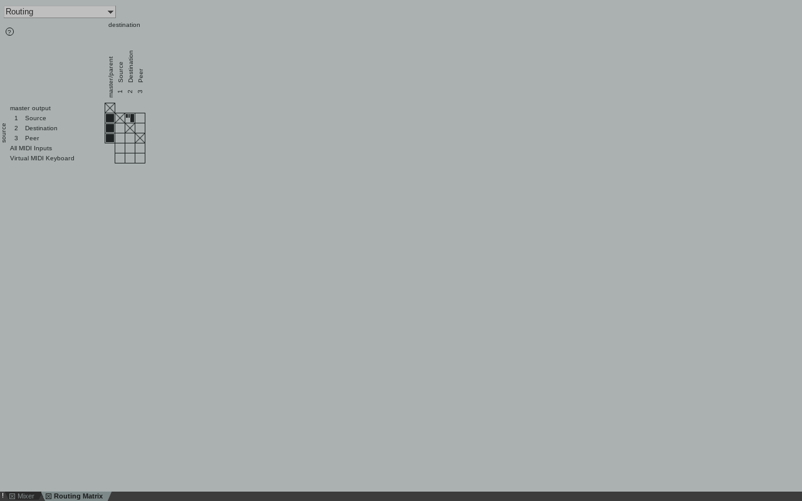
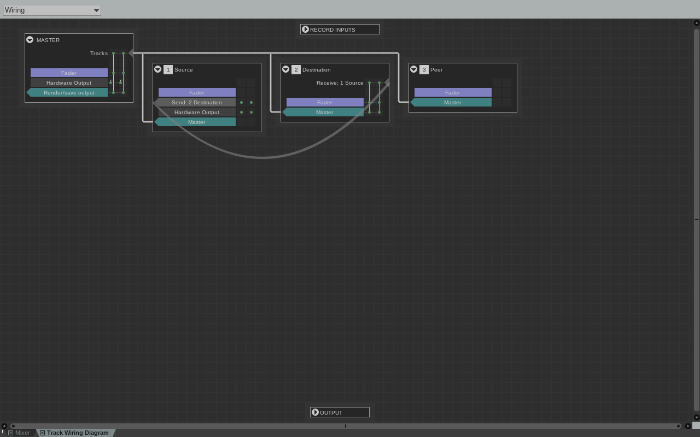
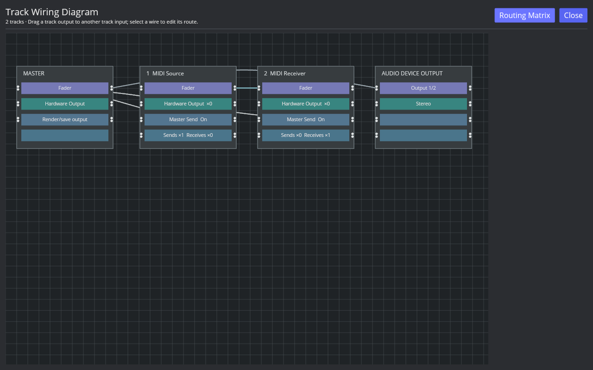

# Track Wiring view

Reference: Linux REAPER 7.82 / x86_64 / Default 7. The native probe created one ordinary Source → Destination Send and one separate Source Hardware Output. It saved the project, queried both route collections, opened View: Show routing matrix window (action 40251), and captured the Routing and Wiring modes at 1280×800. The isolated REAPER profile had no audio device open.

The native probe reports one category 0 ordinary Send and one category 2 Hardware Output. The Hardware Output defaults to stereo source/destination 1/2 and Send Mode 0. In Routing mode, the matrix shows Master/Parent and track destinations, while the unavailable physical device outputs do not appear as columns. In Wiring mode, REAPER keeps a Hardware Output row in the Source node and draws the ordinary Send and Main/Parent paths between track nodes. The native RPP, API readback, screenshots, and binary/source hashes are in the [evidence manifest](fixtures/routing-wiring-native-evidence.tsv).

AAADAW's Routing Matrix window now switches between its track grid and a Wiring canvas. The canvas displays Master, track, and current stereo device nodes, with the project's Master/Parent, ordinary Send, and Hardware Output paths. It labels per-track Send and Receive counts. Dragging a track output to another track input uses the existing route-creation action, including its cycle check and normal Undo/Redo. Dragging onto an already connected pair opens that route's settings rather than adding a duplicate; clicking a Send wire opens the source/destination-filtered Routing controls. Main and Hardware Output wires open that track's Routing controls.

AAADAW screenshot SHA-256: `abd3893dba3f7b079742f56b1c7bf390c4ed6f3c4b574c58c63f5900176215e7`.

The wiring drag and wire-hit interactions are covered by `crates/aaadaw/src/app/view/routing_wiring.rs` tests; `crates/aaadaw/src/app/tests.rs::routing_matrix_switches_between_grid_and_wiring_views` covers the mode switch. The desktop screenshot and native screenshots verify visible UI state, not live audio.

This is an initial functional view, not native layout or behavior parity. REAPER positions nodes according to routing and exposes per-channel connector controls and receive boxes. AAADAW currently uses a fixed node row layout, one stereo device target, and opens the existing Routing controls for per-route channel/tap editing. Device enumeration, arbitrary channel wiring, MIDI hardware endpoints, native node placement, and live signal behavior remain open. Keep `ROUTE-WIRING-001`, `ROUTE-HW-OUTPUT-001`, and P3 in progress.

Reproduce the native evidence with [`capture-routing-wiring-native.sh`](../../../scripts/reaper_parity/capture-routing-wiring-native.sh); it starts an isolated REAPER profile and never opens or saves a user project.
